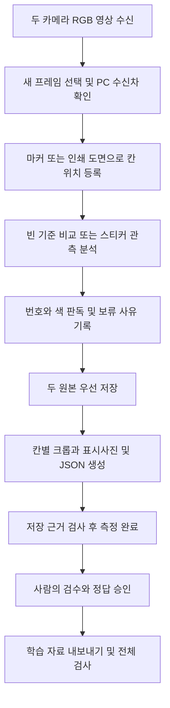

# V51 주차장 데이터 수집 · Geti 학습 전환 · 서버 연동 준비

> **보관용이다. 시연·실시간 전송은 [`../v53`](../v53/README.md)만 사용한다.** 이 폴더의 코드는 실행하지 않는다.


**공개 제출본은 V51 코드 원형을 기반으로 설정과 검증 기록을 익명화한 보관본이다.** Python 소스는 V51 배포본과 동일하다. `confidence=None` 전송 수정, 두 카메라 서버 전송, 세션 분할은 후속 구현 항목이다. 검증 JSON의 경로·시리얼·사진 파일명은 공개용 자리표시로 바꿨으며 기존 현장 수치와 이번 제출본 검사는 구분해 기록한다.

**의존성은 카메라 전용 환경에 설치한다.** `backend/app/camera/v51/`에서 아래 명령을 실행한다. 검증에 사용한 로컬 환경은 Python 3.13.15이며, 새 PC의 장치·GPU 환경은 설치 후 확인한다.

```powershell
python -m venv .venv
.\.venv\Scripts\python.exe -m pip install -r requirements-v51.txt
.\.venv\Scripts\python.exe -B main.py --check
.\run_windows.bat
```

[requirements-v51.txt](requirements-v51.txt)에 NumPy, OpenCV, Pillow, pyrealsense2, EasyOCR, PyTorch와 torchvision을 기록했다. `requirements.txt`는 이 파일을 참조한다. Intel GPU용 PyTorch는 선택한 GPU 환경에 맞는 설치 절차를 별도로 사용한다. Tkinter는 Python 설치 구성요소다. 실행기는 현재 폴더의 `.venv` 또는 `SMART_PARKING_PYTHON`을 사용한다. OCR 모델을 별도 보관하면 `SMART_PARKING_MODEL_DIR`로 그 위치를 지정한다.

**실제 촬영 전에 현장 설정과 참조 자료를 준비한다.** `dual_cameras.json`의 `<serial-A>`·`<serial-B>`를 실제 카메라 배정으로 설정한다. 단독 화면은 `cameras.json`의 배정도 확인한다. `config.json`의 저장 위치 기본값은 상대경로 `datasets`다. 런타임에 생성되는 `configs/parking_a.json` 등은 현장 파일이며 Git에서 제외한다. 예시의 ROI 형식은 V51 내부 형식이며 팀 공통 ROI 형식으로의 변환은 후속 작업이다.

인쇄 도면 맞춤에는 `configs/board_print/A.npz`와 `B.npz`가 필요하다. 이 사진 파생 특징 자료와 `configs/sticker_print/`의 여섯 참고 PNG, 마커 인쇄 자료, 모델 가중치는 팀 Drive에서 로컬 경로에 복원한다. 팀 Drive 위치는 팀에서 공유한 실제 경로로 확인한다. 도면 특징 자료를 준비한 뒤 F5 수집을 시작한다. 현재 원형 코드는 해당 도면 자료가 없으면 자동 도면 맞춤에서 파일 오류가 발생할 수 있다. 사진 재생·참조 자료에 의존하는 시험도 같은 준비가 필요하다.

공개용 검증 JSON은 이력 열람용으로 사용한다. 익명화 과정에서 원본 경로와 일부 파일 식별 정보가 바뀌어 현장 재생의 입력으로 사용하려면 Drive의 원래 검증 자료가 필요하다. 제출본의 검사 결과는 [PUBLICATION_CHECK.json](PUBLICATION_CHECK.json)에 기록한다.

Intel RealSense D435 두 대로 모형 주차장의 차량을 촬영하고, 각 사진에 주차칸 위치·번호 스티커·배경색·촬영 시각·검수 결과를 연결하는 프로그램이다. 현재 구현 기준은 **V51**, 정리 기준일은 **2026년 11월 6일**이다.

**현재 작업은 V51을 기준으로 Geti 학습과 서버 연결을 준비하는 단계다.** PM 전달문의 KAN-52 이관 대상을 현재 버전인 V51로 갱신한다. 개발·검증 근거는 `smart_parking_v51`이며, 팀 저장소에서 원형을 먼저 보관할 위치는 `backend/app/camera/v51/`로 계획한다. 이후 카메라 수신, ROI 매칭, 모델 추론, 관측 전송을 역할별로 연결한다.

업로드할 문서의 파일명은 **`README.md`**다. 이 문서와 V51 코드 파일을 `backend/app/camera/v51/`에 함께 배치하며, 본문의 상대경로 링크는 그 폴더를 기준으로 한다. PM 검토에서 전달된 서버 계약을 반영해 `confidence`는 필수 0~1 숫자, `bbox_xyxy`는 null 허용으로 정정했다. V51의 기존 전송 코드에서 `confidence=None`을 만드는 부분은 서버 연결 전에 수정할 항목으로 기록한다.

**수집 방향은 해준님과 일반 데이터를 대량 수집하고, 선별·라벨링을 거쳐 Geti에 전달하는 흐름으로 전환한다.** 아래 결정 기록은 사용자에게 전달된 PM 요청과 서버 주소 정정 내용을 반영한다. 모델의 실제 설정·산출물·성능은 확보된 증거를 채워 최종 확정한다.

| 결정 항목 | 기록 |
|---|---|
| 기준 버전 | V51. 카메라 두 대 수집, 도면·빈 기준 재정합, 사각형 라벨, 단축키, 저장·검수·복구가 현재 기준 |
| 변경 이유 | 구도 불일치로 측정이 보류되고, 반사·과노출·번호 방향 혼동과 기존 원형 라벨의 추정 의존으로 자동 정답 생성의 일관성이 제한됨 |
| 변경 후 수집 흐름 | 우지원·해준님이 일반 촬영 원본 대량 확보 → 품질·중복·조건 확인 → 학습 대상별 정답 라벨링 → 세션 분할 → Geti 학습·평가 |
| V51 활용 | 촬영 출처·시각·원본·관측 후보·검수 기록을 관리하는 수집 기반으로 활용. 일반 원본을 빠르게 대량 저장하는 경로의 적합성은 후속 코드 작업에서 확인 |
| PM 결정 기록의 근거 | 사용자 제공 KAN-52 요청, D-52 자료 보관 원칙, D-58 서버 주소 정정, 2026-11-06 정리 |
| 현재 확인 상태 | 학습 대상 최종 선택, Geti 설치판·버전, 최종 라벨 목록, 실제 추론 출력, 데이터 수량·성능은 확인 필요 |
| 다음 검토 자료 | 모델별 입출력 명세, 실제 출력 한 건, 세션별 수량·분할표, 평가 결과, 모델 파일의 팀 Drive 위치 |

V51에서 보류 원본을 재처리하고 새 사각형 라벨의 판독을 개선한 결과는 아래 검증 기록에 남긴다. 이 수정 이력을 이어서 활용하면서 학습 데이터의 다양성과 수량을 확보하는 방향으로 작업을 진행한다.

**Geti에서 무엇을 학습할지는 네 항목을 각각 확인한다.** 아래 체크는 최종 학습 범위 확정용이다. 현재 제공 자료에는 실제 Geti 프로젝트의 선택 결과가 없어 확인 대기로 기록한다.

- [ ] 차량 탐지 — 차량 전체 위치의 바운딩 박스를 학습할지 확정
- [ ] 번호 스티커 숫자 읽기 — 10~99의 학습 범위와 판독 방식을 확정
- [ ] 스티커 색 — 흰색·초록색·파란색의 분류 학습 여부를 확정
- [ ] LED 모의 화재 — 점등 여부·위치 중 어떤 관측을 학습할지 확정

| 대상 | V51에 있는 처리 | Geti 작업 종류의 검토안 | 라벨 이름 검토안 |
|---|---|---|---|
| 차량 위치 | 빈 기준 변화·스티커 근거의 점유 후보와 경계 검토 | 차량 박스가 필요하면 Detection | `car` |
| 번호 스티커 위치 | 원형·사각형 후보 위치 검출 | 스티커 박스가 필요하면 Detection | `sticker` |
| 숫자 10~99 | EasyOCR와 인쇄 모양 추정, 방향 충돌 보류 | 스티커 크롭 Classification 후보와 기존 OCR 경로를 비교한 뒤 확정 | 숫자 분류를 선택하면 문자열 `"10"`~`"99"` 중 확정된 학습 클래스 목록 |
| 스티커 색 | 스티커 내부·테두리 색 판독 | 스티커 크롭 Classification | `white`, `green`, `blue` |
| LED 모의 화재 | V51 기본 두 카메라 흐름에서 전용 Geti 모델 연결 미확인 | 고정 LED 영역의 상태는 Classification 후보, LED 위치까지 필요하면 Detection 후보 | `led_on`, `led_off` |

위 작업 종류와 라벨은 구현 검토안이다. 모델팀·PM이 선택한 Geti 작업 설정과 실제 라벨 목록을 확보한 뒤 확정한다. Segmentation은 차량 윤곽 등 픽셀 단위 정답이 필요한 경우에 추가 검토한다. 스티커 검출 박스, 번호 영역, 차량 전체 박스는 각각의 대상을 명시해 저장한다.

**서버 연결 판단에는 실제 모델 출력 규격이 먼저 필요하다.** 검출 모델에서 박스·라벨·점수를 받은 뒤 원본 좌표로 환산하고, 차량·스티커 연결과 ROI 매칭을 수행해 칸별 관측으로 변환하는 흐름을 계획한다. 숫자 판독과 색 분류의 결과도 해당 차량에 연결한다.

```text
Geti 추론 결과
  → 박스 좌표 단위·이미지 변환 확인
  → 원본 픽셀 좌표로 복원
  → 차량 박스와 번호·색 관측 연결
  → 주차칸 ROI 매칭
  → vision-event 생성
  → 서버에서 입출차 확정
```

| 출력 명세 항목 | README에 확정해 넣어야 할 값 | 현재 상태 |
|---|---|---|
| 모델 ID·버전 | Geti 프로젝트, 작업 종류, 모델 이름·버전 | 확인 필요 |
| 한 번의 추론 결과 | 검출 객체 목록 또는 분류 결과의 실제 구조 | 확인 필요 |
| 박스 대상 | 차량 전체 또는 스티커 등 객체 종류 | 확인 필요 |
| 박스 형식 | `xyxy` 또는 `xywh`, 0~1 비율 또는 픽셀 | 실제 출력으로 확인 필요 |
| 좌표 기준 이미지 | 원본 크기 또는 리사이즈·패딩한 모델 입력 크기 | 실제 전처리와 함께 확인 필요 |
| 라벨 | 출력 클래스 ID와 이름의 전체 대응표 | 검토안만 기록, 실제 목록 확인 필요 |
| confidence | 출력 필드명과 어떤 관측의 점수인지. 서버 전송값은 필수 0~1 숫자 | 모델 출력 해석과 점수 산정 방식 확인 필요 |
| 모델 내보내기 | 실제 확보한 OpenVINO IR / ONNX 등 형식, 파일 목록·버전 | 모델 파일 미확보 |
| 모델 입력 | 너비·높이, 채널 순서, 자료형, 정규화·리사이즈·패딩 방법 | 모델 메타데이터 확인 필요 |
| 추론 예시 한 건 | 실제 추론의 숫자·좌표·라벨·점수를 그대로 복사 | 실제 출력 미확보 |

모델 입력 크기는 촬영 원본의 1920×1080 설정과 별도로 확인한다. 원본을 리사이즈하거나 패딩했다면 그 변환을 역으로 적용해 ROI와 같은 좌표계로 맞춘다. 최종 `bbox_xyxy`를 원본 픽셀의 `[x1, y1, x2, y2]`로 사용하는 방안을 제안하며, 서버의 최신 스키마를 확인한 뒤 단위를 확정한다.

실제 추론 예시 한 건은 Geti 모델을 실행한 후 이 문단 위치에 원출력 그대로 추가한다. 현재 기록 상태는 **실제 출력 미확보**다. 위 검토안의 라벨이나 아래 V51 사진 판독 결과를 Geti 실행 결과로 대신 기입하지 않는다.

| 서버 요구 필드 | 만들거나 확인할 내용 |
|---|---|
| `space_id` | 차량 박스와 실제 칸 ROI의 매칭 결과. 칸 ID는 도면 기준이며 주차장 ID도 함께 식별 |
| `car_id` | 판독한 `"10"`~`"99"` 문자열. 번호를 확인하지 못하면 `null`, 점유 관측 유지 |
| `vehicle_type` | 스티커색을 서버 enum으로 변환. V51 기존 매핑은 흰색→`general`, 초록→`ev`, 파랑→`accessible`. 최신 서버 허용값·미확인 처리 확인 |
| `confidence` | 필수 유한 숫자, 범위 0~1. `null` 전송 시 서버 422 거절. 0.8 미만은 서버에서 `uncertain` 처리. 관측 근거에 맞게 산정 |
| `bbox_xyxy` | `null` 허용. 차량 박스가 있으면 `[x1, y1, x2, y2]`로 전달하며 좌표 단위·범위를 확인하고 ROI 매칭 결과와 함께 보관 |
| `observed_at` | 실제 관측 프레임의 시간대 포함 시각. 현재 V51은 PC 수신 UTC 시각을 사용 |
| 이벤트 부가 필드 | `event_type`, `event_id`, `camera_id`, `lot_id`, `source`, `frame_id` 등의 필수 여부와 형식은 서버 스키마로 확인 |

**서버 계약은 사용자에게 전달된 PM 검토 내용을 기준으로 기록한다.** 점유·빈칸 관측 모두 `confidence`를 0~1 숫자로 전달해야 한다. 모델 준비 전에도 `bbox_xyxy=null`을 사용해 관측을 보낼 수 있다. `confidence`가 0.8 이상이면 서버의 후속 상태 판정 대상으로 전달하며, 최종 입출차는 서버 규칙으로 확정한다. LED 모의 화재의 이벤트 종류·전송 주소·필드는 별도 합의가 필요하다.

**V51의 기존 전송 코드에는 서버 계약과 맞추기 위한 수정이 필요하다.** [transport19.py](transport19.py)의 `build_events()`가 현재 `confidence=None`을 생성하므로 전송 시 422 거절 대상이다. 이 부분은 변화량과 관측 품질을 근거로 계산한 0~1 숫자를 채우도록 수정해야 한다. 기존 `api_nullable_confidence` 전제도 필수 숫자 검사로 바꾸고, `bbox_xyxy`의 null 허용 처리는 계약에 맞춰 사용한다. 아래 정책과 검사는 후속 코드 작업에 적용할 계획이다.

**모델 준비 전 confidence는 빈 기준 대비 변화율과 관측 안정성을 근거로 산정한다.** 변화율이 큰 경우 점유를, 작은 경우 빈칸을 지지하므로 각각의 방향에 맞춰 계산해야 한다. 현재의 변화율 값을 그대로 confidence에 대입하면 빈칸 관측의 점수가 낮아지는 문제가 생긴다. 빈 기준·현재 구도의 일치, 영상 신선도, 노출·반사·가림 상태와 연속 관측을 확인해 점수에 반영한다.

| 관측 조건 | 모델 준비 전 점수 정책 검토안 | 전송 처리 |
|---|---|---|
| 점유 근거와 관측 품질이 충분함 | 확인된 규칙을 통과한 관측에 0.90 이상의 임시 점수 부여 | `vehicle_observed`, 번호 미확인은 `car_id=null` |
| 빈 기준과 비교해 빈칸 근거가 충분함 | 빈칸 방향의 변화율과 품질 규칙을 통과하면 0.90 이상의 임시 점수 부여 | `space_empty_observed`, `bbox_xyxy=null` 가능 |
| 유효한 관측이지만 근거가 약함 | 근거에 맞는 낮은 점수를 유지 | 0.8 미만은 서버의 `uncertain` 처리 대상 |
| 가림·연결 끊김·만료 프레임·구도 불일치로 상태 확인 불가 | 해당 프레임의 관측 전송 보류 | 상태 미확인을 빈칸 이벤트로 변환하지 않음 |

0.90은 리뷰 제안값(확정 전)이며, 변화율·품질을 점수로 바꾸는 공식과 기준은 실제 장면으로 검증한 뒤 확정한다. 규칙 기반 점수의 근거는 로컬 진단 기록에 남기고 Geti 모델 점수와 구분한다. 모든 프레임에 높은 고정값을 주면 불확실한 관측도 확정 대상으로 올라가므로, 점수 산정과 전송 보류 조건을 함께 시험한다.

후속 검증에서는 `confidence` 누락·null·문자열·비유한 값·0~1 범위 밖 값을 송신 전에 차단하는지 확인한다. 유효한 점수 0.79, 0.80, 0.90의 서버 처리와 `bbox_xyxy=null` 수락도 대조한다. 이 값들은 계약 경계 시험용 입력이다. 실제 Geti 추론 출력은 모델 실행 후 별도로 확보한다.

[dashboard.py](dashboard.py)의 단독 화면에는 기존 전송 경로가 있고, 기본 [dual_dashboard.py](dual_dashboard.py)는 두 사진 수집·저장에 연결돼 있다. 두 카메라 결과와 1초 전송 주기를 연결하고, 모델이 준비되면 Geti 박스·점수를 추가하는 구현·시험이 후속 작업이다.

**성능은 모델별 검증 결과와 실행 환경을 함께 기록한다.** 현재 Geti 모델의 실제 정확도·속도는 미측정이다. 아래 항목을 학습 후 채운다.

| 기록할 항목 | 현재 상태·작성 기준 |
|---|---|
| 차량·스티커 Detection 성능 | 미측정. 검증/시험 사진 수와 정답 박스 수, precision·recall·mAP 및 평가 조건 기록 |
| 번호 판독 성능 | 미측정. 번호 완전 일치·오답·보류 수와 대상 번호별 결과 기록 |
| 색·LED Classification 성능 | 미측정. 정확도, 클래스별 결과, 혼동한 사례 기록 |
| 모델 한 장 추론 시간 | 미측정. 입력 크기·배치 수·워밍업 조건과 평균·지연 분포 기록 |
| 전체 처리 시간 | 미측정. 전처리·모델·ROI 매칭·이벤트 생성까지의 시간을 함께 확인 |
| 시험 PC | CPU, RAM, GPU, OS, 추론 런타임·버전, 실행 장치 확인 필요 |

V51의 회귀 709개 통과는 수집·저장·판독 처리 코드의 검증 결과다. Geti 학습 모델의 성능표는 실제 학습·추론 시험 결과로 작성한다.

**대량 수집 자료는 세션을 기준으로 선별·분할한다.** 동일 촬영 세션의 연속 프레임과 두 카메라 사진, 그 사진에서 만든 칸·스티커 크롭은 같은 분할에 묶는다. 같은 차량 배치가 여러 세션에 이어지거나 거의 같은 장면을 재촬영했다면 더 큰 그룹으로 묶어 중복 평가를 막는다.

| 수량·분할 기록 | 현재 기록 상태 |
|---|---|
| 일반 데이터 수집 원본 수 | 새 Geti용 수집 묶음 미집계 |
| 독립 촬영 세션·장면 수 | 미집계 |
| 선별 통과·제외 수와 제외 이유 | 미집계. 흐림·과노출·가림·중복·잘린 대상 등을 사유별 기록 |
| 정답 라벨링 완료 사진 수 | 미집계. 원본 수·칸 크롭 수·스티커 크롭 수를 각각 기록 |
| 학습·검증·시험 분할 수 | 세션별 그룹표 확정 후 기록 |
| 분할 근거 | `session_id`, 연속 장면 그룹, 차량 배치, 원본 해시와 파생 크롭의 연결 관계 |

V51의 `export_training()`은 현재 `batch_id`의 해시를 사용해 70/15/15 구간으로 분할한다. 한 세션 안에서 배치가 바뀔 수 있으므로, PM이 요청한 촬영 세션 분리를 적용하려면 세션·연속 장면 그룹 분할표와 내보내기 경로를 보완해야 한다. 기존의 동일 픽셀 중복·정답 충돌 검사를 함께 활용한다. 제공 Intel 사진 2장이나 회귀시험 수를 새 Geti 학습 데이터 수로 합산하지 않는다.

**D-52에 따라 촬영 사진·영상·모델 파일은 팀 Drive에 보관한다.** 코드 저장소에는 코드, 사용 설명, 라벨·입출력 명세, 실측값을 제거한 설정 예시, 모델 평가 요약을 올리는 범위로 준비한다. 실제 촬영 ROI 설정, `.env`, 토큰, 가중치, 데이터셋, 가상환경과 실행 로그는 커밋 대상에서 제외한다. Drive 폴더 경로·권한·데이터 버전·파일 해시 목록은 팀과 확인한 뒤 기록한다. 현재 팀 Drive 위치는 미제공이다.

**KAN-52 이관은 V51을 출발점으로 진행한다.** 전체 이관·정리 순서는 아래와 같이 계획하며, 현재 단계의 산출물은 이 README다.

1. 팀 저장소의 최신 상태와 작업 위치를 확인하고 `feature/KAN-52-camera-roi` 브랜치를 준비한다. 기존 동일 브랜치가 있으면 진행 상태를 먼저 확인한다.
2. V51 실행 코드와 이 문서를 `backend/app/camera/v51/`에 함께 준비하고 문서 이름을 `README.md`로 저장한다. 문서 링크에 사용한 `.py`·설명서·검증 요약 파일을 포함한다. 의존 파일과 이미지·모델 참조 경로를 조사하고, 사진·영상·가중치·`.env`·실제 `configs/parking_a.json`·실행 로그·`.venv`를 제외한 이관 목록을 검수한다.
3. `backend/app/camera`에 장치 열기·최신 프레임 공유·재연결 책임을 모은다. RealSense SDK 연결과 영상 재생의 `cv2.VideoCapture` 사용도 이 경계에서 관리한다.
4. A주차장 12칸 ROI는 `parking_a.example.json`의 팀 형식에 맞춰 예시를 제공하고, 실제 `configs/parking_a.json`은 현장 설정으로 관리한다. `backend/app/roi`에 박스와 칸의 매칭을 둔다.
5. 필수 confidence 숫자 산정·검사와 null 박스 처리를 보완한 뒤 유효한 A주차장 관측을 칸마다 1초 간격으로 `vehicle_observed` 또는 `space_empty_observed`로 보낸다. 번호 미확인은 `car_id=null`로 기록하며, 가림·끊김·보류 상태에서는 빈칸 이벤트를 생성하지 않는다.
6. 같은 칸의 시뮬레이터 송신 상태를 확인하고 관측 소스를 하나로 운영한다. 모델은 관측값을 제공하고 최종 입출차 확정은 서버가 맡는다.
7. 모델이 준비되면 실제 박스·점수·번호·색 출력을 연결하고, 정상 점유·번호 미확인·빈칸·가림·단절·재연결을 서버 수신 결과와 대조한다.

V51의 실제 재사용 대상에는 `camera_hub.py`, 도면·좌표 관련 모듈, 큰 사각형 라벨 판독, 원본·검수·복구 로직이 포함된다. 기존 칸의 다각형 좌표와 모델 차량 박스를 연결하는 ROI 매칭 규칙은 면적 겹침·복수 칸 충돌 등 검증 조건을 정해 구현한다. 통합 프로그램의 후속 기능 수정본은 프로젝트 버전 관리 규칙에 따라 V52로 관리한다.

**서버 주소는 D-58 Docker 안내의 정정 내용을 적용한다.** 아래는 전달된 연결 기준이며, 실제 접속과 인증 수락 여부는 후속 시험에서 확인한다.

| 실행 환경 | 사용할 주소 | 확인할 점 |
|---|---|---|
| 카메라 PC와 Docker 서버 PC가 같음 | `http://127.0.0.1:18080/api/v1/internal/vision-events` | PM이 알려준 서버 PC 로컬 웹 포트 |
| 카메라 PC와 서버 PC가 다름 | `http://<교육장 서버 PC IP>:<웹 포트>/api/v1/internal/vision-events` | PM의 LAN 바인딩·웹 포트·방화벽 확인 필요 |
| 개발용 서버를 직접 실행 | `http://<개발 서버 IP>:8000/api/v1/internal/vision-events` | 개발 서버 직접 실행 환경에 적용 |

요청 방식은 `POST`, 인증 헤더는 `Authorization: Bearer <VISION_TOKEN>`이다. 기존 `EventSender`는 `API_BASE_URL`에 `/api/v1/internal/vision-events`를 붙이므로 환경변수에는 `http://127.0.0.1:18080`처럼 기본 주소를 넣는다. PM 전달사항에서 Docker의 8000은 컨테이너 내부 포트이고, LAN 공개는 확인 대기다. 외부 카메라 PC에서 접근하려면 서버의 바인딩·포트·접근 가능 여부를 먼저 확인해야 한다. 실제 토큰 값은 환경 설정으로 관리한다.

**서버 연결 가능 여부의 현재 판단은 전송 코드 보완 후 접속 시험이 필요한 단계다.** 우선 V51의 `confidence=None` 생성 부분을 필수 숫자 산정으로 수정하고 카메라·주차장 ID, 서버 LAN 접근, 토큰과 관측 소스 배정을 확인한다. 모델 준비 전에는 검증한 변화량 기반 점수와 `bbox_xyxy=null`로 연결을 시험할 수 있다. Geti 도입 시 실제 출력·좌표 단위·점수 변환을 추가로 검증한다. HTTP 접수 응답 이후에는 서버에서 해당 칸의 관측이 처리됐는지도 확인한다.


이 프로젝트에서 **정밀 데이터 수집**은 원본 사진과 주차칸 좌표, 판독 근거, 저장 상태를 함께 관리해 각 결과를 원본까지 거슬러 확인할 수 있게 하는 수집 방식을 뜻한다. 자동 판독 결과에 사람이 정답을 확인하는 절차를 연결하고, 확인된 사진을 향후 학습·평가 자료로 전달하는 것이 목적이다. 거리·주차선 침범의 물리적 오차와 현장 인식률은 별도 실측으로 평가해야 한다.

현재 개발은 실물 인쇄 주차판과 번호·색 스티커를 붙인 모형 차량을 중심으로 진행했다. 기본 작업 범위는 A주차장 12칸과 B주차장 16칸, 총 28칸이다. 코드에는 확장용 가상 도면도 포함돼 있다. 근거 코드와 기록은 [실행 진입점](main.py), [사용 설명서](START_HERE.md), [검증 결과](VALIDATION.json)에서 확인할 수 있다.

**프로그램은 반복 촬영한 사진을 분석 가능한 자료로 모으기 위해 제작했다.** 한 번의 측정에 카메라 A와 B의 사진을 묶고, 각 칸에 어떤 번호와 색의 스티커가 관측됐는지 기록한다. 번호를 확정하기 어려운 경우에도 가능한 관측 정보와 보류 사유를 남겨 검수자가 다시 판단할 수 있도록 했다.

| 수집하려던 정보 | 기록하는 방법 | 활용 목적 |
|---|---|---|
| 촬영 원본과 출처 | 원본 PNG, 카메라 시리얼, 프레임 번호, 연결 구간, 세션·배치 ID | 서로 다른 카메라·배치의 사진을 구별 |
| 두 사진의 시간 관계 | PC 수신 시각과 수신 시각 차이, 제공되는 SDK 프레임 정보 | 어떤 기준으로 두 사진을 묶었는지 확인 |
| 주차칸 위치 | 원본 픽셀 기준 네 꼭짓점, 주차장·칸 ID, 등록 방법 | 번호와 색을 해당 칸에 연결 |
| 번호와 스티커색 | 직접 판독, 추정 후보, 방향별 근거, 색 판정 위치 | 관측값과 불확실성을 함께 보관 |
| 점유·위치 정보 | 빈 기준 대비 변화량, 점유 후보, 경계 관련 검토 사유 | 사람이 차량 상태와 주차 위치를 확인 |
| 검수와 학습 자료 | 승인 결과, 무표시 크롭, 이미지 목록·해시·분할 | 검수된 학습 자료를 추적하고 전달 |

**촬영은 두 대의 RGB 카메라와 고정된 실내 배치를 기준으로 구성했다.** 아래 값 중 해상도·FPS·수신 허용차는 프로그램 기본 설정이고, 조명 높이는 설정 파일에 기입된 설치 조건이다. 매 촬영에서 조도와 높이를 자동 계측하는 기능은 추가 구현 범위다.

| 항목 | 현재 설정·설치 기록 |
|---|---|
| 카메라 | Intel RealSense D435 2대 |
| 기본 배정 | 카메라 채널 A → A주차장, 채널 B → B주차장 |
| 기본 시점 | 천장 방향의 고정 촬영, 설정 코드 `ceiling` |
| 영상 | 각 카메라 1920 × 1080, 30 FPS, RGB 컬러 스트림을 BGR8로 수신 |
| 기본 수신 허용차 | 두 사진의 PC 수신 시각 차이 100ms 이하 |
| 저장 간격 설정 | `save_interval = 2.0`초. 분석·저장 시간과 프레임 대기에 따라 실제 간격이 늘어날 수 있음 |
| 조명 종류 | 실내 형광등, `indoor_fluorescent` |
| 조명과 촬영 표면 거리 | 설정 파일 기록 184cm |
| 카메라 배치 높이 | 조명보다 아래쪽 10~30cm 범위로 기록 |
| 노출·색 설정 | 기본 자동 노출·자동 화이트밸런스, 채널별 선명도 설정 70 |
| 입력 번호 | 현재 실물 스티커 수집은 10~99 |
| 색 종류 | 흰색·초록색·파란색 |
| 확대 라벨 | 기존 대비 면적 약 4~5배인 사각형 라벨. 같은 형태라면 가로·세로 약 2~2.24배 |

카메라의 30 FPS는 영상 수신 설정이다. 저장은 분석을 마친 두 사진을 한 쌍씩 기록하는 방식이며, 실제 수집량과 저장 공백은 연속수집 기록으로 확인한다. 현재 기본 분석은 컬러 영상의 2차원 좌표를 사용한다. 설정 근거는 [카메라 배정](dual_cameras.json), [분석·설치 설정](config.json), [카메라 화질 설정](camera_quality.json), [RGB 수신 코드](camera_hub.py)에 있다.

**주차장 종류와 차량 종류는 각각 다른 근거로 기록한다.** 주차칸 종류는 도면의 칸 ID에서 가져오고, 차량 종류 후보는 스티커 배경색을 읽어 구한다. 이 프로젝트의 색 약속은 흰색이 일반, 초록색이 전기차, 파란색이 장애인 차량이다. 전용칸과 스티커색의 조합을 비교해 검토할 항목을 표시한다.

| 주차장 | 전체 칸 | 전기차 칸 | 장애인 칸 |
|---|---|---|---|
| A | 12 | A-05, A-06 | B-06 |
| B | 16 | A-07, A-08 | B-07, B-08 |

같은 `B-06`이라는 이름도 A주차장에서는 장애인 구역이고 B주차장에서는 일반 구역이다. 따라서 코드가 사용하는 칸의 식별 단위는 **주차장 ID와 칸 ID의 조합**이다. 도면 매핑은 [layouts.py](layouts.py)의 `DEFINITIONS`와 `layout()`에 정의돼 있다.

**실제 수집은 준비, 프레임 선택, 분석, 저장, 검수 순서로 진행한다.** V51은 연결과 수집 시작을 키 하나로 묶었으며, 내부에서는 아래 검사를 순서대로 수행한다.

1. 카메라 두 대를 각 주차판에 맞추고 전체 칸과 라벨이 들어오도록 구도를 잡는다. 지정한 카메라·주차장 배정과 저장 경로를 확인한다.
2. 프로그램에서 **F5**를 누르면 장치를 연결하고 연속 수집을 시작한다. **Space**는 한 쌍 저장, **Esc**는 수집 정지다.
3. 수신한 영상에서 서로 다른 두 장치의 새 프레임을 고른다. 오래된 프레임, 이전 연결 구간의 프레임, 이미 처리한 프레임을 검사하고 수신 시각 차이를 확인한다.
4. 등록된 마커 또는 인쇄 도면과 현재 영상을 맞춰 각 칸의 원본 좌표를 구한다. 실제 도면이 확인되면 그 칸에 번호와 색을 연결한다.
5. 빈 기준이 등록돼 있으면 현재 사진과 비교해 점유 상태 및 경계 관련 후보를 구한다. 빈 기준은 차량이 없는 두 사진을 사람이 확인한 뒤 등록한다.
6. 각 칸에서 스티커 위치와 색을 찾고 숫자를 여러 방향·전처리로 판독한다. 합의 정도에 따라 직접 판독, 추정, 보류 상태를 정한다.
7. 두 원본을 우선 저장한 뒤 칸별 크롭, 표시사진, 예측 결과, 한글 JSON을 생성한다. 파일과 근거를 검사한 뒤 측정 완료를 기록한다.
8. 검수자는 원본을 보고 번호·색·점유를 승인하거나 수정한다. 품질 검사와 검수를 통과한 자료를 학습용 크롭과 목록으로 내보낸다.



실물판을 찾기 어려운 경우에는 가상 안내선의 배치 구역을 사용할 수 있다. 이때 `실물칸확인=false`를 기록하고 실제 점유·주차선 평가는 미평가로 둔다. 빈 기준이 없는 실물 촬영에서도 스티커가 확인된 위치를 수집할 수 있으며, 그 외 칸은 확인 근거에 따라 점유 보류로 남는다. 이 동작은 [sticker_guide.py](sticker_guide.py)와 [vision19.py](vision19.py)에서 처리한다.

**화면에 영상이 보이는데도 측정이 진행되지 않았던 주원인은 빈 기준과 현재 구도의 불일치였다.** V50에 저장된 보류 원본 두 쌍을 당시 코드로 재생했을 때 두 채널 모두 등록 구도 확인 단계에서 멈췄다. 첨부 화면을 재생한 경우에도 같은 경로의 보류를 확인했다. 카메라가 영상을 전달하는 단계 이후에 칸 위치 검사가 실패하면서 분석·완료 저장으로 이어지지 못한 것이다.

| 관측된 문제 | 코드·사진에서 확인한 원인 | V51에서 적용한 처리와 결과 |
|---|---|---|
| 실시간 영상은 보이지만 측정이 계속 대기 | 고정 빈 기준과 현재 사진의 주차판 위치가 달라 기존 특징점 검사 실패 | 현재 사진에서 인쇄 도면을 다시 찾고 주차선 대조 후 빈 기준을 좌표 변환. 보류 원본 2쌍을 저장·재열람 |
| 화면의 등록 위치가 0칸처럼 보여 원인 파악이 어려움 | 등록 실패, 구도 확인 실패, 측정 보류 상태가 사용자가 보기에 혼동됨 | 실제 보류 사유와 등록 상태를 화면에 표시하도록 보완 |
| B주차장 표면이 밝게 번지거나 반사됨 | 밝기 변화가 빈 기준과의 차이로 잡혀 물체 변화와 혼동될 수 있음 | 새 물체 윤곽 근거를 함께 확인. 첨부 화면 B의 5칸은 점유 보류, 11칸은 빈칸으로 기록 |
| 어두운 화면에서 등록이 보류됨 | 칸 글씨·주차선·숫자를 확인할 대비 부족 | 저조도 조건과 사유를 기록하고 촬영 조건 확인을 요구 |
| 크게 바꾼 사각형 라벨을 기존 경로로 읽기 어려움 | 원형 후보 검출·색 영역 추출을 중심으로 설계된 코드와 새 라벨 모양 차이 | 사각형 외곽·테두리색·숫자 안쪽 영역을 검사하는 경로 추가 |
| 작은 도면 글씨·차량 유리 반사를 라벨로 혼동 | 색이 있는 사각형 영역 또는 한 번의 약한 OCR 결과가 후보로 등장 | 크기·사각형 형태·내부 획과 여러 판독 근거를 검사하도록 보완 |
| 흰색 87의 번호 확정 보류 | 회전 판독에서 87과 28이 함께 강한 후보로 나타남 | 흰색·위치를 보관하고 번호는 보류. 사람의 방향 확인 필요 |
| 조작 단계가 많아 수집 시작이 어려움 | 연결·미리보기·등록·측정 버튼이 기본 화면에 여러 단계로 노출 | F5·Space·Esc로 기본 조작을 묶고 설정·검수를 접는 UI 추가 |

과노출로 숫자 획이 사라진 원본은 추가 촬영이 필요하다. 라벨을 크게 붙이면 사용할 수 있는 숫자 픽셀이 늘어나지만, 반사와 방향 혼동은 별도로 확인해야 한다. 이번 수정은 이 조건들을 보류 사유와 원본에 연결해 기록한다. 재현 기록과 판정 근거는 [종합 진단](CODE_AUDIT_V51.md) 및 [사진 재생 결과](FIELD_REPLAY_V51.json)에 있다.

**코드는 화면, 영상 수신, 분석, 저장, 검수 역할로 나뉜다.** 기본 실행은 `run_windows.bat → main.main() → DualDashboard`로 이어진다. 화면은 Tkinter로 만들고, 카메라 수신과 분석·저장에는 작업 스레드를 사용한다. 핵심 파일의 역할은 다음과 같다.

| 코드 | 주요 함수·클래스 | 담당하는 역할 |
|---|---|---|
| [run_windows.bat](run_windows.bat), [main.py](main.py) | `main()` | Python 환경 선택, 설정 검사, 두 카메라 기본 화면 실행 |
| [dual_dashboard.py](dual_dashboard.py) | `DualDashboard`, `shortcut()`, `quick_capture()`, `step()` | 키 입력, 자동 연결, 분석 요청, 저장 완료 표시, 설정·검수 UI |
| [camera_hub.py](camera_hub.py) | `CameraHub`, `RealSenseColorSource`, `FramePacket` | RGB 수신, 프레임 이력, 장치 상태·연결 구간·수신 시각 관리 |
| [dual_capture.py](dual_capture.py) | `continuous_pair()`, `synchronized()`, `ChannelAnalyzer`, `save_pair()` | 두 프레임 선택, 채널별 분석, 한 측정으로 저장·검증 |
| [layouts.py](layouts.py), [capture_views.py](capture_views.py) | `layout()`, `snapshot()`, `view_code()` | 주차장·전용구역·ROI·촬영 시점 정의 |
| [board_profile.py](board_profile.py) | `locate()`, `align_printed_reference()` | 인쇄 도면 대응점과 칸 위치 계산, 빈 기준 재정합 |
| [automatic_setup.py](automatic_setup.py), [marker_setup.py](marker_setup.py) | `prepare_auto_scene()`, `anchor_alignment()`, `locate()` | 칸 글씨·경계·마커·등록 구도를 이용한 위치 확인 |
| [sticker_guide.py](sticker_guide.py) | `physical_or_virtual()`, `virtual_roi()` | 실물 도면 또는 가상 안내선의 수집 위치 구성 |
| [empty_pair.py](empty_pair.py) | `store_empty_pair()`, `reference_for()`, `verify_empty_evidence()` | 두 빈 기준 저장, 현재 구도 대조, 저장된 기준 근거 재검사 |
| [vision19.py](vision19.py) | `VisionEngine.run()`, `enrich()` | 점유·변화영역·번호·색을 칸별 분석 결과로 결합 |
| [round_sticker.py](round_sticker.py), [rectangular_sticker.py](rectangular_sticker.py) | `identify()`, `proposals()`, `read_rectangle()` | 원형·사각형 라벨 위치와 배경색, 숫자 후보 추출 |
| [sticker_ocr.py](sticker_ocr.py) | `rectified_views()`, `read_sticker()` | 라벨을 정면으로 펴고 여러 영상·회전의 OCR 결과 대조 |
| [print_estimator.py](print_estimator.py), [sticker_reference.py](sticker_reference.py) | `examine()`, `compare()` | 직접 판독이 어려운 원형 라벨의 인쇄 모양·참고 사진 추정 |
| [sticker_exposure.py](sticker_exposure.py) | `diagnose()` | 원본·판독 영상의 포화와 명암 상태 기록 |
| [analysis.py](analysis.py), [intel_ocr.py](intel_ocr.py) | `number()`, `make_reader()`, `build_reader()` | 번호 범위 검사, EasyOCR 생성, XPU·CUDA·CPU 실행 장치 선택 |
| [pipeline.py](pipeline.py), [dataset19.py](dataset19.py) | `save_capture()`, `persist_scene()`, `export_training()` | 원본·장면 자산 저장, 자료 인덱스, 승인 학습 자료 생성 |
| [collection_output.py](collection_output.py) | `labels_for_scene()`, `render_collection()`, `read_collection()` | 한글 JSON·표시사진 생성 및 다시 읽을 때 검증 |
| [records.py](records.py), [prediction_contract.py](prediction_contract.py) | `validate_capture()`, `validate_record()`, `validate_prediction()` | 장치·원본·좌표·판독 근거의 데이터 규칙 검사 |
| [capture_recovery.py](capture_recovery.py), [dataset_lock.py](dataset_lock.py) | `recover_captures()`, `dataset_writer` | 저장 중단 복구와 동시에 쓰는 작업의 충돌 방지 |
| [review.py](review.py), [widgets.py](widgets.py) | 검수·편집 처리 | 사람의 번호·색·점유 정답과 승인 상태 관리 |
| [quality_selection.py](quality_selection.py), [export_integrity.py](export_integrity.py) | 품질 평가, `ExportTransaction` | 칸별 품질 선별, 내보내기 완료·해시·목록 검증 |
| [field_check.py](field_check.py), [collection_run.py](collection_run.py) | `field_check()`, `inspect_training_folder()`, `CollectionRun` | 현장 정답 대조, 학습 폴더 검사, 연속수집 시간·실패·저장 공백 기록 |

**프레임을 묶을 때에는 PC 수신 시각을 기준으로 한다.** `CameraHub`는 각 프레임에 카메라 ID, 시리얼, 연결 구간인 `stream_epoch`, 프레임 순번, UTC 시각, 단조 증가하는 PC 시각을 붙인다. `continuous_pair()`는 최근 프레임 중 수신차가 가장 작은 조합을 찾고, `synchronized()`는 장치 일치·신선도·중복 여부를 검사한다. 기본 허용 조건은 아래와 같다.

```text
수신 시각 차이(ms) = |카메라 A의 received_ns - 카메라 B의 received_ns| / 1,000,000
기본 허용 조건 = 수신 시각 차이 ≤ 100ms
```

RGB 센서가 제공하는 프레임 번호·SDK 시각·시계 종류도 함께 보존한다. 두 센서의 노출 순간 차이는 별도 검증 대상이다. 따라서 발표에서는 'PC 수신 시각 기준으로 가까운 두 장을 선택해 한 측정으로 묶었다'고 설명할 수 있다.

**칸의 좌표를 맞추는 과정은 사진마다 번호를 올바른 칸에 연결하기 위해 필요하다.** `board_profile.locate()`는 SIFT 특징점을 사용해 인쇄 도면을 찾고, 평면 좌표 변환으로 각 칸의 네 꼭짓점을 현재 사진에 대응시킨다. V51에서는 두 가지 처리 해상도로 도면 맞춤을 시도한다. 실제 도면 자동 등록과 수동 ROI·마커 등록 경로를 함께 지원한다.

빈 기준 촬영 후 작은 구도 변화가 생기면 `align_printed_reference()`가 빈 사진을 현재 사진의 좌표계에 맞춘다. 이때 같은 카메라·설정·칸 목록인지 확인하고, 최대 칸 이동이 영상 긴 변의 20% 이내인지, 칸 면적 비율이 0.5~2배인지, 변환 후 꼭짓점 오차가 2픽셀 이내인지 검사한다. 각 줄에서 최소 2/3의 칸에 주차선 일치 근거가 있어야 적용한다. 이 값들은 현재 코드의 허용 조건이며 현장의 거리 정확도 성적은 추가 측정 대상이다.

변환 행렬과 일치한 주차선 목록은 `빈기준도면재정합`으로 저장한다. `verify_empty_evidence()`는 다시 읽을 때 원본·빈 기준·변환 근거를 재계산해 대조한다. 카메라 재연결, 큰 이동, 도면 근거 부족은 빈 기준 재등록 대상이다.

**점유는 빈 기준과의 변화량 또는 관측된 스티커 근거로 판단한다.** 빈 기준 모드에서는 `VisionEngine.run()`이 칸 내부에서 달라진 픽셀의 비율을 구한다. 기본 설정은 변화율 2.5% 미만이면 빈칸 후보, 12% 초과이면 점유 후보, 중간은 보류다. 작은 물체의 일관된 변화와 반사로 생긴 밝기 변화에 대한 추가 검사도 적용하므로 최종 결과는 이 비율과 추가 근거를 함께 사용한다.

번호가 가려진 차량이나 손·새 물체도 변화영역을 만들 수 있다. 경계를 넘는 변화영역과 전용칸 종류 불일치는 검토할 사유로 기록한다. 실제 차량 윤곽과 선 침범의 정확도는 독립 정답과 대조해야 한다. 기본 `occupancy_model`은 `null`이며, 별도 학습 모델을 연결하는 분류 경로가 코드에 준비돼 있다.

**번호 판독은 스티커의 실제 위치를 먼저 찾고 그 내부를 읽는 방식이다.** 기존 원형 라벨은 원형 후보와 가장자리 안쪽 색을 사용한다. 확대된 사각형 라벨은 `rectangular_sticker.proposals()`에서 색 영역의 사각형 외곽, 크기, 칸 내부 위치, 테두리색과 검정 획을 검사한다. 칸 이름이나 전용구역의 색 면적이 라벨로 섞이지 않도록 정적 인쇄 영역도 대조한다.

`read_rectangle()`는 라벨을 정면으로 펴고 테두리를 줄인 숫자 영역을 세 가지 영상 표현과 네 방향으로 읽는다. 전체 영역 판독의 점수 기준은 `max(0.90, ocr_min_score)`이고, 같은 방향에서 두 가지 이상의 영상이 같은 숫자를 지지하는지 확인한다. 다른 숫자가 강하게 나타나면 충돌로 보류한다. 조건에 따라 기존 스티커 내부 OCR 경로도 재검사한다. 각 후보의 방향·점수·숫자 영역을 보관해 검수자가 근거를 확인할 수 있게 했다.

| 번호 상태 | 코드에서의 의미 | 검수와 학습 처리 |
|---|---|---|
| 직접 판독 | 스티커 내부의 여러 OCR 근거가 해당 번호를 지지 | 자동 후보로 저장하고 사람이 원본 대조 후 승인 |
| 추정 | 인쇄 모양 또는 참고 사진 비교가 번호 후보를 지지 | `number_estimate`와 추정 사유를 별도로 기록하고 검토 |
| 보류 | 번호·방향 충돌, 낮은 판독 근거, 복수 후보, 포화 등의 조건 | 원본과 가능한 색·위치 및 사유를 보관하고 정답 확인 |

OCR 점수는 모델이 반환하는 판독 점수이고, 실제 정답률은 정답표와의 대조로 계산한다. 사각형 라벨의 새 사진에 나온 여섯 번호는 평가 대상이며 코드의 강제 정답 목록으로 사용하지 않았다.

**저장은 원본 보존과 중단 복구를 고려해 구성했다.** `save_pair()`는 두 장면의 연결 정보를 먼저 `pending`으로 남긴다. 이후 두 원본과 예측 복구 기록을 확보하고, `persist_scene()`이 칸별 크롭·예측·표시자료를 만든다. 두 채널의 파일과 근거를 대조한 뒤 한 쌍의 상태를 `complete`로 기록한다. 중간 실패는 `partial`로 남겨 다음 실행에서 검사·복구한다.

다음은 기본 데이터 폴더에서 사용하는 주요 경로다. 저장 위치는 설정에서 선택할 수 있으며, 내부 파일에는 해당 원본의 해시와 사진 ID가 연결된다.

```text
datasets/
├─ raw/                    카메라·시점별 원본 PNG
├─ manifests/              사진 출처, ROI, 설정, 파일 경로
├─ predictions/            자동 점유·번호·색·판독 근거
├─ spaces/                 원본 좌표에서 자른 칸별 무표시 이미지
├─ stickers/               스티커 영역 크롭
├─ collected/              실물 칸별 표시 PNG와 한글 JSON
├─ scenes/                 실물 전체 장면 표시 PNG와 한글 JSON
├─ sticker_only/           가상 안내선의 표시사진·한글 JSON
├─ assets/                 장면 자산 목록과 저장 상태
├─ bundles/                표시자료 목록과 검증 근거
├─ selection/              장면·칸별 품질 판정
├─ reviews/                사람이 수정·승인한 정답
├─ dual_measurements/      두 사진의 연결 정보와 완료 상태
├─ capture_journal/        저장 중단 복구용 기록
├─ references/             등록한 빈 기준 사진과 근거
├─ diagnostics/            보류 사진, 연속수집·실패 기록
├─ field_checks/           현장 정답표와 비교 결과
└─ exports/                수집 사진·JSON 또는 승인 학습 자료
```

한글 칸 JSON에는 `주차장`, `주차칸명`, `주차칸종류`, `촬영시각_UTC`, `주차칸꼭짓점_px`, `점유상태`, `차량번호`, `스티커색`, `번호판독상태`, `사람검수완료`, `원본사진파일`, `원본_SHA256` 등을 기록한다. 추정이 있으면 `추정차량번호`와 `추정근거`를 추가한다. 파일 해시와 원본 크롭의 픽셀 대조는 저장 결과가 원본에서 만들어졌는지 확인하는 데 사용한다.

**V51의 학습 내보내기는 사람이 확인한 정답과 이미지의 출처를 함께 전달한다.** `export_training()`은 승인된 번호·색·점유 자료와 원본을 확인하고, 품질 조건에 맞는 무표시 크롭과 `manifest.json`을 만든다. 현재 구현은 배치 ID의 해시로 학습·검증·시험 그룹을 나누며 기본 배정 구간은 70/15/15이다. 실제 파일 수 비율은 배치 크기와 자료 수에 따라 달라진다. 새 Geti 수집에는 앞에서 정리한 촬영 세션·연속 장면 그룹 기준을 적용하도록 후속 보완한다.

동일한 크롭이 서로 다른 분할에 들어가거나 같은 픽셀에 다른 정답이 붙는 경우를 검사한다. 같은 실물 차량을 다른 각도에서 찍은 유사 사진은 배치 설계와 사람의 검토가 필요하다. `inspect_training_folder()`는 내보낸 파일의 목록·해시·디코딩·라벨과 분할 정보를 다시 확인한다. Geti 설치판의 실제 가져오기, 학습 성공 여부와 학습 후 성능은 추가 검증 대상이다.

**개발 과정에서는 촬영과 인식뿐 아니라 저장 오류·검수·자료 전달을 단계적으로 보완했다.** 현재 기능을 이해하는 데 필요한 주요 변경 이력은 아래와 같다. 상세한 이전 버전과 시험 기록은 [CHANGELOG.md](CHANGELOG.md)에 남아 있다.

| 버전 | 주요 개발 내용 |
|---|---|
| V35~V39 | 통합 수집·검수 기반과 두 카메라 보류 진단, 가려진 칸 이름 재판독, 등록 표시와 일부 촬영 위치 처리 보완 |
| V40 | 두 원본 우선 저장·복구, 원본과 크롭의 픽셀 대조, 저조도 보류, 변화영역 검사 보완 |
| V41~V44 | 실물 도면 자동 측정, 원형 번호·색 판독과 추정 표시, 가상 안내선, 칸별 승인 전달·현장 배치표 대조 |
| V45 | 원본 포화·명암 기록, 66/99의 방향 근거 충돌 보류 |
| V46~V49 | 가상·실물 평가, PC 수신차 기반 선택, 연속수집 기록, 빈 기준 확인, 저장 복구·학습 중복·정답 충돌 검사 |
| V50 | 지정 전용구역 7칸 연결, RGB 프레임 시각 보존, 학습 폴더 전체 검사, 실제 D435 두 대의 5분 운전 기록 |
| V51 | 인쇄 도면·빈 기준 재정합, 반사 영역 보류, 큰 사각형 라벨, F5·Space·Esc 중심의 간단한 화면 |

**검증 결과는 사용한 사진과 시험 조건에 맞춰 해석해야 한다.** 아래 수치는 V51 배포 때 기록한 결과이며, 이 README를 작성하면서 해당 기록과 코드를 대조했다.

| 시험 | 기록된 결과 | 해석 범위 |
|---|---|---|
| V51 전체 회귀시험 | 709개 통과, 실패·오류·건너뜀 0 | 코드의 재현 가능한 시험 조건 |
| 기존 보류 원본 2쌍 재생 | V50 완료 0쌍 → V51 저장·재열람 2쌍, 각 쌍 28칸 | 확보된 구도 불일치 사례 |
| 기존 첨부 화면 재생 | A 점유 3칸·빈칸 9칸, B 빈칸 11칸·반사 보류 5칸 | 해당 화면에서 보이는 차량과 반사 조건 |
| 새 Intel 사진 2장 | 28칸 등록, 라벨 6개 중 번호·색 직접 일치 5개·번호 보류 1개, 색 일치 6개 | 제공 사진에 대한 육안 정답 대조 |
| 기존 원형 라벨 11칸 | 직접 일치 2개·추정 일치 9개 | 기존 사진 및 반복 관측을 포함한 시험 |
| 단축키 처리·저장 경로 | 파일 입력을 연결한 실제 Tk 처리기 시험 두 경로에서 각각 2쌍 저장·56칸 내보내기 | 빈 기준 사용과 초기 실행의 자동 연결·저장 처리 |
| 재정합 근거 검사 | 정상 저장 6장 재검사, 근거 누락·변경 18건 거부 | 기록된 변환 근거의 무결성 |
| V50 자료 호환 | 원본·기록 102개 해시 확인, 기존 28칸 내보내기 | 검사한 V50 자료 |
| 배포 검사 | 파일 467개, Python 105개 구문 검사, 압축본 해시·CRC 및 실행기 설정 검사 통과 | 배포 파일 일치와 실행 설정 |

새 Intel 사진의 칸별 결과는 다음과 같다. 이 사진은 카메라에서 촬영한 사용자 제공 자료이며, 정답은 제공 사진의 숫자와 색을 육안으로 확인해 정리했다.

| 주차장 | 칸 | 사진에서 확인한 번호·색 | V51 결과 |
|---|---|---|---|
| A | A-06 | 11 · 초록 | 번호·색 직접 판독 |
| A | B-04 | 87 · 흰색 | 색·위치 저장, 87/28 방향 충돌로 번호 보류 |
| A | B-06 | 49 · 파랑 | 번호·색 직접 판독 |
| B | A-07 | 23 · 초록 | 번호·색 직접 판독 |
| B | B-05 | 34 · 흰색 | 번호·색 직접 판독 |
| B | B-08 | 77 · 파랑 | 번호·색 직접 판독 |

V51의 위 시험은 저장 원본·첨부 화면·제공 Intel 사진 재생과 모의 입력으로 수행했다. 이전 V50에서는 D435 두 대를 300.092초 운전한 기록이 있다. 당시 표본 6쌍 중 4쌍을 저장·재열람하고 2쌍은 스티커 대기로 기록했으며, 저장 실패와 재연결은 0건이었다. 해당 실장치 표본의 수집 모드는 가상 안내선이었다. V51 실제 카메라 연속 운전과 신규 실물 배치 평가는 후속 시험 범위다.

검증 수치는 [VALIDATION.json](VALIDATION.json), [TEST_RESULTS_V51.json](TEST_RESULTS_V51.json), [FIELD_REPLAY_V51.json](FIELD_REPLAY_V51.json), [V50 5분 실장치 기록](HARDWARE_5MIN_V50.json)에서 확인할 수 있다.

**남은 검증 항목은 처음 정리한 일곱 문제와 연결된다.** 프로그램의 구현 완료 범위와 현장 검증 범위를 함께 설명하면 발표에서 현재 상태를 정확하게 전달할 수 있다.

| 항목 | 현재 처리 | 추가로 확인할 내용 |
|---|---|---|
| 1. 번호 추정 의존 | 직접·추정·보류를 구분하고 근거 보존 | 새 번호·폰트·거리·각도와 신규 실물 24대의 독립 정답 대조 |
| 2. 반사·과노출·방향 혼동 | 포화 진단, 밝기 변화 및 66/99·87/28 충돌 보류 | 반사각·노출별 촬영과 방향을 독립 확인한 시험 |
| 3. 가상 안내선의 의미 | 실물 위치 확인 상태와 가상 배치 구역 기록 | 실제 칸을 확인한 자료만 사용한 점유·위치 평가 |
| 4. 두 카메라 시각 | PC 수신차 기준 선택과 SDK 시각 보존 | 센서 노출 시차와 움직이는 차량의 위치 차이 |
| 5. 빈 기준·촬영 구도 | 확인한 빈 기준, 제한된 도면 재정합, 재연결 시 재등록 | 가림·손·새 물체, 조명 변화와 물리 차체 경계 정확도 |
| 6. 현장 성능·Geti | 사진 재생, 저장·복구·승인 자료 내보내기 | V51 실제 연속 운전, Geti 가져오기·학습·고정 시험 세트 평가 |
| 7. 사용 설명과 과거 이력 | V51 조작과 현재 결과를 설명서 앞부분에 정리 | 발표에서도 각 결과의 버전·입력·시험 조건을 함께 제시 |

**발표에서는 수집 방식이 바뀐 이유와 V51의 재사용 범위를 함께 설명한다.** 수집 목적·촬영 환경, 실제 실패 원인·수정 결과, 대량 수집·선별·Geti 전환, 서버 연결의 다음 작업 순서로 전달한다.

> 이 프로그램은 두 대의 Intel RealSense D435로 모형 주차장을 촬영해 정밀한 학습 자료를 수집하기 위해 만들었습니다. 기본 영상 설정은 1920×1080, 30 FPS이고 실내 형광등 환경에서 촬영했습니다. 정밀 수집을 위해 원본 사진마다 주차칸 좌표, 번호와 스티커색, 카메라 정보, 수신 시각과 검수 상태를 함께 기록했습니다.
>
> 두 카메라의 새 영상 중 PC 수신 시각 차이가 허용 범위에 들어오는 사진을 한 쌍으로 선택했습니다. 인쇄 도면이나 마커로 칸 위치를 찾고, 빈 기준이 있으면 변화량을 비교했습니다. 스티커 숫자는 여러 방향으로 읽어 직접 판독·추정·보류로 기록했습니다.
>
> 처음에는 빈 기준과 현재 사진의 주차판 위치가 달라 측정이 계속 보류되는 문제가 있었습니다. 표면 반사와 기존 원형 중심 검출 방식도 분석을 어렵게 했습니다. V51에서는 주차선 근거를 확인해 빈 기준을 현재 좌표에 맞추고, 사각형 라벨 검출과 간단한 키보드 수집을 추가했습니다.
>
> 저장된 실패 원본 두 쌍은 수정 후 저장과 재열람까지 확인했습니다. 새 Intel 사진의 여섯 라벨은 다섯 개의 번호와 색을 직접 판독했고, 흰색 87은 반대 방향의 28과 충돌해 번호를 보류했습니다. 자동 회귀시험 709개를 통과했으며, 신규 24대와 실제 연속 운전, Geti 학습 효과는 추가 검증할 예정입니다.
>
> 자동 판독만으로 정답 자료를 안정적으로 만드는 데 남은 한계가 있어, 해준님과 일반 데이터를 대량 수집하고 선별·라벨링해 Geti 학습에 활용하는 방향으로 전환했습니다. 같은 촬영 세션을 한 분할로 묶고, 학습 대상과 모델 입출력을 확정한 뒤 실제 성능을 측정하겠습니다.
>
> 저장소 이관 기준도 현재 V51로 갱신했습니다. 카메라 수신과 ROI 매칭을 정리하고, 차량 박스·번호·색·점수를 칸별 관측 이벤트로 보내도록 연결하겠습니다. 관측은 카메라 코드가 전달하고 최종 입출차는 서버가 확정합니다. Docker 서버는 웹 포트 경로를 사용하며 LAN 접속 조건을 확인하겠습니다.

실행은 아래 설치·현장 자료 준비를 마친 뒤 같은 폴더의 [run_windows.bat](run_windows.bat)로 시작한다. 실행기는 프로젝트의 Python 환경 또는 설정된 기존 환경을 사용하며, 기본 화면에서 F5로 연결·수집을 시작한다. Space는 입력란·버튼에 초점이 있을 때 해당 컨트롤의 기본 동작을 따르므로 카메라 화면에 초점을 둔 상태에서 사용한다. 기존 자료는 설정·검수에서 사용하던 `datasets` 경로를 선택해 이어 쓸 수 있다. 세부 설치·검수·복구 절차는 [사용 설명서](START_HERE.md)에 정리돼 있다.

**GitHub 제출 폴더는 아래 구조로 준비한다.** 코드와 README를 같은 위치에 두고, 본문에서 연결한 설명서·검증 요약도 함께 포함한다. 기존 V51 배포본의 README와 이 제출용 README가 겹치면 제출 폴더에는 이 문서를 `README.md`로 배치한다.

```text
backend/app/camera/v51/
├─ README.md
├─ main.py
├─ run_windows.bat
├─ camera_hub.py
├─ dual_dashboard.py
├─ dual_capture.py
├─ transport19.py
├─ layouts.py
├─ vision19.py
├─ rectangular_sticker.py
├─ START_HERE.md
├─ CHANGELOG.md
├─ VALIDATION.json
├─ TEST_RESULTS_V51.json
├─ FIELD_REPLAY_V51.json
├─ CODE_AUDIT_V51.md
├─ HARDWARE_5MIN_V50.json
└─ 기타 실행에 필요한 코드·허용된 설정·테스트·설명 파일
```

위 목록은 주요 파일을 보여준다. 실제 코드 묶음은 import와 실행 경로에서 필요한 의존 파일까지 확인해 준비한다. 사진·영상·모델 가중치·`.env`·실제 `configs/parking_a.json`·로그·`.venv`는 팀 저장소에 포함하지 않는다. 본문의 `transport19.py`, `dashboard.py` 같은 링크는 모두 이 제출 폴더를 기준으로 해석된다.

코드와 필수 confidence 수정본을 검수한 뒤 팀 저장소에서 브랜치 생성·스테이징·커밋·push를 진행한다. 아래는 제출 시 사용할 절차다. 기존 작업 브랜치가 있으면 그 진행 상태를 먼저 확인한다.

```bash
git status --short
git checkout main
git pull --ff-only
git checkout -b feature/KAN-52-camera-roi
# 검수한 코드와 README.md를 backend/app/camera/v51/에 배치
git add backend/app/camera/v51
git diff --cached --name-only
git diff --cached
# 제외 대상과 필수 confidence 처리를 확인한 뒤 커밋
git commit -m "KAN-52: add V51 camera and ROI source"
git push -u origin feature/KAN-52-camera-roi
```

수집 프로그램의 후속 수정 버전과 팀 저장소의 이관 경로는 각각 변경 이력에 기록한다. 서버에서 confidence 경계값·빈칸·번호 미확인·가림·연결 단절을 시험한 결과도 실제 실행 후 추가한다.

