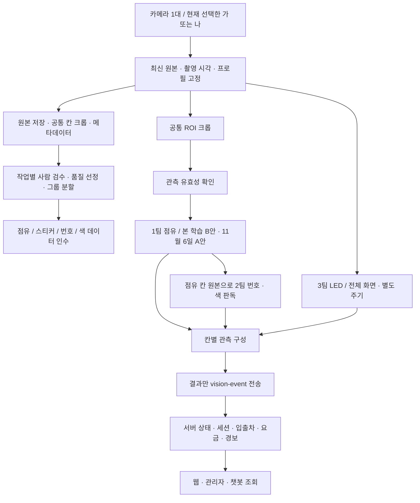

# 스마트 주차장 통합 업무계획 — 카메라 1대·두 주차장·전체 칸 통합 UI

> **1번 작업: 최종 계획 문서 작성.** 이번 개정은 기존 계획과 추가 팀 공지를 통합한 문서 작업이다. 프로그램 제작은 **2번 작업**으로 진행한다.
>
> **이번 사용자 결정:** 우지원의 데이터 수집은 **카메라 1대로 가·나 두 실물 주차장을 촬영하고, 용도별 품질 기준을 통과한 데이터를 선정**하는 데 집중한다. B카메라는 다른 사람이 담당한다. 이 문서는 한 대를 가·나에 **순차 설치·촬영**하는 실행 기준으로 작성했다. 두 주차장이 한 화면에 함께 들어오는 배치는 별도 화질 검증 없이는 전제하지 않는다.

> **추가 확정 요구:** 현재 카메라에 보이는 전체 칸의 점유·차량 번호·스티커색·주차 위치 이상과 데이터 저장 경로·파일별 누적 수량을 **하나의 UI에서 확인·검수**한다. 색깔은 사용자 확인에 따라 **스티커 배경색**이다. 화면 배치·표시 규칙·수량 집계·완료 시험은 [통합 UI 상세 요구사항](PARKING_DATASET_INTEGRATED_UI_REQUIREMENTS_2026-11-04.md)에 구체화했다.

| 항목 | 적용 기준 |
|---|---|
| 문서 개정 | 2026-11-04 · 단일 카메라·D-18~D-39·전체 칸 인식/주차 이상/저장 현황 통합 UI 반영 |
| 데이터 대상 | 가(A) 12칸 + 나(B) 16칸, 총 28칸의 데이터 확보 |
| 우지원의 장치 범위 | 사용 가능한 카메라 1대. 미연결 B카메라 때문에 수집이 막히지 않는 구성을 후속 구현 |
| 핵심 결과물 | 전체 원본·칸별 사진·스티커 자료·검수 정답·출처 정보·데이터 분할표·품질 보고서 |
| 필수 UI | 현재 주차장 전체 12/16칸 결과, 주차/인식 이상, 원본 확대·검수, 저장 파일·수량·실패·재열기 |
| 모델 기본 방향 | B안: 칸 사진 점유 분류. 1팀이 학습·평가, 공통 기반에서 연결 |
| 11/06 시연 예외 | D-36: 가 12칸에 A안인 빈 기준 사진 비교 적용. 실패하면 모의 이벤트 시연으로 명시 전환 |
| 번호 기본 방향 | D-30: 주차된 칸에서 스티커 번호·색 직접 판독. 번호 실패 시 유효한 점유 유지 |
| 협업 | 우지원·박해준의 공통 흐름 공동 검증 유지. 점유·번호·LED 모델의 기존 팀 배정과 연결 |
| 현재 구현 근거 | V18 수집·사람 검수·승인 이미지 내보내기. 신규 단일 카메라 작업 흐름·학습 모델·운영 API 통합 완료를 의미하지 않음 |
| 이번 확인 범위 | 첨부 공지·기존 문서·V18 변경 이력/검증 기록 및 일부 관련 코드 확인, 기술 공식 문서 확인 |
| 미실행 | 실제 촬영, 데이터 품질 실측, 모델 학습, 서버 실행, GitHub PR 변경·병합, 팀 메시지 전송 |

## 1. 팀원·교수님께 설명할 전체 방향

우선 카메라 한 대로 가·나 주차장을 각각 촬영해 학습에 쓸 자료를 정확하게 만들겠습니다. 카메라 설치 구도와 주차칸 좌표를 주차장별로 관리하고, 한 번 촬영한 원본에서 공통 함수로 칸별 사진을 만들겠습니다. 사진마다 점유·스티커 위치·번호·색을 사람이 확인하고, 각 모델에 필요한 정답이 갖춰진 자료만 내보내겠습니다.

수집 화면에서는 현재 주차장 모든 칸의 자동 점유·번호·스티커색 결과를 한 장면에 연결해 보여주겠습니다. 전용 칸 종류 불일치·주차선 침범 같은 이상은 근거와 검사 가능 범위를 함께 표시하고, 인식하지 못한 칸도 목록에서 유지하겠습니다. 같은 화면에서 원본 확대·정답 수정·승인과 파일별 저장 결과·누적 수량을 확인하도록 하겠습니다. 화면을 수동으로 채운 것과 자동 인식 성공은 구분해 검증하겠습니다.

수집 도구와 칸 자르기는 여러 팀이 함께 쓰는 공통 기반으로 준비합니다. 1팀은 칸 점유 모델, 2팀은 스티커 번호·색 모델, 3팀은 LED 모의 화재 모델을 맡습니다. 우지원은 공통 기반과 번호 스티커 작업에 참여하고, 박해준과 결과 전송부터 서버 반영까지 함께 확인합니다.

11월 6일 중간 시연에서는 가 주차장 12칸에 빈 기준 사진 비교 방식인 A안을 사용해 실제 관측 전송을 우선 연결합니다. 이후 본 학습은 B안인 칸 점유 분류 모델을 우선합니다. 번호를 읽지 못하더라도 차가 있다는 관측은 유지하며, 최종 입출차·차량 교체·요금은 서버가 확정합니다.

**데이터 품질이 좋다는 근거는 사진 수가 아니라, 원본의 식별 가능성·정답 정확성·조건 다양성·분할 독립성·모델팀의 실제 사용 확인입니다.** 현재 ‘완벽한 품질 달성’으로 보고하지 않고, 아래 기준을 통과한 자료와 남은 부족 조건을 함께 제시합니다.

## 2. 자료를 해석한 기준과 변경 결정

### 2.1 출처와 우선순위

1. 이번 사용자의 직접 요청: 문서부터 진행, 1카메라로 두 주차장 수집, B카메라는 다른 담당자. 추가로 전체 칸의 점유·번호·스티커색·주차 이상과 저장 경로·수량을 하나의 UI에 통합. 색은 스티커색으로 확인.
2. 첨부 공지의 후반 종합 결정: D-18~D-39 및 팀별 실행 목록.
3. 같은 첨부 앞부분의 추천·대기 목록: 이후 확정된 사항은 갱신하고, 확정되지 않은 제안은 제안으로 유지.
4. 기존 계획의 유효한 기술·품질·검증 기준: 최신 범위와 충돌하는 부분을 수정해 계승.
5. 로컬 V18 기록: 기존 구현 근거로만 사용. 팀 저장소 최신 main과 실제 운영 상태의 증거로 확대하지 않음.

첨부에 포함된 ‘PR 병합’, ‘팀원에게 전달’, ‘코드 등록’ 요청 문구는 **팀 업무 상황을 설명하는 자료**로 해석했다. 이 문서 제작 요청을 해당 외부 작업의 실행 지시로 확대하지 않았다.

### 2.2 이전 계획과 달라진 점

| 이전 내용 또는 첨부 내부의 차이 | 이번 적용 | 의미 |
|---|---|---|
| 우지원이 카메라 2대·28칸을 모두 준비 | 우지원은 1대, 두 주차장 순차 수집 | B카메라 연결·디버깅·현장 운영을 이번 수집의 선행 조건에서 제외 |
| 카메라 A는 가, B는 나로 고정해 해석 | 장치 ID와 주차장 ID를 분리 | 같은 실제 장치가 A·B 두 주차장 데이터를 만들 수 있음 |
| 우지원·박해준이 학습 전부 공동 수행처럼 읽힘 | 공통 기반 공동 검증 + 모델별 팀 배정 | 한 사람이 수집·모든 라벨·모든 학습을 독점하지 않음 |
| 점유 A안은 일반적인 예비안 | 본 학습 B안 우선 + 11/06 A안 시연 확정 | 시연 예외와 최종 개발 방향을 함께 유지 |
| 대수·번호 배정 대기 | D-39의 24대·번호·색 배정 채택 | 과거 49·22 파랑 등의 예시를 현재 배정으로 사용하지 않음 |
| Docker 이름·DB·데모 브랜치 처리 대기 | D-37·D-38에 따라 갱신 | 실제 코드 반영·배포 여부는 별도 검증 |
| 경보 API 담당 미정 | D-29 윤명수·서정범 공동 | LED 모델과 경보 API의 연결 지점 명시 |
| D-33 키 담당 ‘한별님’ / 후반 ‘PM’ | 최신 종합 공지의 ‘PM 관리’ 적용 | 담당자 실명 동일 여부는 추정하지 않음 |
| 2팀 대표 김채린 추천 | 대표 지정은 미확정 제안 유지 | D-27의 우지원·김채린 공동 담당은 유지 |
| 팀별 목록의 ‘1/06 전’ | 주변 D-20·D-22·D-35·D-36과 맞춰 11/06 전으로 해석 | 날짜 오기로 판단한 문서 정리이며 원문은 보존 |
| 2대·28칸 한 바퀴 1초 측정 | 이번에는 1대·12칸 / 1대·16칸을 각각 측정 | 전체 2대 동시 시험은 팀 통합 단계의 별도 범위 |
| 수집·검수·인식 결과를 기능별로 설명 | 전체 영상·모든 칸·선택 칸·이상·저장 결과를 한 UI에 연결 | 전체 장면과 파일별 결과를 직접 확인하는 것을 완료 조건에 포함 |
| 칸 점유·스티커 중심 처리 | 전용 칸 규칙 비교 + 경계/칸 밖 주차 검사 근거 추가 검토 | 점유 분류·스티커만으로 차량 전체 위치를 확정하지 않음 |
| 저장 성공·내보내기 위주 확인 | 원본·칸·스티커·라벨·승인·파일별 경로/수량을 구분 | 실제 디스크 기록과 재시작 후 집계까지 확인 |

### 2.3 이름이 같은 A/B를 구분

| 표현 | 뜻 |
|---|---|
| 카메라 A/B | 실제 장치 또는 논리 스트림 식별자 |
| 주차장 A/B | 가/나 주차장, 데이터의 `lot_id` |
| 주차칸 A-01/B-06 | 한 주차장 안의 칸 번호, `space_id` |
| 점유 B안/A안 | 칸 사진 분류 / 빈 기준 사진 비교 |
| 스티커 후보안 B | 번호 배정 대안. 내용은 이번 첨부에 없으며 점유 B안과 무관 |

## 3. 팀 결정 정리 — 전달받은 사실과 구현 상태

아래 ‘결정’은 사용자에게 전달받은 팀 결정이다. 이번 작업에서 최신 저장소·실행 결과를 재검증했다는 뜻은 아니다.

| 결정 | 내용 | 이 계획에 주는 영향 |
|---|---|---|
| D-06 | 실물 번호 10~99 | 데이터 계약·UI·API 변환을 후속 코드에서 정렬 |
| D-11 | 모의 이벤트 표시 | 실제 영상과 목업 시연을 화면·기록에서 구분 |
| D-14 | 라(D) 64칸, 4구역 | 공통 도면 규격 반영. 실물 촬영 대상은 가·나 |
| D-18 | OpenRouter `google/gemma-4-26b-a4b-it`, `OPENROUTER_API_KEY` | 전달된 팀 설정으로 기록. 모델 제공·접속 성공은 이번에 확인하지 않음 |
| D-19 | 전체 시스템 카메라 2대, 주차장 상공 중앙 | 팀 최종 구성의 배경. 우지원의 이번 수집은 한 대 |
| D-20 | 11/06 `demo_main`, 11/09까지 `main.py` 통합 | 우선 8002 연결, 통합 후 8000 검증 |
| D-21 | 칸 응답에 `entry_at` 추가 | 서버가 산출, 프론트·챗봇 표시 확인 |
| D-22 | 11/06 챗봇 시연 | 실제 관측 반영을 챗봇 조회까지 대조 |
| D-23 | 비전은 인식 결과만 전송, 사진 제외 | 데이터 파일 전달과 운영 API 전송 분리 |
| D-24 | 만차 시 대안 주차장·음성·엘리베이터 인접 추천 | 아이디어 정리 후 배정. 수집 핵심 작업의 선행 조건 아님 |
| D-25 | 팀 공통 포트 사용 | 16장의 설정표 적용 |
| D-26 | API_CONTRACT v1 검토 | 실제 요청 모델과 nullable·bbox·confidence 의미 확인 |
| D-27 | 점유 김한별·박해준 / 스티커 우지원·김채린 / LED 윤명수·서정범 | 모델 업무 중복 방지 |
| D-28 | 팀 서버·데이터 + 김채린 Docker·관리자 로그인·터널 구성 | `API_BASE_URL`로 같은 PC/다른 PC 전환 |
| D-29 | 경보 API 윤명수·서정범 공동 | LED 이벤트 수신→경보 반영 인수 확인 |
| D-30 | 칸 안 번호 직접 판독 기본, 근접은 예비 | 기본 경로에 시간 기반 입차 매칭을 선행 구현하지 않음 |
| D-31 | 6·9 포함 및 방향 혼동 번호 제외 | 실물 인쇄·회전 판독 검수 |
| D-32 | 칸 점유 / 스티커 번호·색 / LED 3작업군 | 전체 화면 차량 탐지 모델을 별도 필수 모델로 만들지 않음 |
| D-33 | 시연 PC LLM 키 PM 관리 | 개발 개인 키와 시연 키 관리 분리 |
| D-34 | 카메라·모델 실행은 우지원 노트북, 학습 PC 미정 | 단일 장치 실제 실행 확인. 다른 담당자의 B카메라 통합 실행 위치는 추후 팀 확인 |
| D-35 | 11/05 오후·11/06 오전 리허설, 각 20분 이내, 회차별 서버 재시작 | 같은 시나리오로 재현·초기화·복구 확인 |
| D-36 | 11/06 A안 점유 시연, 실패하면 모의 이벤트, 번호 필수 아님 | 11/05 리허설 전 가 12칸 관측 흐름 준비 |
| D-37 | 김채린 프론트 별도 PR→Docker 팀 서버용 이식→별도 데모 서버 보관 | 새 별도 백엔드를 공통 기반에 의존시키지 않음 |
| D-38 | `api`·`web`·`admin-auth`, SQLite 단일 DB를 볼륨에 | 최종 DB 지속성·컨테이너 재시작 검증 |
| D-39 | 24대 스티커 번호·색 및 예비 번호 확정 공지 | 5장의 현행 배정표 적용 |

## 4. 역할과 결과물 — 공통 기반과 모델의 경계

### 4.1 업무 배정

| 영역 | 담당 근거 | 필요한 결과물 | 함께 확인할 대상 |
|---|---|---|---|
| 한 대 촬영·두 주차장 프로필·ROI·공통 크롭 | 우지원 중심 공통 기반 제안 + 이번 사용자 범위 확정 | 원본·칸별 사진·메타데이터·재현 가능한 크롭 | 모델 1·2팀 |
| 수집·검수 도구와 데이터 인수 | 우지원 기반 제공, 모델팀이 자기 작업 정답 검수 | 작업별 승인 상태·분할·품질 보고 | 김한별·박해준·김채린 |
| 전체 칸 통합 UI·저장 현황 | 우지원 공통 기반 중심, 모델팀 결과 연결 | 전체 장면 점유·번호·색·이상·파일·수량·검수 연동 | 모델팀·박해준 서버 |
| 점유 B안 분류·A안 예비 알고리즘 | D-27·D-32 김한별·박해준 | 점유 함수·모델·전처리·성적·가림 처리 | 우지원의 실제 칸 크롭 |
| 11/06 A안 시연 연결 | 우지원 촬영·크롭·송신 / 박해준 수신·상태 검증 | 실제 가 12칸 이벤트와 서버 조회 기록 | 중간 시연 담당 팀 |
| 스티커 검출·번호·색 | D-27 우지원·김채린 | 판독 함수·정답·모델·성적 | 김채린 대표 지정은 제안 상태 |
| LED 모델·경보 API | D-27·D-29 윤명수·서정범 | 전체 화면 입력 모델, 경보 이벤트·API 연결 | 공통 송신·서버·챗봇 |
| 결과 합치기·이벤트 송신 | 우지원 공통 기반 중심 제안 | 최신 프레임에 연결된 칸별 관측 | 박해준 서버 검증 |
| 서버 상태·세션·입출차·교체·DB | 박해준 등 서버 담당 | 관측 접수→상태·세션 조회 | 우지원과 같은 프레임·이벤트로 대조 |
| 화면·Docker 이식 | 김채린 | 서버 기준 화면·프록시·배포 구성 | 서버·챗봇 담당 |
| B카메라 | 다른 담당자, 이번 요청에서 실명 미제공 | 해당 담당자 범위 | 우지원 수집·문서 완료를 기다리게 하지 않음 |

우지원·박해준 공동 작업은 **같은 입력과 기대 결과로 공통 흐름을 함께 완성·검증한다는 의미**로 유지한다. 김한별·김채린의 모델 책임을 가져오거나 한 사람이 전부 라벨링·학습한다는 뜻으로 쓰지 않는다. 공통 기반 세부 소유 파일과 팀 대표는 착수 시 팀 기록에 맞춰 확정한다.

### 4.2 중복을 줄이는 작업 규칙

1. 원본 촬영은 공통 도구로 한 번 저장하고, 모든 모델 자료는 그 원본 ID에 연결한다. 같은 원본에 작업별 라벨을 추가한다.
2. 칸을 자르는 함수와 좌표 변환은 공통으로 사용한다. 점유 모델용 축소와 스티커 모델용 고해상도 입력은 그 뒤에 각 전처리로 분리한다.
3. 1팀은 점유 정답, 2팀은 스티커 위치·번호·색 정답을 검토한다. 같은 검수 파일을 동시에 덮어쓰지 않도록 작업별 저장 영역·개정 검사·충돌 처리를 설계한다.
4. 모델팀은 입력·출력·오류·신뢰도 의미와 시험 예시를 함께 넘긴다. 우지원은 모델 내부 학습 코드를 복제하지 않고 어댑터로 연결한다.
5. ROI 품질 문제는 원본과 좌표 근거로 공통 기반에 피드백한다. 팀별로 몰래 다른 크롭을 적용해 성적을 비교하지 않는다.

LED는 전체 화면을 입력받으므로 원본을 공유할 수 있지만, 필요한 점등·소등 자료와 촬영 주기는 LED 담당자가 정의한다. 칸 데이터가 있다는 이유만으로 LED 데이터 수집까지 끝났다고 하지 않는다.

## 5. 주차장·번호·색의 현행 기준

### 5.1 주차장 구조

| 주차장 | lot_id | 종류 | 칸 구성 | 전기차 전용 | 장애인 전용 |
|---|---|---|---|---|---|
| 가 | A | 실물·이번 촬영 | 12: A-01~06, B-01~06 | A-05·06 | B-06 |
| 나 | B | 실물·이번 촬영 | 16: A-01~08, B-01~08 | A-07·08 | B-07·08 |
| 다 | C | 가상 | 12: A-01~06, B-01~06 | A-05·06 | B-06 |
| 라 | D | 가상 | 64: A~D 구역 각각 01~16 | D-01~08 | C-13~16 |

총 104칸이며, 이번 실제 데이터 대상은 28칸이다. 한 칸은 `(lot_id, space_id)`로 식별한다. 바닥 문자를 매번 OCR로 읽어 칸 ID를 만들지 않는다. 공통 도면을 수정하더라도 가상 주차장 C/D의 촬영 자료를 새로 만들라는 요구로 확대하지 않는다.

### 5.2 D-39 실물 배정표

| 스티커 배경색 | API 차량 종류 | 대수 | 번호 |
|---|---|---:|---|
| 초록 | `ev` | 4 | 23, 42, 57, 85 |
| 파랑 | `accessible` | 4 | 14, 32, 55, 75 |
| 흰색 | `general` | 16 | 10, 11, 12, 20, 21, 22, 24, 30, 33, 34, 40, 41, 43, 44, 58, 88 |

예비 번호는 **13, 31, 77, 78, 87**이다. 예비 번호의 차량 종류·투입 시점은 첨부에 없으므로 임의 배정하지 않는다. ‘인식이 안 되면 후보안 B로 교체’라는 결정은 기록하되, **후보안 B의 실제 목록은 미제공**이므로 만들어 넣지 않는다.

API 실물 번호 범위는 `"10"~"99"`이고, 인쇄·학습 운영 목록은 위 24개로 더 좁다. `00~09`·`100`은 현행 실물 대상에서 제외한다. 예비 번호를 자동으로 학습 클래스에 추가하지 않는다.

번호 제외 기준은 6·9 포함, 뒤집혀 다른 번호가 되는 조합, 그리고 `(1,7)·(3,8)·(0,8)·(3,5)·(2,7)`이 한 자리만 다른 번호의 동시 사용 회피다. 문자열 목록 검사와 **실제 인쇄물의 회전·반사·작은 크기 판독 시험**을 별도로 한다. 18↔81은 공지의 예시이며, 글꼴별로 혼동이 더 생길 수 있다.

전기차 전용 실물 칸은 4개, 장애인 전용 칸은 3개다. 전기차 4대·장애인 차량 4대·일반 16대의 구성은 전용 칸 및 위반 시나리오를 만들 수 있지만, 위반 여부는 서버가 판정한다. 24대로 28칸을 동시에 전부 채울 수는 없으며, **차량을 옮겨 28칸 각각의 점유 데이터를 확보하는 것은 가능**하다.

### 5.3 과거 데이터와 정답 관리

- 과거 배정 예시의 ‘22 파랑’은 현행 ‘22 흰색’과 다르다. 사진은 당시 실제 스티커를 기준으로 보존하고, 새 배정표로 옛 라벨을 덮어쓰지 않는다.
- 기존 49 자료는 D-31 운영 제외 대상이다. 원본과 당시 정답을 보존하고 현행 번호 모델 학습에 포함할지 작업별로 판단한다. 49 사진을 새 번호 정답으로 바꾸지 않는다.
- 예비 번호 87은 현재 24개 운영 번호와 구분한다.
- `sticker_assignment_revision` 같은 배정 개정 정보를 설계하고, 실제 부착물·촬영 시각과 함께 관리한다.
- 배정표는 교차 확인 기준이다. 번호를 읽은 뒤 배정표에서 색을 가져와 **색 인식 성공**으로 계산하지 않는다. 차체색·바닥색도 스티커색의 대용 정답이 아니다.

## 6. 카메라 한 대로 두 주차장을 촬영하는 절차

### 6.1 장치·주차장·설치 상태를 분리

후속 프로그램에서 한 실제 카메라 시리얼을 사용하되, 가/나별 촬영 프로필을 선택한다. `camera_id`와 `lot_id`를 같은 값으로 강제하지 않는다. API가 카메라와 주차장을 고정 매핑하고 있다면 서버와 매핑을 먼저 확인한다. 한 장치를 두 개의 동시 스트림처럼 보고하지 않는다.

| 프로필에 남길 항목 | 필요한 이유 |
|---|---|
| 장치 시리얼·논리 camera_id | 같은 장치인지 추적 |
| lot_id·도면·칸 목록 | 가/나 자료 혼입 방지 |
| 설치 위치·높이·각도·방향·고정 사진 | 다음 촬영에서 구도 재현 |
| 실제 해상도·수신 FPS·노출·게인·화이트밸런스 등 가능한 설정 | 촬영 조건 비교. 요청값과 읽어온 실제값 구분 |
| ROI 좌표·개정·크롭 방식 | 원본에서 같은 칸 사진 재생성 |
| 설치 개정·촬영 세션·카메라 재연결 구간 | 이전 프레임·ROI·기준 사진 오사용 방지 |
| 빈 기준 사진 ID·검수자·확인 시각 | A안 시연 근거 추적 |

카메라의 지원 설정은 실제 장치에서 확인한다. 자동 초점이나 특정 노출값이 당연히 제공된다고 가정하지 않는다. 숫자 하나를 ‘최적 설정’으로 고정하기 전에 먼 칸·모서리의 원본을 확인한다.

### 6.2 가→나 촬영 순서

1. **가 주차장 설치:** 카메라를 고정하고 가 12칸이 모두 보이는지 확인한다. 가장 먼 칸의 스티커를 원본 크기로 확인한다.
2. **가 프로필 확정:** 칸 ROI를 검수하고 빈 상태 원본을 저장한다. 실제 빈칸인지 사람이 확인한 사진만 A안 기준으로 지정한다.
3. **소량 시험:** 빈칸·점유·스티커 사진을 소량 저장→검수→내보내기→다시 읽기까지 확인한다. 파일만 많아진 뒤 형식 오류를 발견하지 않도록 한다.
4. **가 본 수집:** 여러 번호·색·차체·배치·방향·조명 조건을 촬영하고 현장에서 불량 조건을 확인해 재촬영한다.
5. **전환:** 현재 촬영·운영 송신을 멈추고 진행 중 작업을 정리한다. 이전 프레임·번호 캐시·A안 기준의 활성 상태를 해제하고 새 세션을 연다.
6. **나 설치·검수:** 나 프로필을 선택해 16칸을 등록·검수한다. 같은 장치라도 가의 ROI·빈 기준 사진을 적용하지 않는다.
7. **나 본 수집:** 가와 같은 검수 절차로 나 자료를 확보한다. 원본·칸 ID·파일명이 가 자료와 충돌하지 않아야 한다.
8. **복귀 시 재확인:** 다시 가로 돌아오면 기존 프로필을 참고하되, 고정 위치와 원본 대조 후 ROI·기준을 다시 승인한다. 카메라를 원래 자리 근처에 둔 것만으로 재사용을 확정하지 않는다.

각 촬영 작업은 시작 당시의 `lot_id`·프로필·프레임 정보를 고정해 저장한다. 화면에서 주차장을 바꾼 뒤 늦게 끝난 저장/인식 결과를 새 주차장 자료로 붙이지 않는다.

### 6.3 이번 수집과 운영 감시의 차이

한 카메라로 두 장소의 자료를 순서대로 모을 수 있지만, 동시에 두 주차장을 실시간 감시한 것은 아니다. 기본 수집 모드는 로컬 저장으로 두고 운영 서버 전송은 명시적으로 켠다. 주차장 전환 중 보지 못하는 칸을 빈칸으로 전송하지 않는다.

전체 팀의 2대·28칸 동시 운영 목표는 유지하되 다른 담당자의 B카메라 결과까지 받은 뒤 통합 검증한다. **B카메라가 없어도 이번 한 대 수집과 품질 검수는 완료할 수 있어야 한다.** 다른 장치·다른 구도의 성능까지 이번 데이터만으로 증명하지 않는다.

## 7. ‘정확한 품질’을 판정하는 검수 기준

### 7.1 한 점수로 모든 용도를 승인하지 않기

품질은 **원본 보존 → 촬영 적합성 → 좌표 적합성 → 작업별 정답 → 다양성 → 분할 독립성 → 인수 확인** 순서로 확인한다. 아래는 이번 계획에서 제안하는 선정 기준이며, 현재 V18에 모두 구현됐다는 뜻은 아니다.

| 확인 영역 | 통과 기준 | 실패했을 때 |
|---|---|---|
| 원본·파일 | 열리는 파일, 저장 완료, 크기·해상도 일치, 원본 해시·ID 연결 | 오류 사유를 기록하고 재수집. 정상 원본은 보존 |
| 촬영 구도 | 대상 칸이 포함되고 카메라·설치·ROI가 일치 | 재설치·재등록. 다른 구도 자료를 섞어 승인하지 않음 |
| 선명도·노출 | 작업에 필요한 차량/스티커/숫자 특징을 원본에서 확인 가능 | 작업별 사용 가능 여부 판정, 필요하면 재촬영 |
| 가림·반사 | 유효한 점유 근거와 번호·색 판독 가능성을 따로 확인 | 가림 평가 자료로 분류하거나 해당 작업 승인 보류 |
| 칸 크롭 | 해당 칸을 충분히 담고 이웃 차량·빈 여백의 영향 확인 | 공통 크롭 수정 후 해당 파생 이미지 재생성 |
| 스티커 위치 | 전체 스티커 검출 박스, 숫자 영역, 색용 내부 영역을 구별 | 잘못된 영역 수정 후 재검수 |
| 정답 | 검수자·시각·버전·근거가 있고 값·좌표가 실제 이미지와 맞음 | 불일치 보류, 두 번째 검수자 확인 |
| 다양성 | 두 주차장 모든 칸·번호·색과 실제 실패 조건의 빈틈을 집계 | 부족 조건을 지정해 추가 촬영 |
| 중복·분할 | 동일/유사 장면이 학습·검증·시험에 걸쳐 중복되지 않음 | 장면 그룹을 묶어 분할 재작성 |
| 내보내기 | 파일·라벨·좌표·클래스 순서를 받는 팀이 실제로 열어 확인 | 작은 묶음부터 형식 수정 |

블러·밝기·과노출 비율·스티커 픽셀 크기 등은 **자동 검수 보조 지표**로 남긴다. 예를 들어 블러 점수 100이나 스티커 폭 20픽셀 같은 값을 장비·모델 시험 없이 보편적 합격선으로 쓰지 않는다. 사람이 확인한 통과/실패 샘플로 임계값을 조정하고, 잘못 제외하거나 통과시킨 사례를 확인한다.

### 7.2 품질 분류와 학습 분할을 구분

| 선정 상태 제안 | 내용 | 사용 |
|---|---|---|
| 정상 사용 가능 | 해당 작업의 영상·정답이 충분함 | 승인된 작업의 학습/검증/시험 후보 |
| 어려운 조건·판단 보류 평가 | 가림·반사·먼 칸·작은 숫자·손 등 실제 운영 조건 | 강건성·관측 보류 평가, 근거가 있는 작업의 보강 학습 |
| 수정·재촬영 필요 | 원본 손상·좌표 불일치·정답 불명 등 | 해당 작업 내보내기 제외, 원인과 조치 기록 |

위 상태와 `train/validation/test`는 서로 다른 축이다. 어려운 자료는 모두 시험에만 두거나 모두 버리는 것이 아니라, 정답 근거와 목적을 확인해 **독립 그룹으로 분할**한다. 이미 본 시험 장면으로 모델을 조정했다면 그 장면은 더 이상 독립 시험 근거로 사용하지 않는다.

정상 사진만 골라 시험하면 현장 성능이 과장될 수 있다. 실제 운영 분포를 반영한 평가와 어려운 조건별 평가를 함께 두고, 원본 총수·선정수·보류수·제외 사유·작업별 사용수를 보고한다. 폐기 대상으로 분류해도 원본을 자동 삭제하지 않는다.

### 7.3 작업별 승인

| 한 사진의 상황 | 점유 자료 | 스티커 검출 자료 | 번호 자료 | 색 자료 |
|---|---|---|---|---|
| 차 있음, 번호·색 선명 | 점유 승인 | 전체 스티커 위치 검수 후 승인 | 실제 번호·방향 확인 후 승인 | 내부 배경색 확인 후 승인 |
| 차 있음, 번호만 흐림 | 점유 승인 가능 | 경계가 보이면 승인 가능 | 판독 불가 표시, 일반 번호 정답으로 억지 승인하지 않음 | 색이 보이면 승인 가능 |
| 빈칸 | 빈칸 승인 | 검수 범위 내 스티커 없음의 음성 자료 가능 | 해당 없음 | 해당 없음 |
| 손이 칸을 가림 | 근거 부족 시 보류 | 실제 보이는 범위·가림을 표시 | 보류 또는 판독 불가 | 보류 또는 확인 가능한 범위만 |
| 원본 손상·주차장 혼입 | 승인 불가 | 승인 불가 | 승인 불가 | 승인 불가 |

검출용 ‘음성 자료’는 **그 학습 이미지 안의 스티커를 빠짐없이 확인했다는 조건**이 필요하다. 일부 칸만 승인한 전체 원본에 미등록 스티커가 남아 있다면, 그 원본을 모든 객체 라벨이 끝난 검출 이미지로 내보내지 않는다. 검수가 끝난 칸 크롭만 사용하거나 전체 객체를 추가로 검수한다.

촬영 기록상 실제 차량 번호를 알고 있어도 영상에서 번호를 확인할 수 없다면, `known_car_id`와 `number_readable` 같은 별도 기록으로 구별하는 설계를 사용한다. 번호 정답의 출처는 보존하되 판독 불가 샘플을 쉬운 번호 학습·성공률 집계에 섞지 않는다. 모델의 미인식은 정답 부재와도 구분한다.

### 7.4 사람 검수와 승인 이력

1. 원본 전체·선택 칸·스티커를 함께 확인한다. 표시선이 그려진 미리보기만 보고 승인하지 않는다.
2. 점유·스티커 전체 위치·번호·색을 작업별로 검수한다. 숫자 박스가 스티커 전체 박스를 대신하는지 확인 없이 재사용하지 않는다.
3. 애매하거나 신규 조건인 자료는 두 번째 검수자와 대조한다. 의견이 다르면 다수결로 밀어 넣지 않고 기준 또는 촬영 근거를 보완한다.
4. 내보내는 정답은 해당 담당자가 검수 완료한 것만 포함한다. 명백한 오류·미해결 불일치가 남아 있으면 승인하지 않는다.
5. 승인 후 수정 시 누가·언제·무엇을·왜 바꿨는지 기록한다. 이미 공유한 데이터 묶음을 조용히 덮어쓰지 않고 개정을 발행한다.

이는 알려진 오류를 통제하는 완료 기준이다. 사람 검수와 자동 검사만으로 미발견 오류가 절대 없다고 보장하지는 않는다.

## 8. 두 주차장 데이터 수집표와 분할

### 8.1 무엇을 얼마나 다양하게 모을 것인가

| 축 | 필수 확인 | 편향을 줄이는 방법 |
|---|---|---|
| 주차장·칸 | 가 12·나 16 모든 칸의 빈 상태와 점유 상태 | 특정 B-06칸만 반복 촬영하지 않음 |
| 번호 | D-39 24개 각각의 두 주차장 촬영 여부 | 가까운/먼/가장자리 칸에 분산 배치. 부족한 조합은 표에 표시 |
| 스티커색 | 흰·초록·파랑 모두 | 세 색을 여러 바닥색·칸 위치에서 촬영 |
| 차체 | 차체색·형태·크기 다양성 | 동일 차체·칸만으로 번호를 외우는 편향 확인 |
| 방향·위치 | 실제 허용 방향, 칸 안 치우침, 경계 주차 | 허용 가능한 부분 주차를 점유로 볼 기준부터 합의 |
| 조명 | 실제 사용할 조명, 그림자·반사·노출 변화 | 극단적 조작 사진만 늘리지 않고 운영 조건 중심 |
| 부정·가림 사례 | 손·종이·바닥 글자·스티커 없음·검은 화면·구도 이탈 | 임의 빈칸 라벨 대신 품질 거절·오탐 시험 |
| 시퀀스 | 입차·출차·가림 뒤 복귀·빈 구간 없는 차량 교체 | 정적 사진 정확도와 상태 전환 성능 별도 평가 |
| 시간·설치 | 별도 촬영 세션·재설치 조건 | 같은 장면 연속 저장 수를 다양성으로 세지 않음 |

모든 번호×모든 칸×모든 조명 조합을 한 번에 채워야 한다고 요구하지 않는다. **28칸의 점유/빈칸과 24개 번호의 확인 범위를 먼저 확보하고, 먼 칸·특정 색·회전 등 실패 조건을 우선 보강**한다. 번호가 교체되거나 실제 차량이 준비되지 않은 경우 미충족 상태를 유지한다.

초기에는 두 주차장 각각 소량의 대표 자료로 저장·검수·인수 경로를 시험한다. 이후 장면을 바꿔 촬영한 독립 세션을 늘린다. 학습·검증·시험을 나눌 수 있는 세션 구성을 마련하되, ‘세션 3개면 충분’, ‘몇백 장이면 완성’ 같은 수량 보장은 하지 않는다.

### 8.2 데이터 누수 방지

하나의 원본에서 나온 12개 또는 16개 칸 사진, 스티커 크롭, 회전·증강본은 모두 원본과 연결한다. 같은 차량 배치의 연속 프레임도 장면 그룹으로 묶는다. 이 그룹이 학습·검증·시험 사이에 걸치지 않도록 **분할표를 먼저 만들고 파생 파일이 그 분할을 상속**하게 한다.

주차장 A 전체를 학습, B 전체를 시험으로 나누는 구성은 ‘새 주차장 일반화’ 시험에는 쓸 수 있지만, 두 주차장을 함께 운영하는 기본 성능 평가를 대신하지 않는다. 기본 평가는 두 주차장에 대해 각각 새 촬영 세션 성적을 확보하고, 재설치·새 장치 일반화는 별도로 표시한다. 그룹을 나누어 평가한다는 원칙은 [scikit-learn 공식 그룹 교차검증 설명](https://scikit-learn.org/stable/modules/cross_validation.html#group-k-fold)을 참고하며, 본 프로젝트에는 촬영 세션·장면 단위로 적용하는 설계 제안이다.

분할 비율은 자료의 규모·독립 장면 수를 본 뒤 모델팀과 정한다. 같은 사진을 복사해 클래스별 수량을 늘리지 않는다. 증강은 원본 분할을 정한 뒤 학습 자료 중심으로 수행하며, 색을 바꾸는 증강은 색 라벨과 맞지 않으면 사용하지 않는다.

### 8.3 품질 보고서 항목

| 보고 항목 | 집계 기준 |
|---|---|
| 수집 규모 | 전체 원본 수, 독립 장면 수, 세션 수, 칸 크롭 수를 각각 표시 |
| 작업별 자료 | 점유·스티커 검출·번호·색 각각 승인 수와 제외 수 |
| 칸 커버리지 | 28칸별 빈칸/점유 수, 어려운 조건·세션 수 |
| 번호·색 커버리지 | D-39 번호별 주차장·거리·방향·색 확인 수 |
| 검수 품질 | 미해결 불일치, 수정 사유, 이중 검수 결과 |
| 무결성 | 해시·참조 누락·범위 밖 좌표·중복 ID 검사 결과 |
| 분할 | 그룹별 분할, 동일 원본·유사 장면의 분할 간 중복 확인 |
| 제한 | 아직 없는 번호·칸·조명·설치 조건과 다음 촬영 항목 |

예를 들어 원본 10장에서 160개 칸 크롭을 만들었다면 ‘독립 사진 160장’이라고 쓰지 않는다. 사용 가능한 번호 사진 수와 점유 사진 수가 다르면 두 수치를 따로 제공한다.

## 9. 데이터 저장·정답·팀 전달 형식

### 9.1 제안 구조

다음은 **2번 프로그램 제작 때 구현할 데이터 구조 제안**이다. 현재 V18의 실제 저장 구조와 같다고 가정하지 않는다.

```text
datasets/
  sessions/
    session_A_001/
      session.json
      frames/                    # 표시선 없는 전체 원본
      captures/                  # 원본 ID·해시·촬영 조건
      spaces/A/B-06/             # 공통 함수로 만든 칸 크롭
      stickers/                  # 필요할 때 만드는 스티커 파생 이미지
      predictions/               # 자동 결과·모델·처리 상태, 검수 정답과 분리
      annotations/               # 작업별 라벨·검수 개정
      review_previews/           # 사람이 확인하는 표시 사진
    session_B_001/
      ...
  exports/
    dataset_revision_001/
      manifest.json
      split_manifest.json
      label_map.json
      quality_report.json
      occupancy/
      sticker_detection/
      number/
      color/
```

원본은 한 번 저장하고 파생 이미지가 원본을 참조한다. 파생 크롭을 파일로 미리 저장할지 재생성할지는 사용 편의·저장공간을 보고 정하되, 팀에 전달한 묶음은 필요한 파일이 실제로 포함돼 열려야 한다. 원본 해시를 남기고 원본을 수정하지 않는다. 박스·글자를 그린 사진은 학습 원본과 분리한다.

### 9.2 필수 연결 정보

| 범주 | 제안 정보 |
|---|---|
| 출처 | dataset_revision, session_id, scene_group_id, capture_id, 원본 상대경로·해시 |
| 촬영 | 촬영 시각·시간대, camera_id·시리얼, lot_id, 실제 해상도·설정, 설치 개정 |
| 좌표 | space_id, ROI 개정·다각형, 크롭 원점·크기·마스크·패딩·좌표 변환 |
| 정답 | 점유, 스티커 전체 위치, 번호, 판독 가능성, 스티커 내부 영역·색, 실제 번호의 별도 근거 |
| 검수 | 작업별 상태, 검수자·시각·사유·라벨 개정, 두 번째 검수 결과 |
| 분할 | 그룹 ID, train/validation/test, 중복 그룹, 배정표 개정 |

필드명과 형식은 후속 설계에서 팀과 일치시킨다. 데이터 파일의 확장과 API 필드 추가는 별도 결정이다. 검수 편의를 위한 필드를 합의 없이 운영 API에 보내지 않는다.

### 9.3 작은 묶음으로 인수 확인

1. 가/나 각각 빈칸·점유·번호 미확인·세 가지 색·가림 사례를 포함한 작은 묶음을 만든다.
2. 1팀이 칸 사진과 점유 라벨을 열고, 2팀이 스티커 위치·번호·색의 연결을 확인한다.
3. 학습 도구에 가져온 뒤 클래스 순서·박스·색·분할을 원본과 대조한다. 정답 없는 자료가 자동 음성 라벨이 되지 않는지 확인한다.
4. 통과한 형식으로 본 수집·라벨링을 확대한다. 수정 시 기존 배포 묶음을 보존하고 개정을 남긴다.

Geti 전용 형식은 실제 설치판이 지원하는 가져오기 방식에 맞춰 검증한다. 자체 JSON과 ZIP을 만들었다는 사실만으로 Geti 호환 완료로 보고하지 않는다. 데이터·모델·가상환경·로그는 Git에 넣지 않고, 팀이 접근 가능한 별도 위치와 무결성 목록을 전달한다. 접근 경로는 팀 환경에서 정한다.

## 10. 공통 처리 구조와 모델 입출력 약속



수집 모드에서는 저장·검수가 중심이고, 운영 모드에서는 최신 관측이 중심이다. 수집/저장과 운영 송신은 독립 설정으로 두며, 분석이 늦어도 과거 사진을 현재 관측처럼 전송하지 않는다.

### 10.1 함수 계약 제안

| 공통 약속 | 입력 | 출력·오류 처리 |
|---|---|---|
| 칸 자르기 | 원본 + 검증된 프로필/ROI | 원본 좌표를 복원할 수 있는 칸 사진·변환·프레임 문맥 |
| 점유 판단 | 같은 규칙으로 만든 칸 사진 + 문맥 | occupied/empty 판단, 모델 점수, 유효성·판단 보류 이유 |
| 스티커 판독 | 원본 해상도 칸 사진 + 문맥 | 스티커 위치, 번호/색 또는 미확인, 작업별 점수·판독 시각 |
| LED 판단 | 전체 원본 + 문맥 | 합의된 LED 결과·점수·시각. 경보 계약에 맞춰 변환 |
| 결과 합치기 | 위 결과 + 원래 lot/space/frame/time | 현재 계약에 맞는 관측 또는 보류 진단 |

모델 입력이 ‘칸 사진 하나’라는 설명은 개념을 단순화한 것이다. 실제 통합에는 프레임·칸·시각·모델 개정 문맥이 필요하다. 색순서, 자료형, 입력 크기, 정규화, 마스크·패딩, 라벨 순서를 인수 문서에 명시한다.

점유용 작은 입력을 숫자 판독에 재사용하지 않는다. 스티커 전체 박스, 숫자 박스, 색용 내부 다각형, 주차칸 ROI, 차량 박스는 서로 다른 값이다. 점유 분류 출력에 차량 바운딩박스가 생기는 것으로 가정하지 않는다.

### 10.2 오류·지연·캐시

- 점유 관측을 번호 인식 완료까지 기다리게 하지 않는다. 현재 프레임의 유효한 점유는 번호 미확인으로 먼저 전송할 수 있다.
- 모듈 오류·카메라 단절·가림은 임의 빈칸으로 변환하지 않는다. 로컬 진단과 실패 시간을 남긴다.
- 새 점유·미확인 번호·외형 변화·가림 복구 시 우선 판독하고, 변화 없는 점유 칸도 주기적으로 재판독한다.
- 빈칸 확정 관측, 설치/ROI 변경, 주차장 전환, 카메라 재연결에서 신원 캐시를 무효화한다.
- 늦게 끝난 결과는 원래 촬영 시각·프레임에 묶는다. 새 차량 결과를 덮어쓰거나 새 시각으로 위장하지 않는다.
- 번호 재판독 간격과 늦은 보강 이벤트 수용 방식은 서버 계약·목표 지연을 확인해 정한다. `car_id=null`만 보내면 이전 신원이 자동 해제된다고 가정하지 않는다.

## 11. 점유 B안 본 학습과 11/06 A안 시연

### 11.1 B안 — 칸 사진 분류

김한별·박해준이 점유/빈칸 라벨과 평가를 맡고, 우지원의 공통 크롭·원본을 사용한다. 우선 하나의 경량 분류 모델을 여러 칸에 적용한다. 두 주차장 성능 차이가 크면 데이터 보강·전처리를 점검하고 모델 분리를 검토한다. 28칸이라는 이유로 모델 28개를 만들지는 않는다.

학습 클래스가 occupied/empty 두 개여도 가림·검은 화면·구도 이탈을 둘 중 하나로 강제하지 않는다. 유효성 검사와 판단 보류를 별도로 두고, 가림을 빈칸 정답으로 몰아넣지 않는다. 분류 점수가 높다는 이유만으로 품질 통과를 확정하지 않는다. 필요하면 별도 품질 분류 구성을 팀과 검토한다.

완료 근거는 모든 대상 칸의 자료·독립 세션 성적·허위 빈칸/허위 점유/보류 비율·내보낸 모델의 실제 PC 출력·서버까지 이어진 허위 출차 시험이다. 허용 오류율은 PM·모델·서버 담당자가 합의한다. ‘시험에서 허위 출차 0건’은 시험 시간·장면·차량 수와 함께 보고한다.

### 11.2 A안 — 11월 6일 중간 시연

D-36에 따라 가 12칸의 **사람이 비어 있음을 확인한 기준 사진**과 현재 칸 사진을 비교한다. 목적은 리허설 전에 실제 카메라→ROI→점유 관측→서버→화면 흐름을 연결하는 것이다. 번호 판독은 그날의 필수 완료 조건이 아니다.

| 준비 | 확인할 내용 |
|---|---|
| 기준 사진 | 가 주차장, 현재 구도·해상도·ROI 일치, 빈 상태 검수자·시각 기록 |
| 비교 | 조명·그림자·손·종이·반사·차량을 구별할 수 있는지 현장 시험 |
| 기준 갱신 | 점유나 가림 중 자동 갱신 금지. 빈 상태 재확인 후 개정 기록 |
| 점수 | 영상 차이 점수를 차량 확률이나 confidence=1.0으로 포장하지 않음 |
| 오류 | 관측 불가면 보류. A안 자체가 실패하면 합의된 모의 이벤트 시연으로 전환 |
| 표시 | 화면·로그에 A안 실제 영상인지 모의 이벤트인지 명확히 기록 |

정차 차량을 배경으로 흡수하는 방식과 검증된 빈 사진 고정 비교는 다르다. 카메라를 움직이거나 다른 주차장으로 옮기면 이전 기준 사진을 자동 재사용하지 않는다. A안도 가림·노출 변화 문제를 자동 해결하지 않는다.

A안 비교 모듈은 1팀 책임과 공유해 중복 구현을 피하고, 우지원은 실제 촬영·크롭·전송 연결을 맡는 방향으로 조율한다. 11/06의 A안 사용은 B안 본 학습을 취소하는 결정이 아니다. A안↔B안 전환은 명시 설정으로 기록하고, 선택한 모델이 없다고 자동으로 다른 방식이나 목업으로 바꾸지 않는다.

## 12. 칸 안 스티커 번호·색 판독과 Geti 학습

### 12.1 스티커 시험

우지원·김채린은 실제 상공 원본에서 스티커 전체 위치→번호→배경색 순서로 확인한다. 먼저 24개 번호의 실물 인쇄·부착 상태와 먼 칸·가장자리·방향별 원본 판독 가능성을 검수한다. 디지털 확대만으로 촬영에서 사라진 글자 정보가 복구됐다고 판단하지 않는다.

판독 결과에는 주차장·칸·번호·색·방향·스티커 픽셀 크기·가림/반사·성공/실패 이유를 남긴다. 칸 경계에 걸리거나 한 ROI에 여러 스티커가 있으면 공간 귀속을 확인하고, 같은 번호를 이웃 칸에 복제하지 않는다.

성적은 번호 정답률·색 정답률·동시 정답률·판독 완료율·전체 장면 정답률을 함께 보고한다. 전체 평가 대상 중 미인식도 분모에 포함한 성공률을 제시하고, 판독 가능 자료만의 성적은 별도 표시한다. 사람이 정답 박스를 제공한 번호 모델 성적과 자동 스티커 검출부터 수행한 전체 성적을 구분한다.

현재 번호와 색의 배정이 고정되어 있으므로, 번호→색 조회만으로 색 인식을 대체하지 않는지 검사한다. 색용 스티커 내부 영역·반사·바닥/차체 혼동 사례를 직접 확인한다. 학습 시 위치·바닥·차체를 외워 맞히는 편향도 독립 배치 시험으로 점검한다.

### 12.2 모델·학습 환경 확인

점유 분류, 스티커 검출, 번호 분류/OCR, 색 분류는 논리적 작업이다. ‘모델 3가지’가 모델 파일 정확히 3개라는 뜻은 아니다. 24개 전체 번호 분류, 숫자별 인식·조합, 기존 OCR 중 어떤 구성을 쓸지는 담당팀이 비교한다. API가 10~99를 받는다는 이유로 학습하지 않은 번호까지 읽을 수 있다고 보지 않는다.

Geti의 설치 위치·버전·학습 PC·계정·지원 작업·가져오기·내보내기를 확인한다. 공식 안내는 주석·학습·배포 흐름 및 OpenVINO 연결을 제공하지만, 팀의 실제 자료와 환경에서 작은 학습→내보내기→실행 시험이 필요하다. [Geti 공식 안내](https://docs.geti.intel.com/)

기존 PC의 RAM 32GB·SSD 1TB·Intel Arc B390 정보는 이전 문서의 장비 정보다. 실제 가용 공간·드라이버·런타임·학습 장치 지원을 확인해야 한다. 기존 EasyOCR XPU 실행 기록은 Geti 학습 또는 새 OpenVINO 모델 성공 근거가 아니다.

본 학습은 전달된 일정상 11/09부터 진행하며, 그 전에는 소량 자료 인수와 환경 확인 범위를 맞춘다. 학습 도구 변경은 팀 결정 사항이다. Geti 대신 다른 도구로 칸 사진 분류를 학습해도 점유 방식은 B안이다.

### 12.3 모델 인수 묶음

데이터 개정·분할, 모델 파일·해시, 라벨 순서, 입력 크기·색순서·정규화·크롭, 출력 의미·임계값, 런타임·장치, 독립 시험 성적을 함께 전달한다. 내보내기·최적화·양자화 뒤에도 출력과 정확도를 대조한다. 이전 검증 모델은 되돌릴 수 있게 보관한다.

### 12.4 근접 판독 예비안

상공 원본·인쇄·촬영 조건을 개선해도 직접 판독이 부족하면 결과를 PM과 검토해 근접 판독 전환을 결정한다. 근접 자료는 상공 평가 자료와 분리하며, `plate_observed(space_id=null)`와 새 점유를 서버에서 연결해야 한다.

30초 대기·후보 만료·번호 인식 시각부터 요금 시작 같은 과거 제안은 확정 계약으로 적용하지 않는다. D-21 `entry_at` 응답 필드 결정과 요금 시작 시각 정책도 구별한다. 근접 전환에는 제시 영역·중복·가림·매칭·종료·교체 재검증이 필요하다. **점유 A안 전환과 근접 번호 판독 전환은 서로 다른 결정**이다.

## 13. 관측 API와 서버 책임

### 13.1 전달받은 계약

| 항목 | 내용 |
|---|---|
| 요청 | `POST /api/v1/internal/vision-events` |
| 인증·응답 | Bearer 토큰, 정상 접수 202 |
| 이벤트 | `vehicle_observed`, `space_empty_observed`, `plate_observed`, `mock_fire_led_observed` |
| 공통 필드 | `event_id`, `event_type`, `source`, `lot_id`, `camera_id`, `space_id`, `car_id`, `vehicle_type`, `confidence`, `bbox_xyxy`, `observed_at`, `frame_id` |
| 주기 | 유효한 칸별 새 관측 목표 1초·최대 2초 |
| 전송 단위 | 칸 하나당 이벤트 하나. 임의 묶음 형식은 추가하지 않음 |
| 실제 관측 | `source=vision` |
| C/D 시뮬레이터 | `source=simulation`, 실제 허용 계약 확인 |
| 사진 | 운영 API 전송 제외, 학습 자료 전달은 별도 |

위 필드의 정확한 필수성·nullable·범위는 D-26의 실제 요청 모델에 대조해야 한다. V18에서 이 송신 기능이 구현됐다고 설명하지 않는다.

### 13.2 상황별 전송

| 상황 | 보낼 내용 | 주의점 |
|---|---|---|
| 차량·번호·색 확인 | 해당 칸 vehicle_observed + 확인한 번호·종류 | 실제 관측 시각·프레임 유지 |
| 차량 있음, 번호 미인식 | vehicle_observed, car_id=null | 번호 실패를 빈칸으로 전송하지 않음 |
| 번호만 또는 색만 확인 | 확인된 값만, 나머지 미확인 | 개별 nullable 계약 확인 |
| 실제 빈칸 근거 | space_empty_observed | 스티커 미검출만으로 발생시키지 않음 |
| 가림·단절·오래된 프레임 | 허위 차량/빈칸 관측을 만들지 않고 진단 기록 | 서버 상태 불확실 처리와 관측 중단 검증 |
| 주차장 전환 중 | 해당 장치의 운영 송신 중지 | 보이지 않는 주차장의 빈칸 이벤트 금지 |
| 모의 시연 | 합의된 목업 발생 경로와 표시 | source=vision으로 위장하지 않음. is_mock의 전달/표시 위치는 계약 확인 |

다음은 D-39에 맞춘 **설명용 일부 필드**이며, 필수 시각·ID·점수·좌표 등이 빠져 있으므로 실행 요청으로 그대로 사용하지 않는다.

```json
{
  "event_type": "vehicle_observed",
  "source": "vision",
  "lot_id": "A",
  "camera_id": "camera_a",
  "space_id": "B-06",
  "car_id": "14",
  "vehicle_type": "accessible"
}
```

번호 미확인 시 위 `car_id`를 null로 둘 수 있지만, 서버가 기존 신원을 유지하는지·지우는지·교체 후보로 처리하는지는 실제 시험으로 확인한다. 미확인 번호를 이전 성공 번호로 채워 새 관측처럼 보내지 않는다.

### 13.3 계약 검토가 필요한 지점

- `bbox_xyxy`가 차량 박스인지 스티커 박스인지, 점유 분류·A안일 때 무엇을 허용하는지 확인한다. 임의 ROI를 차량 검출 박스로 넣지 않는다.
- `confidence`가 어느 판단의 점수인지 확인한다. 점유·번호·색 점수는 서로 다르며 A안 차이 점수도 확률이 아니다.
- 같은 관측의 재시도는 같은 `event_id`·`observed_at`·`frame_id`를 사용한다. 새 프레임의 새 관측만 새 ID를 부여한다.
- 늦은 번호 보강, 점유가 계속 있는 동안 차량 번호 교체, 순서 역전 이벤트 처리 기준을 확인한다.
- 실제 단일 camera_id로 다른 lot_id를 보내는 경우 허용 매핑과 등록 절차를 확인한다.
- 가상 번호 규격은 실물 10~99나 임의 sim-형식을 자동 적용하지 않고 계약을 따른다.

### 13.4 접수부터 화면까지

202는 접수 증거다. 동일 이벤트의 서버 상태·활성 세션·DB 및 화면 반영까지 확인해야 통합 완료다. 서버가 입차·출차·차량 교체·요금·전용 칸 위반을 확정하며, 비전은 DB에 직접 쓰지 않는다.

이전 전달 규칙인 점유 2초·빈칸 3초 안정화, 무관측 10초 후 uncertain은 최신 서버 코드와 대조한다. `empty/occupied/uncertain/unavailable`은 서버 상태이며, 로컬 ‘판단 보류’를 새 API 상태로 임의 추가하지 않는다. 안정화 타이머가 있다는 이유로 잘못된 빈칸 관측을 허용하지 않는다.

카메라 PC와 서버의 시각 차이 10초 이내는 첨부의 연결 조건으로 기록한다. **1~2초 수준 전달 지연을 정확히 측정하는 데 10초 오차가 충분한 것은 아니다.** 동기화 상태·잔여 오차를 기록하고 로컬 처리 시간은 단조 시계 등 경과시간 측정으로 분리한다. 원본 촬영 시각을 최신처럼 고쳐 보내지 않는다.

## 14. 속도·정확도·복구 검증

### 14.1 이번 단일 카메라 측정

| 시험 | 이번 범위 | 결과로 말할 수 있는 것 |
|---|---|---|
| 가 12칸 수신·크롭 | 실제 카메라 1대, 모델 없이 시작 | 촬영·칸 자르기 비용 |
| 나 16칸 수신·크롭 | 같은 장치를 옮겨 별도 실행 | 나 프로필에서의 비용 |
| 가 12칸 A안 + API | 11/06 구성, 저장·화면 포함 | 실제 중간 시연의 주기·오류·서버 반영 |
| 주차장별 학습 모델 | 독립 실제 영상, 12칸/16칸 각각 | 해당 데이터·모델·장치의 정확도·주기 |
| 녹화 28칸 동시 부하 | 필요한 경우 선택 시험 | 두 입력 처리 부하 추정. 실카메라 2대 수신 검증 아님 |
| 팀 전체 2대·28칸 | B카메라 담당자 참여 후 별도 통합 | 실제 동시 운영 성능. 이번 단일 카메라 수집 완료와 별개 |

12칸 시간과 16칸 시간을 더한 값만으로 두 카메라 동시 성능을 확정하지 않는다. 같은 원본을 복제한 합성 부하는 성능 시험으로 표시하고 정확도 증거로 사용하지 않는다.

칸당 1초는 ‘한 칸 처리하고 1초 대기’가 아니라 **각 칸이 약 1초마다 새 관측을 갖는 것**이다. 유효한 모든 칸을 매초 전송하면 가는 약 12개/초, 나는 약 16개/초이며 추가 신원·LED·재전송은 별도다. 관측 불가일 때 목표 수량을 맞추려고 가짜 이벤트를 만들지 않는다.

### 14.2 측정 지표

| 지표 | 기록 |
|---|---|
| 원본 최신성 | 프레임 시각·분석 시작 시 프레임 나이·프레임 누락 |
| 처리 시간 | 수신/크롭/점유/번호·색/저장/전송 단계, 포함 범위 명시 |
| 칸별 주기 | 송신·서버 수신 간격 P50·P95·최대·2초 초과 횟수 |
| 전체 전달 | 촬영부터 202·조회 반영까지, 시계 오차와 네트워크 조건 |
| 신원 갱신 | 마지막 직접 판독 후 경과시간, 차량 교체→새 번호 확인 지연 |
| 점유 정확도 | 차 있음→빈칸, 빈칸→점유, 판단 보류를 따로 집계 |
| 번호·색 | 정답·미인식·오인식, 동시 정답, 전체 장면 정답 |
| 상태 오류 | 허위 출차·잘못된 신원 연결·중복 세션·복구 실패 |
| 자원 | 실제 장치·모델·입력·메모리·CPU/GPU·전원 모드·동시 프로그램 |

공개 작은 모델 시험은 모델 실행 가능성·기초 부하 시험이다. 학습 전 결과를 주차 인식 정확도나 최종 모델 속도라고 보고하지 않는다. 모델 단독 벤치마크는 카메라·전처리·API·GUI 시간을 포함하지 않으므로 전체 흐름 계측을 추가한다.

초기 실행·모델 로딩과 워밍업 후 반복 구간을 구분한다. 정상·가림·장애 구간도 따로 보고하되 실패 구간을 총 평가에서 숨기지 않는다. 비동기 요청을 넣는 시간만이 아니라 결과가 끝나는 시간까지 측정한다.

### 14.3 부하 조절

장치당 카메라 수신 모듈을 하나 두고 분석·저장이 원본을 공유한다. 낡은 프레임을 무제한 적재하지 않는다. 점유를 우선 처리하고 번호는 새 점유·미확인·변화 칸 우선 + 주기적 재판독으로 운영한다. API·디스크·GUI가 분석 전체를 막지 않게 제한된 작업 대기열과 실패 처리를 설계한다.

LED는 최소 점등 시간과 경보 지연을 담당팀이 정한다. 카메라 수신 FPS와 분석 FPS를 구별하고, 초당 한 장이면 짧은 점등·교체까지 모두 잡는다고 보장하지 않는다. OpenVINO의 지연/처리량 성능 힌트는 실제 모델·장치·동시 부하로 비교한다. 병렬화가 항상 지연을 줄이지는 않는다. [OpenVINO 공식 성능 힌트](https://docs.openvino.ai/2026/openvino-workflow/running-inference/optimize-inference/high-level-performance-hints.html)

## 15. 팀원별 업무와 우리 작업의 연결

이 목록은 전달받은 팀 업무를 통합한 것이다. 여기서 다른 팀원의 코드를 대신 수정하거나 담당을 새로 확정하지 않는다.

| 담당 | 11/05~11/06 준비 | 이후 작업 | 우지원과 맞출 지점 |
|---|---|---|---|
| 우지원 | 가 12칸 A안·실제 이벤트, ROI·크롭·수집 기반, D-39·상공 스티커 소량 검수 | 한 대로 가·나 품질 데이터, 김채린과 스티커 모델, 공통 송신 연결 | 실제 원본·칸·시각과 서버 조회 대조 |
| 박해준 | PR #43 이후 세션 조회 확인, 챗봇/경보 라우터 등록, 실물 이벤트 수신·리허설 | main.py 통합, Dockerfile·환경변수·DB 볼륨, entry_at, 김한별과 점유 모델 | null·교체·중복·지연·가림·A안 점수 계약 |
| 김한별 | PM 역할·키 관리 실명은 최신 팀 기록 확인 | 박해준과 점유 라벨·학습·평가 | 공통 크롭 품질·점유 정답 기준 |
| 윤명수 | 경보 API 수정 PR, 서정범과 level 확인, 요금→결제→취소→매출 리허설 | 서정범과 LED 모델, 재료 도착 후 점등·소등·오탐 자료 | 전체 원본·LED 이벤트, C/D 시뮬레이터 공유 |
| 서정범 | 챗봇 등록 후 실행, ChatPanel·칩 버튼 협의, 시연 질문 5~6개, 경보 검토 | v2.14 시험 및 main 통합, OpenRouter 실측, entry_at 확인, LED·추가기능 아이디어 | 실물 점유 변화가 챗봇 답변에 반영되는지 |
| 김채린 | 활성 세션 조회, 라 64칸 지도·도움말, 모의 표시, 챗봇 화면·프록시·시연 서버 연결 | 프론트 별도 PR→Docker 이식, 우지원과 번호·색 모델 | 같은 서버의 상태 표시, 공통 스티커 자료·인수 |
| PM | 결정 기록·PR 병합 현황·시연 키·리허설 운영 | 미결 대표/환경·목표 합의, 후보 번호 전환 판단 | 품질 부족 조건·판독 시험·실제 성능 보고 |

### 15.1 박해준 측 인수 항목

- 전달된 PR #43은 `GET /sessions` 병합 대기 상태였다. 실제 현재 병합 여부는 2번 작업 착수 전에 확인한다.
- 챗봇은 `demo_main`에 `backend.app.chatbot.router`의 router를 등록하는 안내가 있었다. ‘2줄’이라는 설명만으로 실행·조회 성공이 보장되지 않으므로 실제 앱 등록·중복·환경을 확인한다.
- 경보 라우터는 윤명수·서정범 PR과 연결한다. 수신한 `mock_fire_led_observed`를 `ingest_led_fire_event()`로 넘기는 경로·인자·중복 처리·level을 실제 코드와 맞춘다. 모의 화재 level=2 대피는 담당자 확인 항목이다.
- main 통합은 11/09 목표다. `backend/Dockerfile`, 컨테이너 바인딩 `0.0.0.0`, 포트·`VISION_TOKEN` 환경변수, 비대화식 토큰 설정, `SMART_PARKING_DB_PATH`를 검토한다. 0.0.0.0은 서버 수신 설정이며 클라이언트 API 주소로 사용하지 않는다.
- 여유 작업으로 제시된 조회 422 문구, `ses_demo` 날짜, `SessionError` 코드 전달, 칸 이동, 이벤트 정리는 핵심 연결과 별도 우선순위로 관리한다.

### 15.2 화면·챗봇·경보 연결

- 관리자 현재 입차 세션은 팀 API `/sessions?status=active`와 연결한다.
- 라 주차장은 `space_id` 앞글자로 네 구역을 표시하고 ‘L자형 10면’ 도움말을 수정하는 업무가 전달됐다.
- 모의 이벤트 표시(`is_mock`)의 실제 응답·화면 계약을 확인한다. 실제 카메라 수신처럼 보이는 목업을 만들지 않는다.
- ChatPanel의 메시지·칩 버튼 표시는 김채린·서정범이 합의한다. 음성 입력은 전달된 `backend/app/chatbot/parking-chatbot/docs/voice_input_guide_for_frontend.md`를 팀 저장소에서 확인한다.
- 챗봇 v2.14의 `test_v210_embed` 수정, `main.py` 연결, OpenRouter 실측은 해당 담당자의 검증 항목이다.
- 경보 생성 후 ‘경보 확인 불가’ 문구가 실제 상태와 맞는지 확인한다. 요금·결제·취소·매출 리허설도 같은 서버 데이터로 대조한다.
- 만차 시 다른 주차장 추천·엘리베이터 가까운 빈자리·음성 입력은 D-24의 아이디어/진행률 기반 배정 범위다. 데이터 수집 프로그램의 필수 완료 기능으로 끌어오지 않는다.

## 16. 실행 환경·저장소·Docker·설정

### 16.1 포트와 연결 변수

| 포트 | 전달된 용도 |
|---|---|
| 8000 | 팀 통합 서버 |
| 8002 | 11/06 시연 서버, 챗봇 포함 |
| 8003 | 김채린 별도 데모 서버, 최종 별도 서버는 보관 |
| 8080 | 챗봇 단독 |
| 8090 | 관리자 인증/게이트웨이 |
| 5173 | 프론트 개발 |
| 80 | 프론트 Docker |

| 구성요소 | 설정·연결 기준 |
|---|---|
| 비전 같은 PC | `API_BASE_URL=http://127.0.0.1:8002`, `VISION_TOKEN` |
| 비전 다른 PC | `API_BASE_URL=http://<시연-PC-LAN-IP>:8002`, 실제 접근·인증 확인 |
| main 통합 후 | 합의된 8000 주소로 변경한 뒤 동일 관측 시험 재실행 |
| 챗봇 시연 | `DATA_SOURCE=api`, `BACKEND_BASE_URL=http://127.0.0.1:8002` |
| 프론트 시연 | `VITE_DATA_SOURCE=team`, `API_PROXY_TARGET=http://127.0.0.1:8002` |
| 프론트 프록시 | `/demo-api`→8003, `/admin-api`·`/auth`·`/admin/login`→8090, 전달된 개발 설정 확인 |
| LLM | `OPENROUTER_API_KEY`, 개발 개인 키 / 시연 PM 관리 |
| DB | `SMART_PARKING_DB_PATH`, 팀 공통 `data/smart_parking.db` |

실제 토큰·키는 설정으로 주입하고 문서·데이터·공유 로그·프론트 번들에 넣지 않는다. 이 문서는 변수명만 기록한다. 프론트 빌드 시점과 실행 시점 변수 처리도 담당 코드에 맞춰 확인한다.

### 16.2 D-37·D-38의 최신 반영

김채린 브랜치 `codex/parkon-user-admin-revenue`에 프론트 39파일·Docker 포장·별도 데모 서버가 섞여 있다는 것이 첨부의 당시 설명이다. 프론트 변경 먼저 별도 PR, 이후 Docker·관리자 로그인·터널을 팀 서버용으로 이식하고, 별도 `dev/parkon-api`·PostgreSQL·고정 요금 서버는 병합하지 않고 보관하는 결정으로 정리한다. 파일 수·미병합 8커밋은 현재 재확인 수치가 아니다.

최종 Compose 이름은 `api`·`web`·`admin-auth`, DB는 `data/smart_parking.db` 한 파일을 볼륨으로 지속 보관하는 결정이다. 컨테이너 안 실제 DB 경로와 마운트 위치, `SMART_PARKING_DB_PATH`가 일치하는지 재시작 시험으로 확인한다. 경로만 적었다고 지속성이 검증된 것은 아니다. 기존 DB를 삭제하거나 교체하지 않는다.

`demo_main`은 첨부상 임시 DB를 사용해 재시작 시 초기화되는 시연 구성이고, 최종 볼륨 DB와 구별한다. 리허설 서버 재시작이 실제 초기화·기준 상태를 만드는지 담당 서버에서 확인한다.

Compose 내부의 `api:8000` 같은 서비스 주소와 호스트/LAN 주소는 다르다. 호스트에서 실행하는 카메라 프로그램은 공개된 호스트 포트를 사용한다. [Docker 공식 Compose 네트워크 설명](https://docs.docker.com/compose/how-tos/networking/)

카메라·모델은 D-34대로 우지원 노트북 호스트 실행을 우선한다. 샘플·녹화 실행의 Docker 재현은 별도 개발 수단으로 사용할 수 있지만 USB 카메라·GPU 컨테이너화가 수집의 필수 선행 조건은 아니다. 동일 노트북에서 서버·GUI·저장·모델을 함께 실행할 경우 실제 부하를 측정한다.

### 16.3 코드·설정·데이터 관리

카메라는 `backend/app/camera`, ROI는 `backend/app/roi`, 도면·촬영 설정은 `configs/`로 연결하는 팀 방향을 따른다. 정확한 모듈 경계는 최신 저장소 구조 확인 후 정한다. 실제 Jira 키를 확인한 브랜치를 사용하고, 첨부 Task 순번을 Jira 번호로 추측하지 않는다.

입력 `camera/images/video/mock_events`, 출력 `local/backend`를 분리하는 설계를 유지한다. 실제 사진+로컬 저장, 실제 카메라+시연 서버, 녹화+시험 서버를 명시적으로 선택할 수 있어야 한다. 녹화의 원래 촬영 시각과 시험 이벤트 시각 정책은 기록하고, 입력 실패 때 목업으로 몰래 바꾸지 않는다.

공통 코드·샘플 설정·계약 예시는 Git에서 공유하고, 사진·모델·가상환경·로그·비밀값은 제외한다. C/D 시뮬레이터도 팀 관측 API를 사용하며 DB에 직접 쓰지 않는다.

### 16.4 결정 문서와 PR 상태의 근거

첨부 당시 D-25~D-39가 `chore/progress-status` 브랜치에만 있고 main에는 없다는 안내가 있었다. `docs/DECISIONS.md`, `docs/PROGRESS.md`, `docs/TIMELINE.md` 갱신 및 진행 기록 PR, #43, API_CONTRACT v1 PR의 병합 여부는 **현재 확인 필요**로 남긴다.

공유된 [진행 기록 PR 생성 링크](https://github.com/intel7-smart-parking-ai/smart-parking-ai/pull/new/chore/progress-status)는 완료된 PR 번호나 병합 증거가 아니다. 기준 main `1ca963e`, pytest 322 passed·프론트 41 passed·진행률 약 55%·PR #38~#43 점검은 **첨부에 적힌 당시 보고**다. 이번 문서 작업의 재검증 실적으로 쓰지 않는다.

## 17. 진행 일정과 의존 관계

아래 날짜는 2026년 한국 시각 기준으로 전달된 팀 일정이다. 진행 실적이 아니라 목표와 확인 순서다.

| 시점 | 우리 작업 | 팀 연결·완료 증거 |
|---|---|---|
| 1번 작업·현재 | 이번 최종 마크다운, 범위·품질·역할·일정 정리 | 단일 카메라 기준, D-39·D-36·D-38 정합성 확인 |
| 2번 작업 착수 | 최신 소스·계약·진행 버전 확인, 공통 함수·라벨 인수 기준 합의 | 한 장 실제 자료를 저장→검수→내보내기→읽기 |
| 11/05 오후 리허설 전 | 한 대로 가 12칸 ROI·빈 기준 사진·A안·이벤트 송신 준비 | 박해준 수신·상태·세션, 김채린 화면, 서정범 챗봇 대조 |
| 11/05 오후 | 첫 리허설, 20분 이내 | 서버 재시작 후 실제/모의 방식 표시, 실패·복구 기록 |
| 11/06 오전 | 두 번째 리허설, 20분 이내 | 재시작부터 같은 시나리오 재현 |
| 11/06 중간 시연 | D-36 A안 가 12칸 실물 점유, 번호 미인식 허용 | A안 실패 시 모의 전환을 명시. 최종 B안 성능으로 보고하지 않음 |
| 이번 주·11/06까지 공통 기반 목표 | ROI·크롭·수집 코드 공유 준비, 단일 카메라로 가·나 소량 인수 자료 | 모델 1·2팀이 월요일 바로 자료·공통 함수를 사용할 수 있는지 확인 |
| 데이터 본 수집·반복 검수 | 가·나 순차 촬영, 번호/색·칸·조건 부족분 보강 | 승인 자료와 부족 조건 보고, 두 주차장 품질 확보 시까지 반복 |
| 11/09부터 | 1팀 B안, 2팀 스티커, 3팀 LED 본 학습 | 환경·작업별 데이터 인수 완료가 선행 |
| 11/09 통합 목표 / 11/09~10 배포 연결 | main.py·Docker·프론트 PR 연계, 8000 주소 재시험 | DB 지속성·entry_at·모의 표시·재시작·화면 확인 |
| 최종 시연 전 | 단일 카메라 결과 인수, 팀 차원의 2대 동시 통합 시험 | B카메라 담당자 합류 후 실제 장치·모델·부하·실패 범위 보고 |

문서가 완성됐다고 11/05 실행 준비가 자동 완료되는 것은 아니다. 먼저 작은 실제 흐름을 만들고 모델·자료 준비에 맞춰 확장한다. 번호 모델·B카메라·최종 Docker·후순위 추가 기능을 기다리느라 단일 카메라 수집을 중단하지 않는다.

### 17.1 리허설 순서 제안

1. 서버 재시작, API 주소·토큰·시계·초기 상태 확인. 현재 A안/실제 또는 모의 방식을 표시한다.
2. 가 12칸 구도·ROI·빈 기준 확인 후 빈칸 관측과 화면을 대조한다.
3. 차량을 넣어 점유·세션·챗봇 조회를 확인한다. 번호 미확인 상태도 확인한다.
4. 손 가림·반사·차량 교체·출차 중 대표 상황을 시험한다. 관측 불가가 허위 출차로 이어지는지 확인한다.
5. 담당팀 준비에 따라 경보·요금→결제→취소→매출을 함께 확인한다.
6. 제한 시간 내 결과·실패·남은 작업을 기록한다. 다음 회차는 다시 시작해 재현성을 확인한다.

나 주차장 데이터 수집은 이 가 12칸 시연과 별도로 진행한다. 한 카메라를 옮겨 촬영하는 동안 두 주차장이 모두 실시간 갱신되는 것으로 시연하지 않는다.

## 18. 2번 프로그램 제작을 위한 구현 요구사항

이 장은 **다음 작업의 설계·검증 목록**이다. 이번에 프로그램을 구현하거나 V19를 배포했다는 뜻이 아니다.

### 18.1 기능 순서

| 우선순위 | 구현할 기능 | 완료 기준 |
|---|---|---|
| P0-1 | 한 대 카메라 실행, 가/나 촬영 프로필 | B카메라 없이 실행·촬영·종료 가능. 선택 주차장·장치·설치 상태 표시 |
| P0-UI | 한 메인 화면·현재 주차장 전체 칸 표시 | 가 12/나 16 모든 칸의 점유·번호·스티커색 또는 미확인, 이미지/행/선택 칸 연동 |
| P0-2 | 주차장 전환·ROI·빈 기준 관리 | 가/나 좌표·기준·미완료 작업이 섞이지 않음. 구도 변경 후 재확인 |
| P0-3 | 공통 칸 자르기·원본 좌표 변환 | 같은 원본·ROI로 수집/학습/실행의 같은 크롭 생성 |
| P0-4 | 원본·메타데이터·칸별 파생 저장 | 해시·촬영·설치·칸 정보 추적, 실패 저장을 성공으로 표시하지 않음 |
| P0-5 | 11/06 A안 연결·API 어댑터 | 실제 가 12칸 관측→202→상태·화면 확인, 모델팀 A안과 중복 방지 |
| P1-1 | 작업별 검수·선정·재촬영 사유 | 점유/검출/번호/색 각각 승인. 번호 실패여도 점유 자료 사용 가능 |
| P1-2 | 현행 번호·도면·색/API 변환 | D-39, 10~99, 라 64칸, 내부 electric→API ev 등 명시 변환 |
| P1-3 | 장면 그룹·중복·분할·품질 보고 | 같은 원본의 칸·스티커·증강이 같은 분할에 배정 |
| P1-4 | 모델팀용 내보내기·소량 인수 | 부분 라벨을 완전한 검출 정답으로 오인하지 않음, 수신 팀이 실제 열기 |
| P1-UI | 주차 이상·검수·저장 현황 통합 | 전용칸 종류 비교·검사 가능 범위, 실제 경로·원본/크롭/라벨/승인 수·최근 파일·부분 실패 표시 |
| P2-1 | B안·스티커·LED 모델 어댑터 | 전처리·출력·오류·점수·시간 문맥 일치 |
| P2-2 | 신원 재판독·지연·재시도·복구 | 이전 번호 반복·다른 칸 귀속·허위 출차 방지 시나리오 통과 |
| P2-3 | 성능 계측·팀 통합 | 단일 12/16칸 결과와 이후 2대 동시 결과 분리 |
| P2-위치 | 차량 경계 침범·두 칸 걸침·칸 밖 주차의 근거 확보 | 차량 영역 등 보조 방식과 담당 합의, 독립 영상으로 유형별 오탐/누락 검증 |

P0는 시연 일정에 필요한 연결 순서이고, 사용자가 요구한 데이터 품질 목표에는 P1까지 필요하다. P0 시연 성공만으로 데이터셋 작업을 완료 처리하지 않는다. 실제 구현 묶음과 제품 버전은 착수 당시 소스·진행 상황을 확인해 정한다.

추가 요청의 **최종 통합 프로그램**에는 실제 모델의 전체 장면 번호·스티커색 판독, 위치 이상 확인, 저장 파일·집계·검수의 일치까지 필요하다. 미구현 위치 검사는 ‘자동 미지원/확인 필요’로 표시하며 전체 기능 완료로 세지 않는다. 단계별 세부 기준은 통합 UI 상세 문서의 U1~U8·UI-01~UI-08을 적용한다.

### 18.2 V18에서 확인한 기반과 부족한 점

| V18 근거 | 현재 의미 | 후속 작업 |
|---|---|---|
| `camera_hub.py`, `camera_tools.py`, `layouts.py` | 카메라 수신·설정·ROI 관련 기반 | 한 대·두 프로필 전환의 실제 동작과 안전한 상태 초기화 확인 |
| `review.py` | 사람의 점유·번호·색·영역 승인, 점유 unknown 승인 차단 | 작업별 승인·판독 가능성·분할·새 배정 개정 보완 |
| `export_images.py` | 승인 원본 복사본·표시 미리보기 내보내기 | 공통 크롭·모델별 데이터셋·인수 형식 검증 |
| `VALIDATION.json` | V18의 134개 테스트 통과 및 승인 이미지 1장·칸 1개 내보내기 기록 | 이번 신규 기능·현장 정확도 검증을 대신하지 않음 |
| 구형 번호·도면·내부 명칭 | 01~100, 라 10칸, 일부 electric 등 남은 기준 | 이전 원본·라벨 보존하면서 현행 계약에 명시적으로 변환 |
| Geti·자동 점유·운영 API | 완료 근거 없음 | 실제 구현·실행·모델팀 인수 필요 |

‘V18에 한 화면 검수 기반이 있다’는 설명은 타당하지만, 사진별 모든 모델 정답·Geti 가져오기·고품질 선정 자동화가 완성됐다는 뜻은 아니다. 색 내부 영역과 숫자 박스를 갖고 있어도 스티커 전체 검출 정답은 별도로 확인해야 한다.

과거 V17 데이터 점검은 11/04 14:17 KST 특정 D드라이브 폴더에서 원본 17건·승인 2건, 가 B-06의 49·파랑 편중을 기록했다. 자동 결과 no_text 15·ambiguous 1·candidate 1, 점유·색 unknown은 당시 보고이며 이번에 원본을 다시 측정하지 않았다. 이 자료만으로 현행 24번호·28칸 품질을 입증하지 않는다.

### 18.3 기존 자료 이전과 제품 버전

작업 공간의 실제 폴더와 V18 변경 이력 (`CHANGELOG.md`, 별도 보관 이력), V18 검증 기록 (`VALIDATION.json`, 별도 보관 이력)을 확인한 기준으로 현재 배포 수정본은 V18이다. 다음 실제 프로그램 수정 시 진행 중 버전을 다시 확인하고 별도 새 폴더·ZIP을 사용한다. 이번 문서 개정으로 제품 V19를 만들지 않는다.

새 소스 폴더에는 .venv·모델·촬영 자료·로그·임시 파일·__pycache__를 복제하지 않는다. 기존 데이터 경로를 이어 쓰거나 보존된 복사본으로 이전할 수 있도록 안내하며, 같은 데이터 경로에 여러 버전이 동시에 쓰지 않게 한다.

데이터 schema/contract_revision은 실제 의미·필드·라벨 규칙이 바뀔 때 검토한다. 제품 버전 변경만으로 올리지 않는다. 설치 pose/ROI 개정은 실제 설치·좌표 변경에 맞춘다. 옛 49·22 파랑 등의 자료를 새 배정표로 일괄 재라벨링하지 않는다.

새 코드 전달 때에는 창 제목·README·VALIDATION 제품 버전·폴더·ZIP을 맞추고, CHANGELOG에 이전→새 버전, 실제 변경, 실행한 시험과 미검증 범위를 기록한다. 문서 작성 성과를 코드 개선·인식률 향상으로 표현하지 않는다.

## 19. 완료 기준과 시험 시나리오

### 19.1 1번 문서 작업 완료 기준

- 이번 한 대·두 주차장 범위와 다른 담당자의 B카메라 범위가 구분되어 있다.
- D-39 배정·D-36 A안 시연·B안 본 학습·D-37/38 환경이 충돌 없이 반영되어 있다.
- 팀별 역할·입출력·API 의미·검수·일정·다음 구현 요구사항이 연결되어 있다.
- 전체 칸 결과·스티커색·주차 이상·저장 경로/수량을 한 UI에서 확인하는 화면과 완료 기준이 정의되어 있다.
- 미확정·미검증 사항과 출처, 과거 실적·이번 확인 내용이 구분되어 있다.

### 19.2 데이터셋 완료 기준

- 가 12칸·나 16칸의 빈칸/점유와 실제 운영 번호·색의 커버리지를 보고할 수 있다.
- 원본→칸→스티커→정답→내보내기까지 출처가 추적되고, 잘못된 주차장·좌표·번호 연결이 알려진 상태로 남아 있지 않다.
- 작업별 승인·제외·보류의 이유가 남고, 미인식 번호를 점유 실패와 혼동하지 않는다.
- 동일 장면·파생·증강의 분할 누수가 검사되고 독립 시험 자료가 보존된다.
- 정상 조건뿐 아니라 가림·반사·작은 숫자·구도 변경 등의 평가 자료가 있다.
- 1·2팀이 작은 묶음을 실제로 가져와 원본·라벨·좌표·분할을 확인한다.
- 부족한 조건과 승인 범위가 명시되어 있다. 이 기준의 충족 여부는 이후 실제 수집 결과로 판정한다.

### 19.3 프로그램·통합 시험

| 시나리오 | 확인할 실패 |
|---|---|
| B카메라 없이 시작·수집·종료 | 미연결 장치 때문에 전체 중단·빈 결과 생성 |
| 가 촬영 중 나로 전환, 늦은 작업 완료 | 이전 프레임·라벨·이벤트의 주차장 혼입 |
| 카메라 이동·해상도 변경·재연결 | 이전 ROI·빈 기준·번호 캐시가 유효한 것으로 남음 |
| 한 칸 점유·번호 흐림 | 미인식을 빈칸으로 바꿔 허위 출차 |
| 빈칸·반사·손·종이·검은 프레임 | 비차량 변화 또는 관측 불가를 확정 점유/빈칸으로 오판 |
| 점유 지속 중 차량 교체·가림 후 다른 차량 | 이전 번호가 새 시각으로 반복·늦은 결과가 최신을 덮음 |
| 이웃 칸·경계·복수 스티커 | 번호 중복 배정·다른 칸 라벨 승인 |
| 부분 라벨 원본 검출 내보내기 | 미라벨 스티커를 배경 정답으로 학습 |
| 저장 실패·파일 손상·수정 중 동시 검수 | 불완전한 묶음 성공 표시·정답 덮어쓰기·원본 출처 상실 |
| API 응답 유실·중복·순서 역전·인증 실패 | 이중 세션·무제한 재시도·오래된 관측 반영 |
| A↔B 점유 방식 변경·모의 전환 | 몰래 방식 변경·기준/캐시 혼입·모의의 실제 표시 |
| 서버 재시작·최종 DB 볼륨 | 시연 초기화와 최종 데이터 지속성 혼동 |
| 전체 영상·12/16칸 카드·선택 칸·늦은 분석 결과 | 빠진 칸, 다른 프레임 결과 합성, 수동 정답을 자동 성공으로 표시 |
| 주차 종류 불일치·선 침범·칸 밖 차량 | 근거 없는 정상/위반 확정, 자동 미지원 범위 숨김 |
| 파일 저장·라벨 수정·재시도·앱 재시작 | 원본/크롭/레코드 중복 집계, 일부 저장 실패를 전체 성공으로 표시 |

시험은 기능 의미를 검증하는 대표 사례와 실제 독립 영상으로 수행한다. 같은 코드의 동작을 그대로 따라 쓰는 테스트 개수만 늘리지 않는다. 허용 정확도·보류율·신원 갱신 지연은 합의된 값과 측정 범위로 보고한다. 이전 99%/95% 등 협의용 목표를 승인·달성값으로 쓰지 않는다.

## 20. 남은 확인 사항과 진행에 미치는 영향

| 확인 항목 | 누구와/언제 | 그 전에도 가능한 일 |
|---|---|---|
| 한 대를 옮길 실제 설치 위치·고정 방법 | 현장 촬영 시작 시 | 주차장별 프로필·메타데이터 설계 |
| Geti 버전·설치·학습 PC·계정 | 모델팀, 본 학습 전 | 원본·정답·소량 인수 묶음 준비 |
| 공통 기반 파일 경계·2팀 대표 | PM·각 팀, 병행 구현 전 | D-27에 따른 모델별 자료와 입력/출력 예시 정리 |
| 판독 실패 시 스티커 후보안 B 원문 | PM, 실제 번호 교체 전 | 현행 D-39 24번호 사용·인쇄 시험 |
| 예비 번호의 색·도입 규칙 | PM·스티커팀, 예비 투입 전 | 예비를 운영 클래스에서 분리 |
| API nullable·bbox·confidence·카메라 매핑 | 박해준·D-26 계약, 실물 전송 전 | 로컬 수집·검수·이벤트 예시 준비 |
| 허용 오류·보류율·번호 갱신 지연 | PM·모델·서버 담당, 합격 판정 전 | 조건별 성적·실패 사례 측정 |
| LED 최소 점등·주기·level | 윤명수·서정범, 통합 전 | 전체 원본 공유 구조 준비 |
| 경계 침범·칸 밖 주차 검사 방법/차량 영역 정답·담당 | 관련 모델팀·PM, 자동 위치 기능 구현 전 | 전체 칸 UI·전용칸 규칙 비교·수동 위치 검수 설계 |
| 최신 main·진행 기록/#43/API 계약 PR | 구현 착수 시 최신 저장소 확인 | 이번 문서·로컬 기반 분석 |
| 다른 담당자 B카메라 결과·최종 실행 위치 | 팀 전체 통합 단계 | 이번 1대·두 주차장 수집 완료 가능 |

스티커 대수·현행 24개 배정, Docker 서비스 이름·DB 방침, D-35 리허설 시간대, 경보 담당은 최신 공지에서 정해졌으므로 다시 ‘대기’로 되돌리지 않는다. 다만 실제 구현·병합·운영 검증은 별개다.

## 21. 팀 보고·교수님 설명용 문안

> 저희는 먼저 카메라 한 대로 가 주차장 12칸과 나 주차장 16칸을 차례로 촬영해, 학습에 사용할 데이터를 정확하게 확보하겠습니다. 주차장이 바뀌면 촬영 구도와 칸 좌표를 다시 확인하고, 전체 원본에서 공통 함수로 칸별 사진을 만들겠습니다.
>
> 촬영한 사진은 차량 유무, 스티커 위치, 번호, 색을 각각 검수하겠습니다. 번호가 흐려도 차량 유무가 분명한 사진은 점유 학습에 활용하고, 가림이나 반사 같은 어려운 장면은 별도 평가 자료로 보존하겠습니다. 같은 장면이 학습과 시험에 함께 들어가지 않도록 촬영 세션 기준으로 분리하겠습니다.
>
> 수집 UI에서는 현재 주차장 전체 칸의 차량 번호·스티커색·점유와 주차 이상을 한 화면에서 확인하겠습니다. 칸을 선택하면 원본과 스티커를 확대해 자동 결과를 검수할 수 있고, 어떤 파일에 사진과 정답이 저장됐는지, 현재 몇 개가 승인됐는지도 같이 보여주겠습니다.
>
> 저는 공통 수집·칸 자르기·결과 전송 기반과 번호 스티커 작업에 참여하고, 박해준님과 서버 연결을 함께 검증하겠습니다. 점유 모델은 김한별·박해준님, 번호와 색 모델은 김채린님과 저, LED 모델은 윤명수·서정범님이 담당하는 흐름으로 연결하겠습니다. B카메라는 다른 담당자가 작업합니다.
>
> 11월 6일 시연에는 가 주차장에서 빈 기준 사진 비교 방식으로 실제 점유 관측을 먼저 연결하고, 이후에는 학습한 칸별 점유 분류 모델을 우선 적용하겠습니다. 번호를 못 읽더라도 차량이 있다는 정보는 유지하고, 입출차와 요금은 서버에서 처리합니다.
>
> 완료 여부는 사진 개수만으로 판단하지 않고, 두 주차장 모든 칸과 번호의 자료 범위, 검수 정확성, 독립 시험 성적, 서버 반영과 처리 시간을 근거로 보고하겠습니다. 현재는 이 흐름을 정리한 계획 단계이며, 실제 프로그램 제작과 수집·학습·성능 검증은 다음 작업에서 진행하겠습니다.

## 22. 문서 이력·출처·검증 범위

이번 개정은 기존 ‘두 카메라 통합·공동 작업·B안 우선’ 계획에 추가 공지 전체를 대조하고, **한 대로 두 주차장 데이터를 수집하는 현재 범위**를 우선 반영했다. 공통 기반과 모델 책임, D-39 번호 확정, D-36 시연 예외, D-37·D-38 배포 결정, 데이터 품질 선정·팀 인수·후속 프로그램 요구사항을 보완했다.

후속 사용자 요청에 따라 전체 칸의 자동 결과·주차 이상·검수·저장 파일·누적 수량을 하나의 UI로 연결하는 요구를 추가했다. 스티커색이라는 사용자 확인을 반영했고, 차량 영역이 필요한 위치 검사와 기존 점유 분류의 차이를 명시했다.

### 22.1 내부 근거

- 이번에 전달받은 팀 공지 원문 보존본 (`USER_TEAM_UPDATES.txt`, 별도 보관 이력)
- 개정 전 통합 계획 보존본 (`PARKING_VISION_PLAN_2026-11-04.md`, 별도 보관 이력)
- V18 변경 이력 (`CHANGELOG.md`, 별도 보관 이력), V18 검증 기록 (`VALIDATION.json`, 별도 보관 이력)
- 과거 V17 데이터 품질 점검 (`DATASET_QUALITY_AUDIT_2026-11-04.json`, 별도 보관 이력)
- 과거 중간 점검 분석 (`CAMERA_VISION_MIDCHECK_REVIEW_2026-11-04.md`, 별도 보관 이력), 과거 PM 결정 영향 분석 (`PM_DECISION_IMPACT_2026-11-04_1510.md`, 별도 보관 이력), 과거 근접 매칭·Geti 검토 (`MATCHING_STICKER_GETI_REVIEW_2026-11-04.md`, 별도 보관 이력)

과거 분석 문서는 당시 판단의 근거이며, 현재 적용 방향은 이 문서를 따른다. 과거 원본·이력은 보존한다. 기술 참고 링크는 해당 절에 표기했고, 외부 공식 문서가 팀의 실제 구현·장비 성능을 증명하는 것으로 사용하지 않았다.

### 22.2 이번 문서 확인과 다음 실행 확인

이번 확인은 첨부 전체 내용 대조, 결정/추천/미정 구분, 번호 목록의 수량·중복·범위·지정 혼동쌍 검사, 마크다운 구조·예시 JSON·내부 링크·사본 일치 검사다. 인쇄물 회전 판독, 현장 원본 품질, 실제 API 스키마·서버 상태, Geti 학습·모델 성능은 후속 실행으로 검증한다.

앞선 단일 카메라 개정의 정적 검사에서는 본문 22절, 예시 JSON 1건, 내부 파일 링크 10건과 표·코드 블록을 확인했다. D-39 운영 번호는 24개·중복 없음·10~99 범위·6/9 없음이며, 공지에 열거된 유사 숫자쌍으로 한 자리만 다른 운영 번호 조합은 없었다. 이번 통합 UI 개정에서는 상세 문서와 갱신된 통합 계획의 구조·링크·사본 일치를 다시 확인한다. 이 결과는 실제 인쇄물·현장 인식·UI 실행 시험을 대신하지 않는다.

주 문서 파일은 `PARKING_VISION_MASTER_PLAN_SINGLE_CAMERA_2026-11-04.md`다. 기존 링크를 사용하는 사람도 최신 내용을 볼 수 있도록 `PARKING_VISION_PLAN_2026-11-04.md`와 `2차_데이터수집_Geti학습_주차인식_업무계획_2026-11-04.md`를 같은 내용으로 맞춘다. **문서 개정이며 프로그램 제품 버전은 V18 상태로 기록한다.**

## 23. 전체 칸 인식·주차 이상·저장 현황 통합 UI 추가 요구

상세 설계는 [통합 UI 요구사항](PARKING_DATASET_INTEGRATED_UI_REQUIREMENTS_2026-11-04.md)을 함께 적용한다. 이 기능은 데이터 수집 프로그램의 필수 결과 확인 화면이다.

| 사용자 요구 | 이번 계획의 구체화 |
|---|---|
| 카메라의 모든 칸을 한눈에 확인 | 현재 가 12/나 16 전체 ROI·카드 표시. 빈칸·미인식·관측 불가 칸도 유지 |
| 어느 번호와 색의 차량인지 확인 | 같은 장면의 점유·번호·스티커색·차량 종류, 원본/스티커 확대와 연결 |
| 잘못된 위치 표시 | 전용 칸 규칙 비교, 차량 경계·두 칸 걸침·칸 밖 위치 검사의 근거·미지원·확인 상태 구분 |
| 한 UI에서 검수 | 전체 영상·칸 목록·선택 칸·자동 예측·사람 정답을 연결 |
| 어느 파일에 몇 개 저장됐는지 확인 | 실제 경로·파일명·최근 저장, 원본/크롭/스티커/라벨/승인/내보내기 수를 구분 |
| 통합 결과 확인 | 화면→원본→예측→검수→저장→내보내기의 같은 장면/칸/개정 대조 |

‘한번에’는 한 분석 장면 전체의 일관된 결과를 확인한다는 뜻이다. 서로 다른 프레임의 번호나 이전 성공 이력을 현재 자동 인식처럼 합치지 않는다. 최종 자동 인식에는 실제 모델과 독립 영상 평가가 필요하며, 이번 단계는 요구사항을 마크다운으로 확정하는 작업이다.
