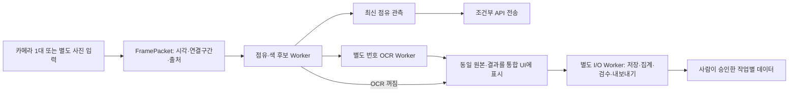

# V20 코드 심층 검수·수정 보고서

작성일: 2026-11-04. 비교 대상: 실제 배포 V19 → 수정 V20. 이 보고서는 사용자 요청에 따라 코드를 검사하고 재현된 문제를 수정한 결과다. 계획 문서에 있는 장기 목표와 지금 검증된 구현을 구분한다.

## 1. 이번 작업의 결론과 적용 범위

V19에는 단일 카메라 수집·칸별 후보·통합 검수·저장·내보내기 기반이 있었다. 그러나 파일 유실을 정상으로 처리하거나, 번호를 못 읽으면 색 후보도 사라지거나, OCR 대기 중 점유 전송이 늦어지는 문제가 확인됐다. V20은 이 데이터 신뢰성·처리 흐름의 결함을 수정했다.

카메라 한 대, A 직사각형 12칸, B 사선 16칸, 스티커 배경색 white/green/blue, D-39 운영 번호 24개라는 사용자 결정은 유지했다. B 카메라 작업을 추가하지 않았다. 실제 주차장에서 완성된 데이터셋이나 학습된 점유 모델을 새로 만들었다는 뜻은 아니다.

기존 V19 코드와 ZIP은 그대로 두고 별도 폴더에서 수정했다. `.venv`, 모델, 촬영 자료, 로그, 캐시는 배포에 복사하지 않았다. 최종 코드 시험은 **83개 통과, 실패·오류·건너뜀 0**이다.

## 2. 확인된 문제와 처리 결과

| 문제·재현 조건 | V19 영향 | V20 실제 조치 | 검증 근거 |

|---|---|---|---|

| 초록 스티커가 보이지만 OCR 후보가 없음 | 색도 unknown | 색·모양·인쇄 흔적 기반 독립 영역 탐색 | OCR 꺼짐/오류에도 green 유지 |

| 번호 라벨 승인, 숫자 박스 없음 | 승인 1개지만 번호 크롭 0개 | 승인 수와 작업별 크롭 가능 수 분리, skipped 사유 | 승인 1 / 가능 0 / 실제 번호 내보내기 0 |

| assets JSON 삭제 | 구형 자료처럼 정상 처리 | 필수 자산 표식, 누락/형식/중복 검사 | 유효 원본은 1, 부분 실패는 1 |

| 완료 predictions JSON 삭제 | 정상 수집으로 집계 | 예측 검증·유실 검사, 캐시 추적 | 일반 새로고침에서도 유실 검출 |

| UUID 기준 최근 정렬 | 실제 최신 촬영 순서와 다름 | 시간대 포함 timestamp 정렬 | UTC/한국 오프셋 비교 시험 |

| 예측 occupancy에 잘못된 문자열 | ID만 일치하면 통과 | enum·점수·영역·종류·번호·상태 검증 | 잘못된 예측은 원본 쓰기 전 거절 |

| 느린 OCR | 같은 작업의 점유 결과까지 대기 | 점유/색과 번호 OCR을 별도 Worker로 분리 | OCR을 의도적으로 막아도 다음 점유 결과 도착 |

| 정지·주차장 변경 뒤 대기 전송 | 이전 문맥의 이벤트가 나갈 수 있음 | 전송 세대 번호와 취소·재시도 차단 | 대기 삭제 및 재시도 중 취소 시험 |

| 녹화 영상 소스 | 실제 camera로 오인할 여지 | FramePacket.source_kind 전파 및 API 차단 | video/synthetic/import 모두 차단 |

| 현재 범위 선택 후 export | 전체 루트 자료가 섞임 | 두 내보내기에 lot/session 전달 | 다른 주차장/세션은 0개 |

| 예측 없이 같은 장면 재저장 | 스티커 자산 기록 소실 | 기존 유효 예측 재사용 | 스티커 수·원본 수 유지 |

| 같은 경로의 모델 교체 | 컴파일 캐시 유지 | 모델 및 IR BIN 수정 시각·크기 검사 | 모의 OpenVINO 재컴파일 확인 |

| 번호 분석 중 촬영 배치 변경 | 결과가 새 배치로 저장될 여지 | 장면 그룹 고정, 진행 중 새 배치 차단 | 표시 장면의 원래 batch/session 유지 |

| 밝은 바닥+어두운 차+흰 스티커 | 외곽 윤곽만 찾으면 내부 흰 영역 누락 | 내부 윤곽도 탐색하고 동일 후보 조건 적용 | 새 회귀시험 및 실제 CPU OCR 재시험 통과 |

| 손상 검수 JSON 재열기 | UI에서 잘못된 필드 사용 가능 | 작업 스레드에서 검수 행 검사 후 표시 | 잘못된 색 필드의 로드 거절 |

## 3. 처리 구조를 어떻게 바꿨는가

카메라 수신, 점유·색 후보, 번호 OCR, 파일 I/O, HTTP 전송이 분리된다. Tk 위젯은 메인 스레드에서만 다룬다. OCR 작업은 한 번에 하나만 진행하며, 완료 전 들어온 모든 프레임을 번호 분석 대기열에 쌓지 않는다. 저장 중이라는 이유만으로 다음 점유 분석을 막던 조건도 제거했다.

이 분리는 처리 의존 관계를 개선한 것이다. CPU/GPU 자원 경합은 여전히 가능하며, 실제 FPS·지연 감소를 현장에서 측정한 것은 아니다. I/O 작업끼리는 한 큐를 공유하므로 큰 내보내기나 첫 해시 대조가 다른 파일 작업을 늦출 수 있다. 영상 파일을 모든 프레임 저장하는 레코더도 아니다.

## 4. 같은 장면을 보장하는 방법

각 결과에 frame_id, captured_at_utc, stream_epoch, lot_id, context_key를 연결한다. context_key는 주차장·카메라·시리얼·크기·설치 pose·ROI로 계산한다. 저장과 전송 전에 이를 대조한다.

주차장 전환, ROI 수정, 위치 재확인, 카메라 설정, 분석 모드 변경, 정지, 새 촬영 배치는 결과 세대를 바꾼다. 이전 세대에서 늦게 완료된 결과는 표시하지 않는다. 표시 장면은 batch/session과 함께 고정한다. 배치를 새로 만들려면 정지 후 현재 분석·저장을 마쳐야 한다.

OCR 완료 장면이 최신 점유 프레임보다 과거인 경우, UI는 그 번호가 나온 원본과 시각을 함께 표시할 수 있다. 그러나 그 과거 번호 결과를 최신 점유를 덮는 서버 관측으로 보내지 않는다. UI에 보이는 시각과 서버에 보낸 최신 점유 시각이 다를 수 있다는 점은 사용 설명서에 명시했다.

## 5. 번호와 스티커색을 분리한 방식

독립 후보는 HSV 범위로 흰색·초록·파랑 영역을 찾고, 사각형 비율·면적·ROI 내부 여부와 어두운 인쇄 흔적을 검사한다. 최소 변 길이 10 px, 면적은 max(150 px², 칸 면적의 0.2%) 초과이면서 칸 면적의 25% 미만, 긴 변/짧은 변 비율 3 이하, 사각형 채움 비율 0.8 이상을 사용한다. 내부 어두운 픽셀 비율은 1.5% 초과 45% 미만이다. 이 값은 합성 회귀시험용 보수적 초기값이며 현장 최적값이 아니다.

조건을 만족한 영역이 정확히 하나일 때 색 후보를 남긴다. 균일한 초록 차체 조각처럼 인쇄 흔적이 없는 패치는 제외한다. 두 개 이상의 그럴듯한 스티커는 하나를 임의 선택하지 않는다. OCR이 성공하면 숫자 주변 색 영역을 추가로 확인하고 그 근거와 방법을 기록한다. 번호 실패가 독립적으로 얻은 색 후보를 지우지 않는다.

학습된 스티커 검출기를 구현한 것은 아니다. 큰 스티커, 곡면, 가림, 반사, 비슷한 차체 무늬는 보류나 오탐을 만들 수 있다. D-39 번호 배정만 보고 실제 보이지 않는 색을 채우지 않는다. 번호와 측정 색이 배정표와 다르면 확인 경고를 남긴다.

실제 CPU 시험 중 흰색 내부 영역 누락이 발견됐다. 밝은 바닥은 흰색 마스크의 큰 바깥 윤곽을 만들고 어두운 차체 속 흰 스티커는 그 안의 별도 영역이 된다. 외곽 윤곽만 조회하면 이 영역을 놓치므로 내부 윤곽도 포함하도록 두 색 영역 함수의 탐색 방식을 수정했다. 이후 같은 큰 흰 스티커 입력으로 점유·23·white가 함께 반환됐다.

## 6. 예측 계약 검사의 범위

`prediction_contract.py`는 저장된 예측과 작업 결과에 대해 다음을 검사한다.

- 지원하는 schema, 처리 단계, 분석 방식, 장면 및 연결 구간 일치.

- 등록한 칸 목록의 정확한 일치와 중복 방지.

- 점유/색 enum, 유한한 0~1 점수, 점수 종류, 유한한 처리 시간.

- 현재 주차장 번호 정책, 중복 번호, 번호가 있을 때 숫자 근거 박스.

- 색에 따른 차량 종류와 전용칸 비교 결과, 색을 주장할 때 근거 다각형.

- 빈칸에 번호·색·영역을 붙이지 않는 규칙.

- 자동 후보의 pending 상태, 문자열 목록·경계 후보 형식.

잘못된 예측은 새 원본을 쓰기 전에 거절한다. 저장된 예측 파일을 열 때도 검사한다. 이 검사는 데이터 구조와 내부 일관성 검사다. 모델의 예측이 실제로 맞는지 판단하는 정확도 평가를 대신하지 않는다. 사람이 직접 지정한 정답 영역은 기존 검수 검사에서 해당 칸과의 겹침도 확인한다.

## 7. 저장 실패와 유실을 어떻게 다루는가

원본·장면 메타데이터를 처음 쓸 때 `asset_schema: scene-assets-v1`과 `asset_status: pending`을 남긴다. 이후 크롭·예측·assets 목록 저장이 끝나면 complete 또는 partial로 바꾼다. 처음 메타데이터만 저장한 직후 중단돼도 다음 대조에서 필수 자산 기록이 없다는 것을 알 수 있다.

필수 assets JSON의 부재·손상·잘못된 ID·종류·중복 경로·중복 칸·누락 칸을 검사한다. 기록된 이미지 파일은 SHA-256으로 대조한다. 완료로 기록한 예측이 사라지거나 내부 내용이 잘못되면 오류에 추가한다. 예측 경로도 캐시 변경 감시 대상에 포함해 재시작 없이 유실을 발견한다.

크롭·예측·검수 파일에 문제가 있어도 원본 자체가 유효하면 원본 수는 유지한다. 손상 자료를 정상으로 보이지 않게 하면서 이미 촬영한 원본의 존재도 숨기지 않는 방식이다. 파일 오류가 나면 무조건 원본을 지우거나 과거 이력을 덮어쓰지 않는다.

기존 장면 재저장 때 새 예측을 주지 않으면 기존 유효 예측과 스티커 자산을 이어 쓴다. 기존 완료 예측이 유실됐다면 조용히 정상 재저장하지 않고 복구 또는 새 예측을 요구한다. 사용하지 않는 과거 크롭 파일은 자동 삭제하지 않으며 현재 자산 목록의 집계에서는 빠질 수 있다.

## 8. 집계 숫자와 내보내기의 관계

원본 수, 칸 크롭 파일 수, 스티커 후보 파일 수, 라벨 파일/행 수, 라벨 승인 수, 작업별 크롭 조건 충족 수는 서로 다른 값이다.

| 항목 | 집계 기준 |

|---|---|

| 점유 라벨 승인 | 칸 검수 상태가 approved이고 점유 확정 |

| 번호 라벨 승인 | 승인 칸에 유효한 display_number 존재 |

| 번호 크롭 가능 | 승인 번호 + 실제 정수 슬라이스가 비지 않는 숫자 박스 |

| 색 크롭 가능 | 승인 색 + 검증된 스티커 다각형 |

| 실제 export 개수 | 내보내기 때 다시 검증하고 쓴 작업별 이미지 수 |

예를 들어 한 칸의 점유·번호·색을 모두 승인하면 작업별 이미지가 최대 3개 나올 수 있다. 장면 1개나 칸 1개와 같은 단위가 아니다. 번호만 텍스트로 승인하고 박스를 지정하지 않으면 번호 승인 1, 번호 크롭 가능 0이며, 내보내기 manifest의 skipped에 사유가 남는다.

크롭 가능 수는 사전 조건 충족 수다. 저장 장치 오류나 동일 원본의 분할 누수가 있으면 내보내기는 실패할 수 있다. 최종 산출물은 manifest와 FAILED.json 여부를 확인해야 한다. 현재 주차장·세션 필터는 파일 목록과 두 가지 내보내기에 모두 적용된다.

## 9. 카메라·사진·녹화·합성 출처

FramePacket에 source_kind를 추가하고 저장 메타데이터까지 전달한다. RealSense는 camera, 파일 재생은 video, 가져온 사진은 import, 합성 데모는 synthetic이다. 사진/합성용 IMPORT 카메라 ID도 전송 차단 조건으로 유지한다.

실제 카메라 관측이라고 확인되지 않는 입력은 API로 보내지 않는다. video가 config의 camera 설정을 덮어쓰고 실제 저장 출처에도 남는 것을 시험했다. 파일 재생의 UTC는 재생 수신 시각이며 원래 촬영 시각이라고 주장하지 않는다.

## 10. 전송 취소와 서버 의미

EventSender는 취소 세대 번호를 갖는다. 정지·전환 시 번호를 올리고 대기 큐를 비운다. 이미 큐에서 꺼낸 작업도 요청 및 재시도 전에 같은 세대인지 확인한다. 종료 또는 오래된 세대이면 보내지 않는다. 최신 대기 장면 한 개 제한과 관측 유효 시간 검사를 유지한다.

취소 호출 순간 이미 네트워크에 나간 요청은 회수할 수 없다. 취소와 실제 네트워크 호출 사이에는 동시 실행 경계가 있으므로 서버 취소 기능이나 트랜잭션과 같은 보장을 주장하지 않는다. 실제 서버의 관측 시각 처리·중복 처리·상태 합의는 별도 통합시험이 필요하다.

HTTP 202는 접수만 의미한다. 차량 검출 박스와 검증된 통합 confidence가 없으므로 두 필드는 null이고, 팀 계약에서 이를 허용할 때만 송신하도록 기존 설정 조건을 유지했다. 번호가 없는 점유 관측은 car_id null일 수 있다. 실제 서버 상태·세션을 조회해 UI와 맞추는 기능은 아직 없다.

## 11. 모델 캐시와 효율의 실제 범위

같은 모델 경로라도 파일 크기나 수정 시각이 바뀌면 OpenVINO 연결부를 다시 컴파일한다. XML 모델의 BIN도 함께 확인한다. 이는 교체 감지이며 모델의 내용에 대한 암호학적 검증은 아니다. 크기와 수정 시각을 강제로 동일하게 유지한 교체까지 잡는다고 보장하지 않는다.

실제 학습 모델은 없다. 재컴파일 검증은 모의 OpenVINO 객체로 파일 교체 반응을 검사한 것이다. 모델 설정, 전처리, 클래스 순서, 실제 추론 정확도, GPU 가속 효과를 검증했다고 해석하면 안 된다. B안 모델 미등록 시 보류하는 동작은 유지했다.

## 12. 실행한 시험과 실패 기록

최종 `run_tests.py --report TEST_RESULTS_V20.json`: 83개 통과. 기존 V19 회귀 52개를 V20 코드에서 다시 실행했고 신규 31개를 추가했다. 기존 전송 시험 1개는 번호·종류만 임의로 주던 불일치 입력을 새 예측 계약에 맞는 색·숫자 박스·스티커 영역으로 수정했다. 전송 bbox/confidence를 만들어내지 않는 원래 단언은 유지했다.

첫 회귀 실행에서는 이 불일치 시험 1개가 거절됐고, 이후 수정된 입력으로 통과했다. 최종 로그의 손상 검수 파일 로드 오류는 의도적으로 잘못된 색 값을 넣은 음성 시험이며 해당 테스트는 정상적으로 통과했다. 초기 결과와 이전 코드의 시험 기록은 최종 성공 수에 더하지 않았다.

`main.py --check`도 통과했다. A12/B16/C12/D64 및 카메라 설정을 읽는 검사이며 장비 연결 시험이 아니다. Python 구문, JSON, 버전명, 배포 제외 항목, 파일 해시와 ZIP 대조는 별도 패키지 검사에 기록한다.

실제 EasyOCR CPU 시험은 로컬 기존 모델만 사용했다. 최초 샌드박스 실행은 Torch XPU DLL 접근에서 WinError 5가 났고, 승인된 로컬 CPU 실행으로 진행했다. GPU를 시험한 것은 아니다.

| 합성 입력 | 실제 결과 | 해석 |

|---|---|---|

| 작은 초록 스티커 23 | 점유 occupied, 색 green, OCR 원문 8 → 유효 번호 없음 | 번호 목표 실패를 기록. 번호 실패가 색·점유를 지우지 않음 |

| 큰 흰 스티커 23, 첫 시험 | 번호 23, 색 unknown | 내부 흰 윤곽 누락을 발견한 계기 |

| 같은 큰 흰 스티커, 윤곽 수정 후 | occupied / 23 / white, OCR score 약 0.868 | 파이프라인 연결 확인. 현장 정확도 아님 |

큰 흰 스티커 최종 시험의 로딩 포함 시간은 약 5.65초다. 스티커 크기와 색이 모두 달라진 두 입력이므로 번호 실패 원인을 크기 하나로 단정하지 않는다. 전체 정확도나 실시간 FPS를 이 두 사례에서 추정하지 않는다. 큰 흰색 23은 실제 D-39 배정과 불일치하는 시험 입력이며, 배정표와 실측 색이 다른 경우를 검수해야 한다.

## 13. 요구사항 중 남아 있는 것

| 남은 항목 | 현재 한계 | 필요한 다음 근거 |

|---|---|---|

| 실제 전칸 번호 가독성 | 합성 화면만 시험 | A/B 실물 원본, 거리·초점·반사 조건 |

| 정확한 점유 모델 | B안 연결부만 존재 | 학습 모델·전처리 설정·독립 시험셋 |

| 정확한 스티커 위치 | 색/모양 휴리스틱 후보 | 스티커 검출 정답과 현장 검출 평가 |

| 잘못된 위치의 차량 판정 | 배경 변화와 종류 불일치 의심 | 차량 영역/추적·기하·팀 판정 규칙 |

| 주차선 자동 인식 | 네 모서리 수동 등록 | 별도 선/칸 검출 모델 또는 보정 연구 |

| 항목별 독립 승인 | 한 칸에 공통 review_status | 점유/번호/색별 승인 계약을 별도로 설계 |

| 품질·커버리지 자동 대시보드 | 개별 지표와 수동 검수 | 칸×번호×색×조명×사례 커버리지 목표 |

| 평가셋 성능 보고서 | 단일 칸의 후보/정답 비교 | 혼동행렬·정확도·보류율·지연의 배치 평가 |

| Geti 가져오기 완료 | 범용 크롭과 manifest | 실제 설치판의 입력 형식·학습·추론 시험 |

| 서버 통합 결과 확정 | 선택 송신과 접수 상태만 표시 | 실제 API 계약·최종 세션 조회·통합시험 |

| 장시간 안정성 | 짧은 합성 회귀시험 | 디스크 부족·USB 재연결·수시간 수집 시험 |

이 항목들을 이번 수정으로 완성했다고 표시하지 않는다. 특히 ‘완벽한 품질’은 코드가 자동 인증하는 상태가 아니라 촬영 조건·육안 검수·독립 평가로 확인해야 하는 목표다. 현재 코드는 원본과 근거를 보존하고 잘못된 확정을 줄이는 도구다.

## 14. 현장에서 진행할 순서

1. V20을 별도 폴더에 풀고 기존 실행 환경을 연결한다. 기존 데이터 루트를 선택할 수 있으며 V19를 동시에 실행하지 않는다.

2. A12칸을 한 화면에 놓되 가장 멀리 있는 번호까지 원본에서 읽히는지 먼저 확인한다. B16 사선도 동일하게 별도 구도로 점검한다.

3. 실제 네 모서리 ROI, 전체 칸 수, 설치 위치를 확인한다. 빈 기준 A안 또는 준비된 B안 모델을 명시적으로 선택한다.

4. 빈칸·점유·가림·세 색상·전용칸 불일치·경계 차량을 각각 촬영한다. 경계 후보를 위반 확정 정답과 혼동하지 않는다.

5. 원본을 저장하고 재열어 같은 장면인지 확인한다. 사람 검수로 점유와 읽을 수 있는 번호·색을 입력하고 근거 영역을 지정한다.

6. 라벨 승인 수와 크롭 가능 수를 대조한다. 자산/예측 유실이나 손상은 오류 상세에서 먼저 해결한다.

7. 실제로 다른 배치에만 새 그룹을 부여한다. 현재 범위를 확인하고 내보낸 뒤 manifest의 samples/skipped/warnings와 FAILED.json 여부를 확인한다.

8. 독립 촬영 배치로 모델 성능과 보류율을 측정하고 팀·교수님께 코드 검증과 현장 성능을 나눠 보고한다.

## 15. 코드·배포·자료 호환성

주요 변경: dashboard.py, vision19.py, dataset19.py, prediction_contract.py, transport19.py, camera_hub.py, pipeline.py, review.py, main.py, demo.py, run_tests.py 및 테스트. `vision19.py` 같은 모듈명은 기존 import 호환을 위해 유지하며 실제 제품 버전은 V20이다.

정답 데이터 계약 `20261104-d39-v3`, camera_pose, 칸 배치, D-39 번호는 유지한다. 예측은 단계 분리에 맞춰 `prediction-v20-1`로 확장했고 V19 예측 읽기도 허용한다. 자산 pending 표식을 추가했다. 과거 원본과 검수 이력은 삭제하거나 자동 승인하지 않는다.

패키지에서 제외하는 항목은 가상환경, 모델, datasets, logs, __pycache__, .test_tmp, .demo_output 등 실행 산출물이다. ZIP의 SHA256SUMS.json과 워크스페이스 PACKAGE_CHECK_V20.json이 배포 파일 대조 근거다. V19 기준 소스 해시와 이전 ZIP 해시도 다시 확인한다.

## 16. 팀원·교수님께 설명할 내용

“한 대의 카메라로 직사각형 A 주차장과 사선 B 주차장을 각각 촬영합니다. 칸 모양은 주차장마다 네 모서리로 등록하고, 전체 칸의 점유·스티커 번호·스티커색 후보와 원본을 한 화면에서 확인합니다. 번호 처리가 늦어도 점유 처리가 같이 멈추지 않도록 분리했고, 번호를 못 읽어도 보이는 스티커색은 별도로 남깁니다. 저장 자료는 원본·크롭·예측·사람 정답을 나눠 보존하며 실제 파일과 해시로 검사합니다. 승인 숫자와 학습 가능한 크롭 숫자도 구분합니다. 현재 V20은 이런 수집·검수 흐름의 오류를 수정한 단계이고, 실제 주차 정확도·학습 모델·차량 위치 위반 판정은 실물 자료를 모아 별도로 검증할 계획입니다.”

