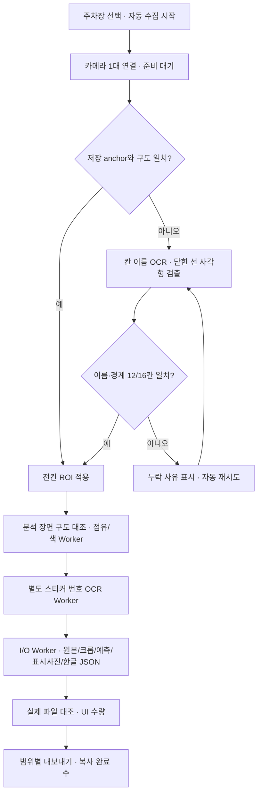

# V21 심층 분석·구현·검수 보고서

작성일 2026-11-04. 비교 기준은 배포된 V20이며 이번 기능·수정 작업을 V21 한 버전으로 묶었습니다. V20 폴더와 ZIP은 변경하지 않습니다. 제품 완성도와 시험으로 확인한 사실을 구분합니다.

## 1. 사용자의 방향성과 구현 기준

카메라 한 대로 A 직사각형 12칸, B 사선 16칸을 순서대로 촬영합니다. 다른 사람이 담당한 두 번째 카메라 작업은 포함하지 않습니다. 색은 스티커 배경색입니다. 화면에 모든 칸 위치·명칭·점유·번호·색·종류 불일치 의심을 모으고 파일 경로와 실제 누적/내보내기 개수를 함께 봅니다. 자동 등록과 저장을 연결하여 일일이 같은 버튼을 누르지 않도록 합니다.

사용자 요청은 자동 라벨을 생성하고 사진·JSON을 함께 수집하는 것입니다. 따라서 자동 후보를 저장/내보내는 데 사람 승인을 요구하지 않습니다. 다만 프로그램이 만든 값을 검증된 정답이라고 표시하지 않습니다. 자동 수집과 학습 정답 승인을 구분하여 사용자가 실패 여부와 품질을 판단할 수 있게 합니다.

## 2. V20에서 재현한 문제와 실제 수정

| 재현/요구 | 이전 문제 또는 미구현 | V21 변경 |

|---|---|---|

| 스티커 좌표 귀속 | 이웃 칸의 근거를 첫 칸 예측으로 수용 가능 | 선택 칸 포함과 타 칸 겹침 검사 |

| 재저장 연결 구간 | 같은 프레임/시각/ROI라도 epoch가 달라진 자료 수용 가능 | stream_epoch까지 일치해야 재저장 |

| 번호와 OCR 근거 | 직접 읽은 값과 다른 유효 번호를 저장 가능 | 원문·선택 근거·점수·박스·2개 전처리 합의 검증 |

| 원형 스티커 | 직사각형 채움 비율과 절대 어두움 임계값 편향 | 원형 지원, 배경 대비 인쇄 흔적, 같은 물체 윤곽 중복 제거 |

| 작은 초록23 | 8로 판독되어 보류 | 스티커 투시 보정·확대·여백·3개 처리 영상·명시적 회전 검사 |

| 회전 후보 선택 | 유효하지 않은 고점수 회전이 정답을 가림 | 스티커 회전별 유효 번호 검사, 칸 이름은 정방향/확대 대조 |

| 칸별 OCR 장애 | 한 칸 오류가 다른 칸 분석에 영향 | 칸별 오류 격리와 중복 번호 동시 보류 |

| 표시사진과 한글 JSON | 새 자동 수집 경로에 없음 | 매 장면 칸명별 PNG/JSON, 전체 PNG/JSON, 해시 묶음 기록 |

| 자동 칸 등록 | 수동 ROI·위치 확인 반복 | 주차선 사각형+칸 이름, 전칸 검사, 구도 anchor 재사용 |

| 자동 실행 | 여러 설정/저장 단계 필요 | 한 번 시작으로 연결→등록→판독→저장, 고급 버튼 접기 |

| 구도 변경 | 자동등록 후 움직임 시 잘못된 라벨 가능 | 매 자동 분석 장면 주차선/이름 특징 대조, 실패 시 세대 무효화/재등록 |

| 통합 내보내기 | 새 한글 사진/JSON 개수 없음 | 실제 복사 이미지·JSON·쌍·장면·제외 수와 경로 표시 |

| 정확도 확인 | 승인 자료와 예측 전체 평가 없음 | 범위별 점유/번호/색 평가·보류·커버리지·비교 제외 보고서 |

| 카메라 설정 전환 | 이전 결과가 새 입력과 혼재 가능 | 설정 전환 시 이전 결과/기준/전송 취소 |

V20 문제 재현은 `verification_v21/V20_REPRODUCTION.json`과 기존 소스/ZIP 해시를 기준으로 했습니다. 테스트를 다시 실행하거나 문서를 저장할 때마다 제품 번호를 올리지 않았습니다.

## 3. 처리 구조와 효율

카메라 수신, 빠른 점유/색, 느린 번호 OCR, 파일 처리, 선택적 HTTP 전송이 분리됩니다. Tk는 Worker의 결과 큐를 받아 갱신하며 Worker가 직접 화면을 수정하지 않습니다. 느린 OCR은 해당 원본 장면에 묶여 표시됩니다. 더 최신 점유 관측이 있으면 오래된 번호 결과를 최신 이벤트로 보내지 않습니다. 저장 중 수량은 늘리지 않고 완료 영수증과 실제 파일 대조 뒤 갱신합니다.

자동 모드에서 최초 OCR 등록 이후 anchor를 재사용하면 매 시작마다 전체 칸 이름을 다시 읽을 필요가 없습니다. 매 분석의 구도 대조는 ORB 특징/해시를 사용합니다. 특징이 부족하면 성공으로 우기지 않고 재등록합니다. 저장 간격 기본 2초는 최소 간격이며 OCR·I/O가 느리면 실제 간격이 더 길어집니다. 연속 장면의 유사 사진을 완전히 제거하는 중복 선별 알고리즘은 추가하지 않았습니다. 배치 그룹은 학습/검증/시험 누수 방지를 위해 사용합니다.

## 4. 자동 ROI 알고리즘과 경계

adaptive threshold(51,-7), Canny(40,130), 3×3/5×5 closing에서 윤곽을 찾고 둘레 0.025 비율의 다각형 근사를 합니다. 볼록 네 점, 전체 면적의 0.2~30%, 최소 변 길이25px, 변 길이 비율8 이하인 후보를 사용합니다. 이것은 선 검출 휴리스틱이며 학습된 주차칸 분할 모델은 아닙니다.

칸 이름은 A/B와 숫자만 허용하는 OCR로 원본, 필요하면 최대2배 확대에서 판독합니다. 같은 이름의 같은 위치는 중복 처리 영상으로 합치고, 같은 이름이 서로 다른 곳에 있거나 같은 위치가 서로 다른 이름이면 충돌로 보류합니다. 이름 박스의98% 이상이 사각형 내부이고 다른 이름이 함께 들어가지 않으며 박스 대비 칸 폭/높이가2.2배 이상이어야 합니다. 후보 중 작은 경계를 선택하고 칸 겹침/크기/도면 카탈로그를 검사합니다. 전칸 면적 차이가3배를 넘으면 보류합니다. 값은 현장에 맞춰 평가해야 하는 초기 기준입니다.

자동 ROI는 operator_confirmed=false로 저장합니다. `roi-registration-v2`의 ready/expected/detected/missing/errors/text_evidence가 필요하고, 각 이름의 박스와 소속 칸도 다시 검사합니다. 사람 승인을 위조하지 않습니다. 기존 수동 ROI의 operator_confirmed=true는 유지합니다.

anchor는 카메라 시리얼·크기·주차장·pose·ROI context key·원본 해시를 모두 대조합니다. 주차선 주변12px와 이름 주변에서 ORB 특징을 추출하여 Hamming ratio0.7, 최소20 대응점, RANSAC3px, inlier15개 이상/비율0.65 이상, 전체 영상 모서리 최대 이동 max(3px, 긴 변0.3%) 이하를 요구합니다. 실제 차량이나 손이 기준 영역을 가리면 보류될 수 있고, 반복 패턴의 잘못된 대응을 수학적으로 완전히 배제하는 방법은 아닙니다.

## 5. 번호·스티커색과 점유

스티커 후보는 색/형태와 인쇄 흔적에서 찾습니다. 원형과 사각형을 지원하되 임의의 모든 모양을 학습한 검출기는 아닙니다. 후보를 투시 보정하고 높이160px 목표/최대4배/최대1024px로 처리합니다. 원형 밖 차체 모서리를 정리하고 흰 여백을 둡니다. 원본색·정규화 명도·이진 영상에서0/90/180/270도를 독립적으로 확인합니다. 최소2개 처리 영상에서 같은 유효 D39 번호가 나와야 채택합니다. 유효 번호가 서로 다르면 보류합니다. OCR 점수는 모델 자체 점수이며 실제 정답 확률로 보정한 값이 아닙니다.

칸 전체 OCR은 스티커가 없을 때 탐색 위치 제안에만 사용하며 스티커 내부 재판독 없이 바닥 숫자를 차량번호로 승인하지 않습니다. 선택 박스는 원본 좌표로 되돌리고 스티커/칸과 귀속을 검사합니다. 동일 차량 번호가 여러 칸에 있으면 양쪽 번호를 지우고 보류 사유를 남깁니다. 번호 실패가 독립 색 후보나 기존 점유 정보를 지우지 않습니다.

자동 시작은 occupancy_model이 있으면 모델을, 없으면 sticker 방식을 선택합니다. 스티커 방식은 인쇄 흔적 후보가 있을 때만 occupied 후보를 주며 occupancy_score는 null입니다. 스티커가 없으면 unknown입니다. 빈 장면을 자동으로 빈 기준으로 잘못 등록하지 않습니다. 점유 모델/빈 기준 없이 완전한 빈칸 인식과 차량 외곽 기반 위반 확정까지 해결했다고 주장하지 않습니다.

## 6. 사진·한글 JSON 설계

원본, 무표시 칸 크롭, 무표시 스티커 크롭, 자동 예측은 보존합니다. 추가된 표시사진은 칸 테두리·명칭·점유·차량 번호·스티커색·스티커 영역·번호 박스를 그립니다. 하단에는 시각·출처·종류 비교·위치 검사 한계를 표시합니다. 저장 형태는 `collected/<주차장>/<칸명>/<칸명>__<UTC>__<ID>.png/.json`이며 서로 같은 stem을 사용합니다. 전체 장면도 별도 PNG/JSON으로 남깁니다.

한글 JSON은 번호를 정수, 좌표를 수치 배열, 점수를 숫자/null, 사람 검수를 boolean으로 기록합니다. 원본 좌표와 크롭 시작점을 명시합니다. 원본 해시, 표시사진 해시, 라벨 파일 경로로 추적합니다. 미확인 값을 채워 넣지 않고 품질주의·미확인 사유를 남깁니다. 기존 영어 기계 계약은 유지합니다.

자동 후보를 사람이 승인하면 한글 JSON/표시사진을 갱신합니다. 원래 예측과 승인 정답은 다른 파일에 남으며 정답 수정 이력도 보존합니다. 렌더링 실패로 이미 저장된 사람 정답을 없애지 않습니다. bundle을 partial로 남겨 손상된 표시자료를 내보내지 않도록 합니다. 과거 asset partial은 보수적으로 유지될 수 있으며 완전 복구는 해당 장면 재저장 후 확인합니다.

표시사진은 검토·발표용입니다. 표시된 정답 글자를 모델 입력에 넣으면 학습 누수가 생길 수 있으므로 학습은 무표시 원본/크롭을 사용합니다. `자동정보완성`은 빈칸 또는 번호/색이 있는 점유 후보라는 형식적 완성 여부이며 사람 정답과 동의하는 정도를 뜻하지 않습니다.

## 7. 저장·복사 무결성과 수량

원본 PNG를 배타적으로 생성하고 fsync 후 manifest를 기록합니다. 처음부터 asset/collection 상태를 pending으로 남겨 중단된 저장을 예전 형식으로 오인하지 않습니다. 새 파일은 임시 파일→replace 방식으로 게시합니다. 원본·칸 크롭·표시사진·JSON 각각 해시를 보관하고 필수 영수증과 완전한 짝을 검사합니다. 같은 장면 재저장은 시각/프레임/epoch/ROI/원본 픽셀이 모두 맞아야 합니다.

수량은 manifest가 참조하는 유효 자료를 대상으로 합니다. 유실된 JSON은 완전한 짝 수에 포함하지 않습니다. 원본이 정상이고 파생 파일이 잘못된 경우 원본 수는 유지하면서 partial 오류를 보여줍니다. 참조되지 않은 고아 파일을 데이터셋 수량으로 부풀리지 않습니다. 캐시에는 관련 파일의 mtime_ns와 크기가 포함되며 강제 대조로 재해시할 수 있습니다. UI의 파일 목록은 최신200개를 보여주지만 집계는 범위 전체를 대상으로 합니다.

자동 내보내기는 전체 장면의 원본과 bundle 파일을 모두 확인하고 복사합니다. 한 장면에서 하나라도 유실/손상되면 해당 장면을 제외하여 칸별 짝이 깨진 묶음을 정상 배포하지 않습니다. 디스크 복사 오류가 발생하면 실패 표시 후 성공 수량을 발표하지 않습니다. 원래 데이터는 이동/삭제하지 않습니다. 내보내기 자체는 실행 당시 로컬 상태의 스냅샷이며 여러 프로세스가 같은 루트를 동시에 수정하는 상황은 지원하지 않습니다.

## 8. 평가·커버리지 보고서

DatasetIndex와 승인 정답을 사용해 lot/session 범위별 보고서를 생성합니다. 점유/번호/색의 비교 수, 일치, 보류, 예측한 샘플 기준 일치율, 보류 포함 일치율, 예측 커버리지를 분리합니다. 예측 파일이 없거나 잘못되면 무조건 틀렸다고 섞지 않고 비교 제외 수/오류로 남깁니다. 승인 정답 자체가 없을 때는 지표가 null이며 UI에 평가 자료 없음이라고 표시합니다.

주차장/칸/번호/색/배치/출처의 수집량과 전칸 ROI 프레임/전칸 승인 프레임을 구분합니다. 전체 개수만으로 A/B와 모든 번호가 충분히 수집됐다고 판단하지 않습니다. OCR의 자체 점수나 복수 전처리 일치를 현장 정확도로 둔갑시키지 않습니다. 임의의 프레임을 서로 다른 train/test에 넣지 않고 batch 그룹을 유지합니다.

## 9. 실제 실행한 검증

### 9.1 소프트웨어 회귀

최종 회귀 **152개 통과**, 실패0·오류0·건너뜀0입니다. 기존 V19 52개, V20 31개, V21 인식/무결성/평가33개, V21 자동화/한글 저장36개입니다. 실제 실행 기록은 TEST_RESULTS_V21.json입니다. 파일 유실/디스크 오류/구도 이동 등 의도적으로 발생시킨 오류 로그는 해당 방어가 성공했는지 확인하는 시험입니다.

전칸 사선·직사각형, 이름 누락/중복/좌표 위조 거부, 동일 구도 재사용·이동 거부, 원형색/번호 근거/충돌 보류, epoch 재저장 차단, 한글 JSON 수치, 사진 원본 불변, 파일 쌍/해시/복사 수, 승인 후 사진 갱신, 내보내기 범위, 한 번 시작하여 등록→분석→저장→내보내기까지 진행하는 Tk 흐름을 검사했습니다. 카메라·OCR·HTTP는 이 회귀에서 모의 객체를 사용합니다.

### 9.2 실제 로컬 OCR

EasyOCR1.7.2, 로컬 Torch CPU, 기존 모델로 별도 검사했습니다. 다운로드·실제 카메라·실제 HTTP는 없었습니다. Torch DLL의 샌드박스 접근 문제는 허용된 로컬 실행에서 검사했습니다.

| 입력 | V20 기준 | V21 결과 | 해석 |

|---|---|---|---|

| 작은 초록23+빈칸 합성 | 차량 번호 실패 | 2/2칸 기대값 일치 | 기존 재현 실패 수정 |

| D39 원형 A12 합성 | 번호7/12 | 번호10/12 | 나머지 보류 |

| D39 원형 B12대+빈4칸 합성 | 번호9/12, 전체13/16 | 번호10/12, 전체14/16 | 나머지 보류 |

| D39 차량24대 합계 | 번호16/24 | 번호20/24, 색24/24 | 42·14·24·44는 보류, 이 입력에서 잘못 채택한 번호0 |

| 빈 기준을 둔 합성 A/B | 별도 기준 비교 | 점유28/28 | 알려진 합성 빈 기준에서만 확인 |

| 과거 실물 원형 파랑49 | 파랑 후보 실패 | 파랑, 번호null | 현행 D39 실물 정확도 검증이 아님 |

| 정방향 이름+닫힌 경계 A/B 합성 | 자동등록 기능 없음 | A12/12, B16/16 | 실제 OCR 사용, 실제 주차장 미검증 |

| 자동등록+초록23 각1대 합성 A/B | 새 기능 | 양쪽23/초록, 칸별28쌍 생성 | 스티커 없는26칸은 unknown 유지 |

AUTO_REAL_OCR.json의 등록 시간은 A 약4.47초, B 약6.32초였고 초기 모델 로딩은 별도입니다. OCR_VALIDATION_V21.json의 D39 A12/B16 처리 약6.75/6.31초는 해당 시험 조건의 한 번 측정이며 FPS 성능 보장이 아닙니다. 통합 저장·내보내기는 이미지32/데이터JSON30, 원본2, 쌍28을 확인했습니다. 결과 기록JSON1개는 별도입니다. 표시사진의 한글·영역·번호/색을 육안으로 확인했습니다. Tk 앱의 실제 화면 크기별 육안 검사는 하지 않았습니다.

초기 자동 칸 OCR은 회전 후보 선택 때문에 A7/B8칸, 확대 설정 변경 후 A7/B10칸만 남는 실패가 있었습니다. 정방향 원본·확대 대조로 수정한 뒤 A12/B16을 확인했습니다. 초기 실패를 숨기고 처음부터 완전했다고 표현하지 않습니다. 중간 실험은 verification_v21에 보존하고 최종 배포는 최종 기록을 담습니다.

## 10. 아직 완료되지 않은 범위

1. 사용자에게 현재 D39 실물 A/B 사진이 없다는 답변을 받았습니다. 실제 환경 정확도를 산출할 자료가 없습니다. 과거49 사진 하나를 현행 데이터처럼 사용하지 않았습니다.

2. 열린/끊긴 주차선과 이름 가림을 모두 복원하는 범용 학습 모델은 없습니다. 자동 등록 성공 조건과 재시도/수동 대안이 있습니다.

3. 학습된 점유 모델, 스티커 검출 학습 모델, 차량 마스크 기반 경계 위반 확정 모델을 제공한 것은 아닙니다. 스티커 없는 칸의 자동 빈칸 확정은 모델 없이 하지 않습니다.

4. 실제 RealSense, GPU, 현장 조명/가림, 장시간/디스크 가득참 실장비, Geti 설치판, 실제 서버는 미검증입니다. 모의 디스크 실패와 서버 취소 시험은 실장비 검증을 대신하지 않습니다.

5. 자동 후보를 별도 승인 없이 내보낼 수 있지만 사람 검수 학습 정답과 동일한 품질이라고 보장하지 않습니다. 항목별 독립 승인, 전 자동 라벨 오류 교정, 전체 과거 자료의 일괄 변환은 미구현입니다.

6. 전용칸 종류 불일치는 스티커색 기반 의심입니다. 실제 차량의 권한이나 법적 주차 위반을 판정하지 않습니다.

## 11. 배포·재현·호환

현재 폴더/창 제목/README/VALIDATION의 제품명은 V21, ZIP은 smart-parking-v21.zip입니다. V20에서 복사한 소스만 수정했고 환경·가중치·사용자 촬영 데이터·로그·캐시·임시 시험자료를 배포에 복제하지 않습니다. 이전 소스와 ZIP의 해시 대조, Python AST/JSON 구문, ZIP CRC/파일 해시는 PACKAGE_CHECK_V21.json에 기록합니다.

데이터 계약 D39와 pose는 그대로입니다. 기능 의미에 따라 prediction-v21-1, roi-registration-v2, korean-collection-v1, automatic-export-v1을 사용합니다. 예전 계약을 제품 번호 때문에 임의로 바꾸지 않았습니다. V21 자동 ROI와 예측은 구버전에서 수정하지 않습니다. 과거 문서는 history에 보존하고 현재 운용 기준은 START_HERE.md와 본 보고서입니다.

실행 예: `python run_tests.py --report TEST_RESULTS_V21.json`, `python main.py --check`. 소스 내 tests는 모의 입력 위주이며 실제 OCR 재현 스크립트는 작업 폴더 verification_v21의 ocr_verify.py, auto_real_ocr.py, collection_real_ocr.py에 있습니다. 실제 모델 경로는 환경에 맞춰 지정해야 합니다.

## 12. 팀원·교수님 설명용 연결 문장

“카메라 한 대로 모양이 다른 두 주차장을 촬영합니다. 처음에는 주차선과 칸에 적힌 이름을 함께 읽어서 어느 칸인지 등록합니다. 등록된 각 칸에서 차량 점유, 번호, 스티커 배경색을 분석하고 화면과 사진에 같은 결과를 표시합니다. 사진은 원본과 표시본을 나누고, 칸 이름별 폴더에 사진과 한글 JSON을 같은 이름으로 저장합니다. 수량은 실제 저장된 파일과 해시를 대조하여 표시하며, 내보내기 후 몇 장·몇 쌍이 복사됐는지도 한 화면에서 확인합니다. 불명확한 값은 억지로 정답으로 만들지 않고 사유와 함께 남겨 재촬영·검수 대상으로 사용합니다. 프로그램 자동화는 구현했고, 실제 인식 품질은 현장 사진과 점유 모델을 확보한 뒤 검증해야 합니다.”

