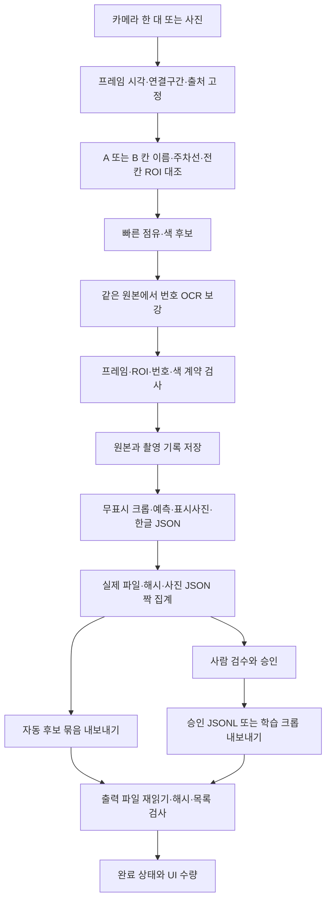

# V25 수집·저장·내보내기 전체 흐름 심층 점검

2026-11-05 한국. 기준 V24, 수정본 V25. 이 문서는 현재 구현과 검증 결과이며 이전 계획을 구현 완료로 간주하지 않습니다.

## 1. 방향성에 대한 결론

카메라 한 대로 A 직각12칸/B 사선16칸을 구분하고, ㄷ자 실제3면과 가상 입구로 칸을 등록하며, 번호·스티커 배경색·점유 후보와 표시사진/한글 JSON을 한 UI에서 수집하는 흐름은 목표에 맞습니다. 원본과 표시사진을 분리하고, 자동 후보를 사람이 승인한 정답과 구분하는 구조도 유지합니다.

하지만 **정확한 데이터만 완전 자동으로 선별하는 시스템이 완성된 것은 아닙니다.** 선명도/노출은 경고 지표이고 자동 탈락 기준이 아닙니다. 차량 외곽 모델이 없으므로 주차선 침범 확정 판정도 없습니다. 두 빈 보드 사진으로 실제 D39 차량번호·스티커색 정답률을 검증할 수 없습니다. 저장 파일의 완성과 인식 정답률은 별개입니다.

이번에는 최초 저장 중단, 재시도, 승인 JSONL 경로, 내보내기 마지막 기록과 출력 파일 검증에서 문제를 재현해 수정했습니다. 기존 버전/촬영 데이터는 보존하고 V25를 별도로 만듭니다.

## 2. 요구사항과 실제 구현 비교

| 요구 | 현재 코드 흐름 | 판정·남은 조건 |

|---|---|---|

| 카메라1대, 주차장2곳 | 단일 hub 입력, lot A/B와 ROI 분리 | 구현. 실제 장치 연결은 이번 미시험 |

| 모든 칸 동시에 확인 | A12/B16 카탈로그, 전칸 등록 확인, 전체 장면+칸 카드 | 구현. 이름/선이 가려지면 등록 보류 |

| 사선·직각의 ㄷ자 주차선 | open_boundaries의 실제3면+가상입구, 계산은 닫힌 다각형 | 구현. 제공 사진 28칸 좌표 유지 |

| 번호·스티커색 연결 | 같은 프레임/ROI에 OCR·색·번호 범위·중복 검사 | 후보 생성 구현, 실제 차량 정답률 미측정 |

| 점유·빈칸 | 학습 분류/빈기준 변화/스티커 근거 선택 | 조건부. 스티커 미검출만으로 빈칸 확정하지 않음 |

| 잘못된 주차 위치 | 전용칸 종류 비교, 배경변화 기반 경고 | 부분 구현. 차량 외곽 기반 위반 확정 모델 없음 |

| 고품질 자료만 자동 선정 | 품질 수치·경고, 정답 대조·사람 승인 | 부분 구현. 자동 품질 합격/탈락 및 실차 평가 필요 |

| 표시사진+한글·수치 JSON | 칸명 폴더/같은 stem, 전체 장면, 무표시 원본 별도 | 구현. 파일 짝·해시·원본 좌표 검사 |

| 저장/복사 수량 통합 | 유효 원본/칸/라벨/짝과 내보내기 결과 UI 표시 | 구현. 내부 JSON과 데이터 JSON 개수는 다름 |

| 학습 자료로 전달 | 승인 크롭, 승인 JSONL, 자동 후보 묶음 구분 | 구현. Geti 설치판 실제 가져오기 미시험 |

## 3. 코드 전체 흐름

| 계층 | 코드 | 핵심 확인 내용 |

|---|---|---|

| 진입·설정 | main.py, settings.py, run_windows.bat | 일반 실행 Dashboard, 기존 Python/모델 재사용, 설정 검사 |

| 입력·작업자 | dashboard.py, camera_hub.py, camera_tools.py | 입력 모드·세대 토큰·연결구간, 빠른 분석/번호/파일 작업 분리, 미저장 검수 보호 |

| 위치·기하 | automatic_setup.py, open_boundaries.py, layouts.py, static_markings.py | 이름과 3면 근거, 전칸 수, ROI 겹침, anchor 대조, 바닥 문자 제외 |

| 인식·품질 | vision19.py, analysis.py, sticker_ocr.py, intel_ocr.py, quality.py | 같은 프레임에서 점유/번호/색, 보류 상태, 번호 근거와 품질의 의미 |

| 계약·원본 | records.py, prediction_contract.py, contracts.py, pipeline.py | 촬영·ROI·출처·프레임 일치, 원본 픽셀/해시, 한글 JSON 원자 교체 |

| 수집·복구·수량 | dataset19.py, collection_output.py, saved_scenes.py | 최초 저장 ID, pending/partial/complete, 예측 유실 방어, 짝·수량·복구 |

| 승인·학습·전달 | review.py, export_images.py, export_integrity.py, multi_vehicle.py | 승인 조건, 범위/분할, 내보낸 상대 경로, 실제 출력 검사, 최종 상태 |

| 평가·운영전송 | dataset_audit.py, transport19.py | 정답 없는 정확도 미표시, 보류 포함 대조, 실제 카메라 출처 제한 |

main.py의 예전 2카메라 App와 --analyze-only는 보존된 보조 경로입니다. 현재 일반 실행과 수집 검수의 기준은 Dashboard입니다. 과거 이력 코드까지 새로운 UI 기능으로 간주하지 않았습니다. 이번 변경은 저장·내보내기 경계에 집중했고, OCR 모델·주차선 탐지 알고리즘·전송 서버 기능은 바꾸지 않았습니다.

## 4. 재현하고 수정한 문제

| 경로 | V24 문제·위험 | V25 수정 |

|---|---|---|

| 최초 저장 재시도 | 원본/manifest가 쓰인 뒤 실패하면 호출자가 사진ID를 받지 못해 같은 장면 원본을 추가 생성 | 프레임·구도·배치·세션으로 안정된 ID 예약, 같은 원본이면 이어 저장, 다른 픽셀이면 거부 |

| 기존 장면 재저장 | 같은 픽셀/시각이라도 packet의 카메라·시리얼·출처 변경을 모두 검사하지 않음 | 새 저장/재저장 모두 capture 검사, 기존 기록과 입력 출처 일치 검사 |

| 승인 JSONL 내보내기 | raw_path가 원래 데이터셋의 raw 경로를 유지해 내보낸 사진과 직접 연결되지 않음 | 내보낸 폴더 기준 상대 경로, 원래 경로는 source_raw_path로 보존, 관련 파일을 한 하위 폴더에 배치 |

| 내보내기 중단 | 파일 일부만 생긴 폴더에 지속되는 진행 상태가 없고 최종 기록 실패 일부는 FAILED도 없음 | 세 내보내기 모두 시작 전에 진행 중 상태, 검증 완료 후에만 완료 상태 기록 |

| 목적지 파일 검증 | 입력 해시를 확인해도 출력된 파일을 다시 읽어 확인하지 않음 | 출력 이미지·데이터·결과 기록을 다시 읽고 SHA256/목록 대조 후 완료 |

| 학습 자료 입력 손상 | JSON 배열이나 유실 manifest 한 건이 전체 내보내기를 중단 | 입력 검증 단계에서 해당 장면만 제외하고 사유 기록 |

| 학습 자료 출력 실패 | 이미지 출력 ValueError가 잘못된 입력으로 처리돼 제외 후 성공할 수 있음 | 장면 입력 준비와 파일 출력을 분리, 출력 실패는 내보내기 실패 |

### 4.1 같은 장면을 재시도할 때의 원본 중복

V24에서는 원본과 manifest를 만든 뒤 파생 자산 저장에 실패하면 UI가 image_id를 전달받지 못했습니다. 다시 저장하면 새 UUID와 원본이 생겼습니다. 원본만 쓴 직후의 중단도 같은 문제가 있었습니다.

V25는 카메라ID·시리얼·프레임번호·시각·연결구간·출처·ROI 문맥·배치·세션에서 사진ID를 결정합니다. 동일한 프레임 재시도는 기존 manifest를 이어 사용합니다. 원본만 남았다면 인코딩된 픽셀이 정확히 같은 경우에만 그 원본을 재사용하고, 다르면 덮어쓰지 않습니다. 새 프레임/배치/세션은 다른 촬영입니다. 전체 이미지 유사도 중복 제거가 아닙니다.

이 보장은 **같은 프레임과 촬영 문맥을 다시 제공하는 재시도**에 적용됩니다. 실제 프로세스가 종료되고 원본만 남아 metadata가 없으면 UI가 그 원본의 시각/구도를 자동 복원하지는 않습니다. 기존의 고아 원본 일괄 복구·삭제 기능도 추가하지 않았습니다. 한 저장 폴더에는 한 프로그램만 쓰는 조건입니다.

### 4.2 승인 JSONL의 사진 경로

V24는 사진을 별도 originals 폴더에 복사했으나 JSONL raw_path는 원래 데이터셋의 raw 경로였습니다. export 보고서의 매핑을 별도로 해석하지 않으면 다른 컴퓨터에서 경로가 끊겼습니다.

V25는 exports/reviewed-ID/ 안에 reviewed.jsonl, reviewed.frames.jsonl, reviewed.report.json, reviewed.images/와 상태 파일을 모읍니다. JSONL과 프레임 JSONL의 raw_path는 **이 폴더 기준** reviewed.images/originals/사진ID.png입니다. 원래 데이터셋 경로는 source_raw_path에 따로 둡니다. 기존 원본 manifest의 raw_path는 바꾸지 않습니다. 이 경로 의미/폴더 구성 변경은 외부 JSONL 소비 프로그램에 반영해야 합니다.

### 4.3 내보내기 완료 상태

자동 후보·승인 크롭·승인 JSONL 모두 ExportTransaction을 사용합니다. EXPORT_STATUS.json의 상태가 진행 중으로 먼저 기록됩니다. 입력 준비가 완료된 뒤 출력하고, 목적지 파일을 다시 읽어 해시와 파일 목록을 검사합니다. 결과 기록까지 검증해야 완료를 기록하고 함수가 정상 반환합니다. UI는 그 정상 반환 수량만 완료로 표시합니다.

일반 출력 오류는 실패 상태와 FAILED.json을 남깁니다. 디스크가 꽉 차 실패 기록도 쓸 수 없거나 강제 종료되면 진행 중 상태가 남을 수 있습니다. 이 폴더는 완료본이 아닙니다. 중단 지점이 최종 완료 기록 직후라면 이미 모든 파일 검증을 마친 완료본일 수 있으며, 시험에서도 해시를 대조했습니다. 원본 촬영 폴더는 내보내기가 변경하거나 삭제하지 않습니다.

완료 이후 USB 복사/동기화 과정의 새 손상까지 프로그램이 감시하지는 않습니다. 상태 파일에는 파일별 SHA256이 들어 있으므로 전달 후 대조할 수 있습니다. 이번에는 A/B 내보낸 폴더를 별도 경로에 복사해 모든 사진/JSON 참조와 해시를 다시 확인했습니다.

### 4.4 학습 자료에서 입력 오류와 출력 오류 분리

검수 JSON 배열, 없는 manifest, 잘못된 원본 같은 입력 문제는 해당 장면을 제외하고 manifest.skipped에 사유를 적습니다. 정상 장면은 계속 처리합니다. 모든 승인 칸의 입력/크롭 준비를 마친 뒤 파일을 씁니다. 출력 인코딩 오류, 짧거나 손상된 출력, 마지막 manifest 저장 실패는 입력 제외로 숨기지 않고 전체 내보내기를 실패 처리합니다. 반환 학습 샘플 수와 실제 정상 PNG 개수가 맞아야 합니다.

## 5. 데이터 구조와 수량 의미

- 원본: raw/카메라/사진ID.png. 글자·선·색을 덧그리지 않습니다.

- 촬영 연결: manifests/사진ID.json. 주차장·ROI·시각·프레임·배치·출처·원본 해시를 연결합니다.

- 무표시 칸: spaces/주차장/칸명/사진ID.png. 학습에 쓸 수 있는 원본 파생 자료입니다.

- 예측/사람 정답: predictions/사진ID.json과 reviews/사진ID.json. 자동 후보를 승인 정답으로 바꾸지 않습니다.

- 검토용 칸 사진/한글 JSON: collected/주차장/칸명/칸명__시각__사진ID.png 및 같은 stem.json.

- 전체 장면: scenes/주차장/주차장명__시각__사진ID.png 및 JSON.

- 저장 상태: assets와 bundles, manifest의 pending/partial/complete.

- 내보내기: exports/automatic-ID, training-ID, reviewed-ID. V25부터 각 폴더의 EXPORT_STATUS.json을 확인합니다.

| A/B 각1장의 자동 자료 | 개수 |

|---|---:|

| 칸별 사진/JSON 짝 | 28 |

| 이미지 | 32 = 칸28 + 전체장면2 + 원본2 |

| 데이터 JSON | 30 = 칸28 + 전체장면2 |

| 내보내기 결과 JSON | 1 |

| EXPORT_STATUS.json | 1 |

| 확장자 기준 실제 JSON / 전체 파일 | 32 / 64 |

UI의 데이터 JSON30은 보조 기록2개를 포함하지 않습니다. 수집 루트에는 manifest/예측/검수/자산 등 내부 JSON도 있으므로 루트 전체 확장자 개수와 UI의 유효 자료 수량은 다릅니다. 정보완성은 필요한 값이 채워졌다는 의미이며 정답률이 아닙니다. 불량 화질 자료도 수집 후보로 보존될 수 있습니다.

## 6. 실제 검증

| 검증 | 결과·범위 |

|---|---|

| 전체 회귀 | 246개: 기존231+신규15. 최종 실패0·오류0·건너뜀0 |

| 같은 신규 시험을 V24/V25에 적용 | V24는 하위 사례 포함 실패12·오류6, V25는15 메서드 통과. 18개 독립 버그라는 뜻 아님 |

| 최초 저장 중단 | 16개 쓰기 지점, 같은 프레임 재시도 후 원본1·칸2쌍·partial0 |

| 재저장/검수 중단 | 16+12=28지점, 원본 보존·불완전 내보내기 차단·복구 |

| 내보내기 중단 | 자동10·학습6·승인JSONL7=23지점, 진행/완료 구별과 재내보내기 |

| 합계 중단 시험 | 67지점. SystemExit 주입이며 물리 정전·클라우드 동시쓰기 시험 아님 |

| 제공한 실물 빈 보드 | A12/B16 ㄷ자 좌표 V24와 같음, 추론오류0, 28쌍 저장·내보내기 |

| OCR 범위 | V23 실제 CPU 관측35회 재사용, 이번 신규 모델 OCR 호출0 |

| 폴더 전달 검사 | 별도 경로로 복사한 자동 묶음, 28쌍/원본 참조·해시·파일명 일치 |

| 기존 자료 호환 | V21 합성171+V23사진169+V24사진169=509파일 읽기·해시 불변 |

| 배포 검사 | V24 소스166파일/ZIP 보존, 전체 Python AST·JSON 파싱, ZIP CRC·파일 해시 |

최초 전체 시험에서는 새 EXPORT_STATUS.json이 추가돼 예전 파일수 기대값 한 개가 실패했습니다. 데이터 JSON 수는 그대로이며 실제 JSON 수가 보조 상태 파일1개만큼 증가한 것이므로 해당 시험을 데이터/결과/상태 파일 수로 구분해 갱신한 뒤 전체를 재실행했습니다. 로그는 verification_v25/tests.log와 tests_final.log에 보존합니다.

## 7. 기존 데이터 사용과 한계

V24 코드/ZIP, 사용자 사진, 기존 수집 자료는 보존합니다. 새 버전 폴더에 .venv·모델·촬영 데이터·로그·시험 임시 폴더를 복제하지 않습니다. V25 실행 후 저장 폴더 선택으로 기존 데이터 루트를 지정하면 정상 자료를 계속 읽고 복구·내보내기할 수 있습니다. 기존 사진ID·D39 계약·prediction schema·ROI v2/v3·collection-v2·설치pose는 변경하지 않았습니다. 새 촬영 ID 생성법과 내보내기 디렉터리/상태 파일만 실제 변경 사항입니다.

이번 작업은 실제 카메라, 차량+D39 사진 정답률, GPU/학습 점유 모델, 실서버/Geti, 실제 창 클릭/DPI, 장시간 운전, 물리정전·OneDrive 경쟁을 검증하지 않았습니다. 숨긴 Tk·모의 장치/서버 시험은 포함합니다. 차량 윤곽 기반 위반 판정, 실차 조건별 검증과 품질 합격 정책은 아직 별도 작업입니다.

## 8. 실행·확인 순서

1. V25를 새 폴더에 풀고 run_windows.bat 실행. 기존 데이터는 저장 폴더 선택으로 연결합니다.

2. A 또는 B를 선택하고 사진 자동 등록·수집 또는 카메라 자동 수집을 시작합니다. 모든 칸이 등록되지 않으면 후보 자료를 억지로 확정하지 않습니다.

3. 파일 대조/새로고침에서 오류·짝·정보완성·미확인을 확인합니다. 파일 문제는 선택 장면 저장 복구를 사용하되 유실된 예측은 원래 근거를 복원해야 합니다.

4. 자동 후보 묶음 또는 승인 자료를 목적에 맞게 내보냅니다. UI 완료 수량과 출력 폴더의 EXPORT_STATUS.json=완료를 확인합니다.

5. reviewed-ID를 전달할 때 JSONL만 떼지 않고 그 폴더 전체를 전달합니다. 표시사진은 검토용이며 학습에는 무표시 원본/크롭을 사용합니다.

