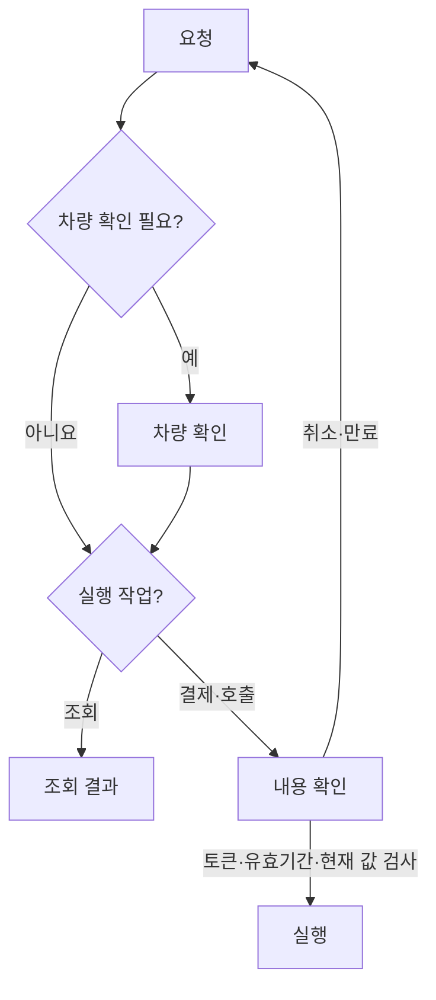

> 이력 문서: 아래의 대기·문의 상태 변경·독립 이용 현황 기능은 2026-11-02 보완본에서 삭제됨. 현재 기준은 `implementation_guidelines.md`와 `cleanup_and_supplement_report.md`입니다.

> 이전 단계의 기록입니다. 현재 동작과 검증 수치는 [안정화 수정 보고서](stability_fix_report.md)를 우선 확인하세요.

> 후속 UX 개선이 적용되었습니다. 관리자 호출은 즉시 실행합니다. 최신 동작과 검사 결과는 [UX 가이드](ux_implementation_guide.md)를 확인하세요.

# 구조 개선 결과 — 2026-11-01

## 개선 목적과 관찰 근거

1차 수정본에서 다음 상황을 재현했습니다.

| 재현 | 문제 | 이번 처리 |
|---|---|---|
| `결제했어?`, `결제 취소` | 결제 실행으로 분류 | 상태 조회/진행 중 요청 취소로 분리 |
| 차량 확인에 `네` 응답 | 바로 결제 실행 | 금액을 제시하고 별도 작업 확인 |
| 요청 중 응답 유실 후 재전송 | 결과 확인과 중복 작업을 구별하지 못함 | 같은 request_id에는 저장된 응답 반환 |
| 빈자리 알림 응답 유실 | 전달 표시가 먼저 되어 재수신 불가 | 수신 커서 확인 전까지 같은 event_id로 재전송 |
| 체크리스트 요청 재전송 | 완료 표시가 다시 취소됨 | checked 최종 상태를 지정하는 방식 |
| 두 관리자가 메모 수정 | 나중 요청이 먼저 저장한 메모를 덮어씀 | 보고서 revision 비교 후 충돌 반환 |
| 메모 저장 후 별도 확정 요청 | 중간 실패 시 상태 불일치 | 메모와 확정을 같은 잠금 안에서 처리 |
| 백엔드 경보 버전이 재시작 후 감소 | 보고서가 다음 변경을 무시 | 외부 버전과 앱 내부 버전을 분리 |

## 대화와 작업 실행

`state.py`에 명시적인 네 상태를 두었습니다: idle, ask_vehicle, confirm_vehicle, confirm_action.
확인 대상에는 작업 종류, 차량, 금액/입차 기록, 일회성 토큰, 120초 유효기간을 함께 저장합니다.
다른 기능 요청·취소·시간 만료 시 이전 작업을 정리합니다. 이전 질문의 버튼은 최신 작업을 실행할 수 없습니다.
금액이나 입차 기록이 바뀌면 새 금액을 제시하고 다시 확인합니다.

결제는 같은 입차 기록과 금액에 대해 안정적인 작업 키를 전달합니다. 프로세스 내에서는 결제 실행을 직렬화하고,
결과가 불확실한 입차 건은 다른 세션에서도 추가 실행을 중지합니다. 백엔드는 이 키의 중복 방지와
금액/입차 기록 검사를 트랜잭션으로 구현해야 합니다. 실제 결제는 현재 모의 결제 API 범위입니다.

## 알림과 대기열

`notifications.py`는 세션별 순번 큐입니다. 클라이언트가 화면 반영을 마친 cursor를 다음 요청에 보내며,
수신 확인 전에는 같은 이벤트를 다시 받을 수 있습니다. 화면은 event_id로 중복 표시를 제거합니다.
일반 대화와 폴링의 화면 반영 순서도 직렬화했습니다.

`waitlist.py`는 등록·알림 배정·취소·만료 상태를 관리합니다. 등록 유효기간은 30분,
알림 배정은 60초입니다. 오래 화면을 닫아 둔 사용자가 이후 대기자의 알림을 영구적으로 막지 않습니다.
알림 배정은 **실제 자리 예약이 아닙니다**. 같은 빈자리가 계속 남아 있으면 유효기간 뒤 다음 대기자에게 안내할 수 있습니다.
주차장별 순번, 대기 상태 조회, 알림 취소를 지원합니다.

큐는 최대 100건/세션이며 유효기간 만료·상한 초과가 있으면 재조회 필요 상태를 반환합니다.
프로세스 재시작·전체 초기화는 runtime_id로 구분하여 이전 화면의 작업이 새 상태에 실행되지 않도록 했습니다.
보고서 안내 인원은 생성 건수 대신 **수신 확인한 세션 수**로 집계합니다.

## 외부 데이터와 관리자 편집

- `contracts.py`: 빈자리 범위, 요금·결제 상태, 차량/경보 필드, 시간대 포함 시각을 검사합니다.
- 30초를 초과한 데이터/장애 시 캐시를 정상 최신 상태로 사용하지 않습니다. 결제 준비에는 stale 데이터를 허용하지 않습니다.
- 차량 목록 조회 실패는 영향 차량 0대가 아니라 영향 범위 미확인으로 기록합니다.
- `api_paths.json`에서 경로를 바꾸고 BACKEND_TOKEN으로 Bearer 인증을 설정합니다.
- `http_api.py`에서 두 서버의 관리자 변경 계약을 공유합니다.
- 체크 항목은 상태 지정, 메모는 revision 비교, 확정은 메모와 함께 한 번의 변경으로 처리합니다.
- 충돌 시 미저장 메모를 유지하고 최신 보고서를 다시 불러올 수 있습니다.
- 세션은 유휴 만료와 200개 상한, 대화 이력은 세션당 100건, 통계 로그는 2,000건 상한을 적용했습니다.

## 실제 실행한 검증

- 기존 질문 CSV 36/36 통과.
- Python 테스트 74/74 통과: 상태·결제·알림·보고서·입력 검증·FastAPI·실제 로컬 HTTP 연결층 포함.
- Chromium 실제 브라우저 검사 12항목 통과: 모바일 가로 넘침, 입력 보존, IME Enter,
  경보 수신, 메모 확정, 저장 실패 보존, 초기화, 결제 전 금액 확인,
  결제 응답 유실 후 동일 요청 복구, 알림 응답 유실 후 중복 없는 수신,
  관리자 수정 충돌 시 서버 메모/로컬 초안 보존, 브라우저 실행 오류 없음.

테스트는 모의 데이터와 로컬 테스트 서버 기준입니다. 팀 실서버·LLM 실호출·카메라/차단기 장치 연동은
명세와 장치가 제공된 뒤 별도 통합 검사를 합니다.

## 기능을 더할 때의 경계

새 조회 기능은 parser/chips에 의도를 추가하고 engine의 처리 함수에 연결합니다.
새 실행 기능은 confirm_action을 거쳐 현재 값 재검사와 실행 함수를 연결합니다.
외부 응답 검증은 contracts, 알림은 notifications, 대기 정책은 waitlist에 둡니다.
DB 저장은 이들 모듈의 저장소 경계에 추가할 수 있습니다.

현재는 단일 프로세스 메모리 모델입니다. 재시작을 넘어선 알림/보고서 보존과 중복 방지에는 팀 DB의
저장·트랜잭션 연결이 필요합니다. 활성 경보 위치는 기존처럼 한 곳이며, 여러 경보의 동시 표현은 아직 구현하지 않았습니다.
본 코드에는 실제 환불, 실제 차단기 제어, 외부 메시지 발송 기능이 없습니다.

## 설계 참고 자료

공식 자료의 원칙을 현재 모델에 적용한 설계 판단입니다. 특정 라이브러리나 클라우드 제품을 도입했다는 의미는 아닙니다.

- [Stately: 상태 전이](https://stately.ai/docs/transitions), [실행 조건](https://stately.ai/docs/guards)
- [Stripe: 동일 요청의 재전송과 응답 저장](https://docs.stripe.com/api/idempotent_requests)
- [AWS: 변경 작업의 멱등성 및 하위 서비스로 키 전달](https://docs.aws.amazon.com/wellarchitected/latest/framework/rel_prevent_interaction_failure_idempotent.html)
- [AWS: 메시지 중복과 소비자 중복 방지](https://docs.aws.amazon.com/en_en/prescriptive-guidance/latest/cloud-design-patterns/transactional-outbox.html)
- [Microsoft: 캐시 유효기간과 일관성](https://learn.microsoft.com/en-us/azure/architecture/patterns/cache-aside)
- [MDN: 수정 버전 비교로 덮어쓰기 방지](https://developer.mozilla.org/en-US/docs/Web/HTTP/Reference/Headers/If-Match)

이 구현은 메모리 수신 확인 큐이며, DB 트랜잭션과 원자적으로 묶인 영속 transactional outbox 구현은 아닙니다.
보고서 수정은 HTTP ETag 대신 요청 본문의 expected_revision을 비교합니다.
