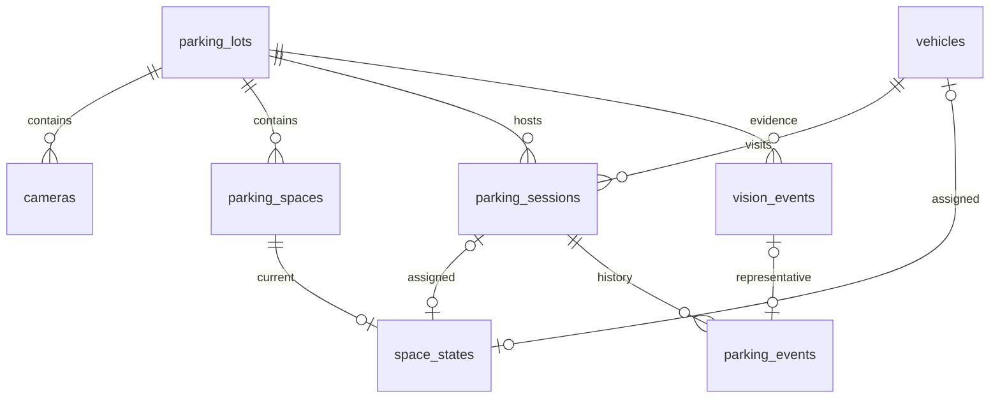

# KAN-17 — PostgreSQL 기반 백엔드 DB 통합 설계안

작성일: 2026-11-02(Asia/Seoul). 상태: **검토용 제안, 팀 승인 전, 구현·DB 적용 전**.
Jira: [KAN-17](https://rgq548.atlassian.net/browse/KAN-17), 상위 업무 KAN-7.

## 1. 기준과 범위

| 구분 | 확인한 기준 |
| --- | --- |
| 개인 원본 | huks13/ParkFlow의 로컬 HEAD·실제 원격 main: 0d4ff4a021b87497826080040b729daa8520f1bb |
| 팀 원본 | 최신 조회 origin/main: 85839e8fdadd8a0cf7340cf3da39b4895d175d65 |
| 이번 브랜치 | 팀 최신 origin/main에서 생성한 feature/KAN-17-db-integration-plan |
| KAN-16 보존 | feature/KAN-16-mock-query-api의 c40025cfc019d499d91879ab74d32776b0c5a6a3 유지. 이번 브랜치에 병합하지 않음 |
| 개인 변경 보존 | PROGRESS.md·backend/app/main.py의 기존 미커밋 변경 보존. 모델·0001 변경 없음 |
| 이번 변경 | 이 문서 1개만 작성. 기존 팀 파일·코드·설정·의존성 변경 없음 |

PostgreSQL은 **우선 제안이며 팀 공식 선택은 미확정**이다. 팀 백엔드 지침에는 SQLite + SQLAlchemy 기본안이 있다. 개인 PostgreSQL 선택을 팀 승인으로 간주하지 않는다.

기준 문서는 CLAUDE.md에 따라 통합 지침서 → API 계약 원문 → 스킬·에이전트 요약을 대조한다. 팀 원문은 최소 필드 초안이며 상세 PK·FK·자료형 대부분을 확정하지 않았다.

- [팀 통합 지침서](https://github.com/intel7-smart-parking-ai/smart-parking-ai/blob/85839e8fdadd8a0cf7340cf3da39b4895d175d65/docs/통합_개발운영지침서.md) §5~6
- [팀 API 계약](https://github.com/intel7-smart-parking-ai/smart-parking-ai/blob/85839e8fdadd8a0cf7340cf3da39b4895d175d65/docs/API_CONTRACT.md)
- [api-contract 스킬](../.claude/skills/api-contract/SKILL.md), [백엔드 지침](../.claude/agents/backend-engineer.md)
- [개인 8개 모델](https://github.com/huks13/ParkFlow/blob/0d4ff4a021b87497826080040b729daa8520f1bb/backend/app/models.py)
- [개인 초기 0001](https://github.com/huks13/ParkFlow/blob/0d4ff4a021b87497826080040b729daa8520f1bb/alembic/versions/0001_initial_parking_schema.py)
- 개인 db.py, migration_guard.py, alembic/env.py, test_models.py, test_database.py, test_migration_guard.py, schema_support.py 및 DB_IMPLEMENTATION/DB_APPLICATION_RESULT 문서도 대조했다.

최초 작성 단계에서는 문서 작성만 수행했다. 이번 공유 단계는 사용자 승인에 따라 이 문서만 Commit·Push하고 main 대상 설계 검토용 PR을 생성하며 개인 Notion에 실제 상태를 기록한다. 설계 승인·main 병합·DB 구현을 뜻하지 않는다.

계속 제외: 요금 계산·결제·매출, rate_policies/mock_payments 구현, KAN-28 코드 수정·병합, 실제 DB 접속·생성·변경, migration 실행, 개인 0001 수정, 팀 main 직접 Push·PR 병합·Jira 변경.

범위 갱신(2026-11-02 사용자 지시): 이전에는 C 필수·D 선택 확장으로 기록했으나 이번 새 설계 범위에는 **가상 C/D 두 주차장**을 포함한다. 실제 주차 면수·도면·배정은 모두 미확정이다. 기존 팀 원문의 D 선택 표기는 보존하고 PM 검토 사항으로 남긴다. 이는 D 구현·시드 생성 완료를 뜻하지 않는다.

## 2. 기존 8개와 팀 10개 대응

공통 이름 6개, 개인 추가 2개, 팀 초안에만 있는 4개다. 모두 합치면 12개지만 표 개수를 목표로 추가하지 않는다. 이번 재사용 후보는 기존 8개이며 신규 모델 구현은 0개다.

PK는 행의 이름표, FK는 다른 표의 행과 연결하는 키다. 복합 키는 여러 값을 함께 사용한다. 아래 `?`는 NULL 허용이다.

| 모델·테이블 | 개인 PK·FK | 개인 컬럼·자료형 | 팀 대응 및 제안 |
| --- | --- | --- | --- |
| ParkingLot / parking_lots | PK lot_id | lot_id varchar(16), name varchar(100), type varchar(8), active boolean, created_at timestamptz | 기본 필드 일치. real/virtual 제약·생성 시각 유지 |
| Camera / cameras | PK camera_id, FK lot_id, UNIQUE(camera_id,lot_id) | camera_id varchar(32), lot_id varchar(16), source_ref varchar(100)?, last_seen_at timestamptz?, status varchar(16) | source_ref와 팀 source_config의 의미·명칭 협의. 비밀 없는 설정 별칭을 인증 포함 URL로 확대하지 않음 |
| ParkingSpace / parking_spaces | PK(lot_id,space_id), FK lot_id | space_id varchar(32), roi_polygon JSONB?, roi_version integer, enabled boolean | 팀 roi_polygon_json과 대응. 좌표 형식·버전·소유권을 우지원과 합의 |
| Vehicle / vehicles | PK vehicle_id UUID, UNIQUE car_id | car_id varchar(32), active boolean, created_at timestamptz | 팀 최소 목록에는 없음. 내부 UUID와 외부 번호를 분리하는 구조로 유지 제안 |
| ParkingSession / parking_sessions | PK session_id UUID, FK lot_id/vehicle_id | entry_at timestamptz, exit_at timestamptz?, status varchar(16), created_at timestamptz | 팀 car_id는 vehicles 연결로 제공. 내부 vehicle_id와 세션 UUID 유지 제안 |
| SpaceState / space_states | PK/FK(lot_id,space_id), FK vehicle_id, 복합 세션 FK 2개 | status varchar(16), vehicle_id/session_id UUID?, observed_at/confirmed_at timestamptz?, updated_at timestamptz, version bigint, confidence double? | 팀 car_id는 차량 연결로 제공. 세션·확정 시각·버전 추가 유지 제안 |
| VisionEvent / vision_events | PK event_id varchar(100), FK lot_id/vehicle_id, 복합 camera/space FK | camera_id/space_id?, model_type varchar(16), event_type varchar(40), source varchar(16), observed_at/received_at timestamptz, confidence double?, payload JSONB, payload_hash char(64), processing_status varchar(16), reason_code varchar(40)?, applied_at timestamptz? | 팀 car_id는 식별된 차량 연결과 payload로 대응. bbox/frame_id/track_id/모델 버전은 payload 보관 제안. 독립 검색 컬럼은 요구 확인 후 |
| ParkingEvent / parking_events | PK parking_event_id UUID, 복합 session/space FK, vision_event_id FK UNIQUE, request_id UNIQUE | session_id UUID, lot_id varchar(16), event_type varchar(16), from/to_space_id varchar(32)?, occurred_at timestamptz, vision_event_id/request_id varchar(100)?, request_hash char(64)?, response_snapshot JSONB?, actor_ref varchar(100)?, reason text? | 팀 최소 목록에는 없음. 확정 입출차·이동·정정 이력으로 유지. 범용 audit_logs 대체 아님 |
| rate_policies | 개인 없음 | 팀: policy_id, lot_id, effective_at, base_fee, unit_minutes, extra_fee, daily_cap | 윤명수와 별도 협의. 이번 구현 제외 |
| mock_payments | 개인 없음 | 팀: payment_id, session_id, amount_krw, status, idempotency_key, created_at | KAN-28과 연결 규격만 협의. 코드 수정·병합·모델 구현 제외 |
| alerts | 개인 없음 | 팀: alert_id, lot_id, space_id, type, status, detected_at, acknowledged_at | 후속 LED 모의 경보 범위로 보류 |
| audit_logs | 개인 없음 | 팀: log_id, actor, action, target, created_at | 후속 감사 범위로 보류. parking_events와 책임 구분 |

개인 모델과 0001은 같은 8개 표와 핵심 제약을 정의한다. 이번에는 소스만 대조했으며 실제 DB·metadata 일치를 새로 검증한 것은 아니다.

## 3. PK·FK와 유지할 무결성

그림은 주요 관계만 표시한다. 실제 복합 조건은 다음과 같다.

| 연결 | 유지 제안 |
| --- | --- |
| state→space | (lot_id,space_id)를 함께 참조 |
| state→session | (session_id,lot_id), (session_id,lot_id,vehicle_id)를 참조하여 주차장·차량 일치 |
| event→session/space | (session_id,lot_id), (lot_id,from_space_id/to_space_id)로 소속 일치 |
| vision→camera/space | (camera_id,lot_id), (lot_id,space_id)로 소속 일치 |

기존 FK의 ondelete/onupdate=RESTRICT와 읽기용 viewonly relationship을 유지하는 안이다. 저장은 FK 값을 명시하고 부모 삭제에 따른 이력 연쇄 삭제를 추가하지 않는다.

- 차량당 active 세션 최대 1개. 종료 후 재방문은 새 session_id다.
- NULL이 아닌 차량·세션의 현재 칸 배정은 각각 최대 1개. uncertain/unavailable에서도 배정을 보호한다.
- empty이면 차량·세션 참조 모두 NULL. session_id가 있으면 vehicle_id 필수다.
- occupied이면서 두 ID가 NULL인 미식별 점유는 허용한다. confidence는 NULL 또는 0~1이다.
- active는 exit_at=NULL, closed는 exit_at 필수이며 entry_at 이상이다.
- 세션당 entry/exit 이력 각각 최대 1개. move는 양쪽 칸 필수이며 서로 달라야 한다.
- event_id/request_id 유일성과 해시·응답 보존으로 중복 적용을 막는 구조를 재사용한다.

**서비스 책임:** 같은 칸 UPDATE 덮어쓰기 방지, 참조 세션의 active 여부, source와 lot.type 일치, 대표 증거와 확정 이력의 lot 일치, 필수 상태·이력 행 생성, 관측 시각 순서, 해시 계산·최초 응답 재현은 FK만으로 해결되지 않는다.

## 4. A/B/C/D 및 식별자 규격안

| 항목 | 제안과 미확정 사항 |
| --- | --- |
| lot_id | A/B=real, C/D=virtual 두 가상 주차장을 새 설계 범위에 포함. 면수·도면 배정 미확정, C/D 실제 데이터는 지금 만들지 않음. 기존 DB는 A~D 고정 CHECK 없이 문자열 저장 |
| 주차칸 수 | 실측 전 확정하지 않음. KAN-16 각 4칸은 합성 예시이며 실제 DB 시드로 자동 전환하지 않음 |
| camera_id/source | A/B는 camera_a/camera_b와 vision, 가상은 NULL과 simulation. 가상용 가짜 카메라 행을 만들지 않음 |
| space_id | A-01 형식 문자열, PK(lot_id,space_id). 기존 시험의 1/2 예시는 승인 후 팀 ID 사례로 보완 |
| car_id | 외부 번호는 01~24 문자열, 정수 변환 금지. OCR 실패는 null, 가짜 번호 생성 금지 |
| vehicle_id | 내부 UUID. vehicles.car_id는 UNIQUE. 조회 시 JOIN으로 외부 car_id 제공 제안 |
| session_id | 내부 UUID, API에는 UUID 문자열. 칸 이동 중 동일 세션·입차 시각 유지. 현행 모델은 식별된 차량 참조 필수 |
| event_id/request_id | 기존 varchar(100) 유지 제안. 생산자·실행 구분 및 재송신 키 재사용 규칙 합의. UUID로 임의 고정하지 않음 |

C/D의 01을 A/B 또는 서로 다른 차량으로 동시에 사용하면 전역 car_id UNIQUE와 활성 세션 제약에 충돌한다. 우선 검토안은 01~24를 전역 중복 없이 배분하거나 동일 차량의 시나리오를 시간상 분리하는 것이다. 가상 전용 접두어나 namespace는 API 변경 승인이 필요하다. 기존 fixture의 SIM-C-01을 공식 ID로 승격하지 않는다.

## 5. 입차·주차·이동·출차 흐름안

아래는 미구현 서비스의 설계안이다. AI는 증거만 전송하고 서버가 상태를 확정한다.

1. **관찰 수신:** 내부 호출 권한·ID·시각·source·카메라 소속·payload를 검증하고 유효 증거를 pending으로 저장한다. 수신과 적용 트랜잭션 분리를 제안한다.
2. **입차 확정:** 합의된 전체 관찰·안정성 규칙 확인 후 차량→세션→칸 순서로 잠금·재검사한다. 세션·entry 이력·칸 상태·증거 적용 상태를 같은 트랜잭션에서 확정한다. 칸 미정이면 세션+entry만 허용하는 안이며 entry_at 기준은 미정이다.
3. **첫 칸 배정:** 세션을 유지한다. 기존 move는 양쪽 칸 필수, entry는 최대 1건이므로 NULL→첫 칸을 move나 두 번째 entry로 억지 기록하지 않는다. 첫 배정 이력 표현을 합의한 뒤 구현한다.
4. **칸 이동:** session_id/entry_at 유지, 양쪽 칸을 lot/space 정렬 순서로 잠그고 재확인한다. 기존 배정 해제 후 새 배정·move 이력을 원자적으로 저장한다. 실패 시 전체 rollback한다.
5. **출차 확정:** 일시 미검출로 종료하지 않는다. 합의된 안정성 규칙이나 권한 있는 수동 확정 후 closed+exit_at, exit 이력, 배정 해제, 증거 처리 상태를 함께 갱신한다.
6. **조회:** empty만 빈자리로 집계하고 차량·세션 연결을 확인한다. KAN-16 고정 목업을 무단으로 실제 DB 조회로 바꾸지 않는다. 전환 시 목업 헤더·실제 데이터 구분을 별도 검증한다.

트랜잭션은 관련 장부를 모두 성공시키거나 모두 취소하는 단위다. 요청별 Session을 쓰고 서비스가 commit을 소유하며 하위 함수는 임의 commit하지 않는다. 같은 칸 경쟁은 PK만으로 막히지 않으므로 행 잠금+배정 재검사+부분 UNIQUE를 함께 사용한다. 잠금 중 AI·LLM·외부 통신은 하지 않는다. 충돌 응답·재시도 횟수는 미정이다.

## 6. 예외와 시간대 처리안

| 상황 | 기존 구조 활용안 | 미확정·시험 조건 |
| --- | --- | --- |
| 미식별 점유 | occupied와 vehicle_id/session_id=NULL, 증거 payload의 car_id=null | 가짜 차량·세션 미생성. 미식별 세션이 필요하면 현행 필수 FK 재설계 필요 |
| 뒤늦은 OCR 식별 | 이전 증거·현재 배정을 비교하는 별도 연결 서비스 | 입차 시각 소급·오인식 정정·요금 영향. 자동 연결은 미승인 |
| 차량 가림 | uncertain/unavailable에서도 기존 배정 유지 | 빈자리·출차로 처리하지 않음. 안정화 시간은 미정 |
| 동일 이벤트 재송신 | PK 경쟁 후 payload_hash 비교, 같은 내용은 재적용하지 않고 다른 내용은 충돌 처리 | 의미 있는 입력 정규화, received_at은 해시 제외 제안. 응답 코드는 합의 필요 |
| 동일 차량의 여러 칸 관찰 | 관찰 증거 여러 건은 보관 가능, 확정 상태는 한 칸으로 제한 | 관찰 보관까지 중복으로 버리지 않음. 판정 불가는 held+사유 제안 |
| 수동 수정 | request_id/hash/response_snapshot/actor_ref/reason 활용, 증거 ID와 명령 ID는 배타적 | 인증·허용 동작·보존 기간·감사 범위 미정 |
| 지연·역순 | 기존 observed_at/version과 비교하여 최신 상태를 과거로 되돌리지 않는 안 | 동일 시각 모순·지연/미래 허용치·시계 오차는 미정 |
| 시간대 | API ISO8601+offset, Python aware datetime, DB timestamptz, 내부 UTC 비교·Asia/Seoul 표시 제안 | naive 입력 거절, UTC/+09:00 동시성·한국 날짜 경계 검증 |

개인 vision_events.source CHECK에는 manual이 없다. 팀 스킬의 manual을 이유로 제약을 임의 완화하지 않는다. 수동 수정은 기존 parking_events 경로를 우선 검토하되 source 확장은 별도 합의한다. event_type 목록과 model_type(vehicle/ocr/led) 대응도 모델 담당과 확인한다. 대표 증거 1건이 확정 전이 최대 1건에 연결되는 제약으로 충분한지, 여러 증거 연결이 필요한지도 미정이다.

## 7. 승인 후 모델 이전에 필요한 파일

아래 경로는 제안이며 이번에는 생성·수정하지 않는다.

| 후보 파일 | 작업 및 재사용 범위 |
| --- | --- |
| backend/app/database/base.py | 개인 Base와 제약 명명 규칙 이전. 팀 Base/metadata를 하나로 통일 |
| backend/app/database/models.py | 기존 8개 유지, 주된 기계적 변경은 Base import. ID/FK/CHECK를 무단 완화하지 않음 |
| backend/app/database/session.py | 개인 Engine·요청별 Session·비밀 없는 오류 처리 이전. import/health에서 접속하지 않음. get_db 자동 commit 금지 |
| backend/app/database/settings.py | 필요한 환경변수만 정의. 실제 .env·비밀번호 복제 금지, 미설정이어도 health 시작 가능 |
| alembic.ini / alembic/env.py | 팀 전용 metadata import·compare_type·명시적 대상 보호 구성. 기본 개발 URL로 자동 upgrade하지 않음 |
| alembic/versions/0001_initial_parking_schema.py | 개인 원본 무수정 재사용 제안. 신규 8표 DDL만, 시드 없음. 실행 직전 기존 팀 revision 존재 여부 재확인 |
| backend/app/database/migration_guard.py | 개인 보호 원칙을 팀 대상에 맞게 별도 설계. 개인 DB 이름·백업 경로·인증정보 하드코딩을 옮기지 않음 |
| backend/requirements*.txt | 팀 Python3.11에서 SQLAlchemy/Alembic/psycopg/pydantic-settings 등 실제 필요 패키지 검증·고정. 개인3.14 의존성 전체 복제 금지 |
| tests/schema_support.py / test_db_models.py | 기존 제약·경합·metadata 차이 시험을 팀 경로로 조정. 개인 backend.tests를 잘못 import하지 않음 |
| tests/test_database.py / test_migration_guard.py | 설정·비밀값 보호·대상 거절 시험 이전, DB 필요/불필요 시험 분리 |

팀 main의 database는 빈 패키지이며 SQLAlchemy/Alembic/psycopg도 현재 팀 requirements에 없다. DB 이전은 단순 파일 복사로 끝나지 않는다.

개인 0001의 검증된 내용 해시(줄바꿈 정규화 후)는 cdd58853fee3fc01957b2d7d0abcde98962489b19923f0b66ab865e2b1e7e057이다. 개인 원본을 수정하지 않는다. 합의로 컬럼을 바꿀 경우 승인된 후속 revision을 설계한다. 개인 guard는 단일0001·최초 적용만 허용하므로 후속 변경을 위한 안전한 경로도 별도 승인 대상이다. 보호 해제·강제 stamp·기존 DB를 빈 상태로 간주하는 방식을 쓰지 않는다.

팀 DB 초기 적용은 대상 확인과 백업·복구 계획을 먼저 승인받는다. upgrade/downgrade·백업/복원·시드의 실제 실행은 각각 승인 범위에 따라 수행한다. KAN-16은 최신 main에 아직 포함되지 않았으므로 PM이 통합 순서를 정한 뒤 API 회귀를 검증한다. KAN-28을 checkout·수정·merge하지 않는다.

## 8. DB 선택과 담당 경계

PostgreSQL안은 기존 JSONB·부분 UNIQUE·복합 FK·행 잠금 및 시험 재사용에 유리하다는 제안이다. SQLite 선택 시 JSONB/jsonb_typeof, btrim, 정규식, 부분 인덱스 지정, 시간대·잠금, DB 생성 helper·드라이버 예외 검사를 재설계해야 한다. URL만 바꾸거나 SQLite 시험 통과를 PostgreSQL 제약·경합 검증으로 보고하지 않는다. 이번에는 어느 DB에도 접속하지 않는다.

KAN-28과 공유할 항목은 lot_id, session_id 자료형, entry_at/exit_at, 세션 상태·보존 책임이다. 요금 정책 선택 시점·계산 결과 보존·결제/취소 이력·KRW 정수 타입은 윤명수와 협의한다. 세션 active/closed와 결제 상태를 혼합하지 않으며 billing 계산을 복제하지 않는다. rate_policies/mock_payments/alerts/audit_logs는 이번 모델 이전 구현 대상에 추가하지 않는다.

## 9. 팀 승인 사항

| 우선순위 | 결정 사항 | 확인 대상 |
| --- | --- | --- |
| 1 | 공식 DB·서버 사용 허가·시험 DB/계정 범위, SQLite 지침과 정합성 | PM·서버/DB 권한자 |
| 2 | 기존8표·내부 UUID/외부 문자열·C/D 차량 번호·미식별 세션 필요 여부, 새 가상 범위와 기존 팀 원문 간 정합성 | PM·박해준·API 이용자 |
| 3 | source/camera/ROI 명칭·형식·이벤트 목록·증거 연결 단위 | 우지원·모델 담당·PM |
| 4 | 첫 칸 배정·가림·지연·뒤늦은 OCR·시각·수동 인증·보존/감사 | PM·관련 담당자 |
| 5 | 세션 참조 계약·migration 도입 순서·의존성 고정·KAN-16 통합 순서 | 윤명수·PM·박해준 |

## 10. 단계별 구현·시험 계획

| 단계 | 작업 | 종료 조건 | 이번 상태 |
| --- | --- | --- | --- |
| A | 대응표·연결·예외·파일·시험 계획 정리 | 문서 정합성과 원본/브랜치 보존 확인 | 이번 문서 작업 |
| B | 합의 및 구현 승인 후 Base/모델/Session 이전 | Python3.11 import/mapper·설정/비접속 단위 시험, DB 없이 health 유지 | 미구현·미실행 |
| C | 승인된 의존성 고정·시험용 migration 구성 | pip check, 원본0001 차이 없음, 잘못된 대상·비밀값 노출 거절 시험 | 미구현·미실행 |
| D | DB/DDL 실행 승인 후 새 일회용 PostgreSQL 검증 | upgrade·metadata/키/제약 비교·실패 rollback·downgrade/upgrade, 자신이 만든 DB만 정리 | 미실행, 승인 전 금지 |
| E | 별도 승인된 서비스·판정 규칙 구현 | 합성 관찰로 입출차·이동·중복·역순·동시성 시험 | 미구현·미실행 |
| F | PM이 정한 KAN-16 통합 순서에 따라 API 연결 | health 보존·응답 호환·목업/실데이터 구분·Swagger/pytest | 미실행, 이번 병합 없음 |

**지금 바로 가능한 일은 A의 설계·문서 검증이다.** B의 독립 모델 이전·비접속 시험은 장비나 요금 정책 없이 진행할 수 있지만 DB 선택·구조 합의·구현 승인·의존성 준비가 선행되어야 한다. 이번 문서 요청을 B 이후의 실행 승인으로 확대하지 않는다.

| 시험 대상 | 사례 | 검증 범위·조건 |
| --- | --- | --- |
| ID·관계 | 01/09, A-01/B-01, 없는 부모, 다른 lot의 camera/session/vehicle | DB FK와 API/서비스 검증 구분 |
| 미식별 | occupied+NULL, 뒤늦은 식별, 가짜 차량 미생성 | NULL 제약 및 승인된 식별 서비스 |
| 세션 | active/closed+시각, 재방문, 첫 배정·칸 이동·출차 | 세션 유지, entry/exit 최대1건과 필수 이력 생성 구분 |
| 경합 | 같은 차량 동시 입차, 같은 칸 두 차량, uncertain 이중 배정 | 독립2연결·잠금·재검사, 한 배정만 성공, 덮어쓰기 없음 |
| 증거 | 동일ID 같은/다른 payload, 여러 칸의 같은 차량, pending 재처리 | 증거 보관과 확정 적용의 중복을 분리 |
| 수동 수정 | 권한 없음·사유 없음·재송신·같은 키 다른 요청 | 인증·감사·최초 응답 재현 |
| 시각 | UTC/+09:00 같은 순간, naive, 역순·동시각 모순·미래·한국 날짜 경계 | 합의된 허용값과 입력 검증 |
| 실패 | 상태 갱신·DDL 중간 오류, 닫힌 세션 참조 | 원자성·rollback·재처리·부분 반영 방지 |
| 보호 | 잘못된 이름/host/권한·기존DB·변조0001·미검증백업 | DDL 전 중단, 기존 연결 강제 종료·삭제 금지 |
| API 회귀 | health 비접속, KAN-16의 목록/칸/위치/404/헤더 | 통합 승인 후 실행. 고정 목업 성공을 실제DB 성공으로 계산하지 않음 |

기존 test_models.py는 실행하면 DB 생성·upgrade·삭제를 수행하므로 이번에는 읽기만 했다. 설정 부족으로 skip된 시험을 성공으로 보고하지 않는다. 과거 개인 PostgreSQL17.11 시험과 KAN-16의 Python3.11 시험은 이번 설계의 실제 DB18.6 동작 증거가 아니다.

## 11. 이번 검증 및 완료 범위

최초 작성에서는 문서·Git·원본 해시·KAN-16 보존만 확인했다. 이번 공유 단계에서도 SQL·pytest·migration·코드 변경·KAN-28 조작은 하지 않는다. 문서만 변경하므로 실행 테스트는 미실행이며, 내용·공백·민감정보·변경 범위를 검토한다. 승인된 Commit·Push·PR 생성 결과는 Git 이력과 PR에서 확인하고, 설계안 작성·공유·팀 승인·모델 이전·실제 DB 적용은 각각 별도 상태로 보고한다.
