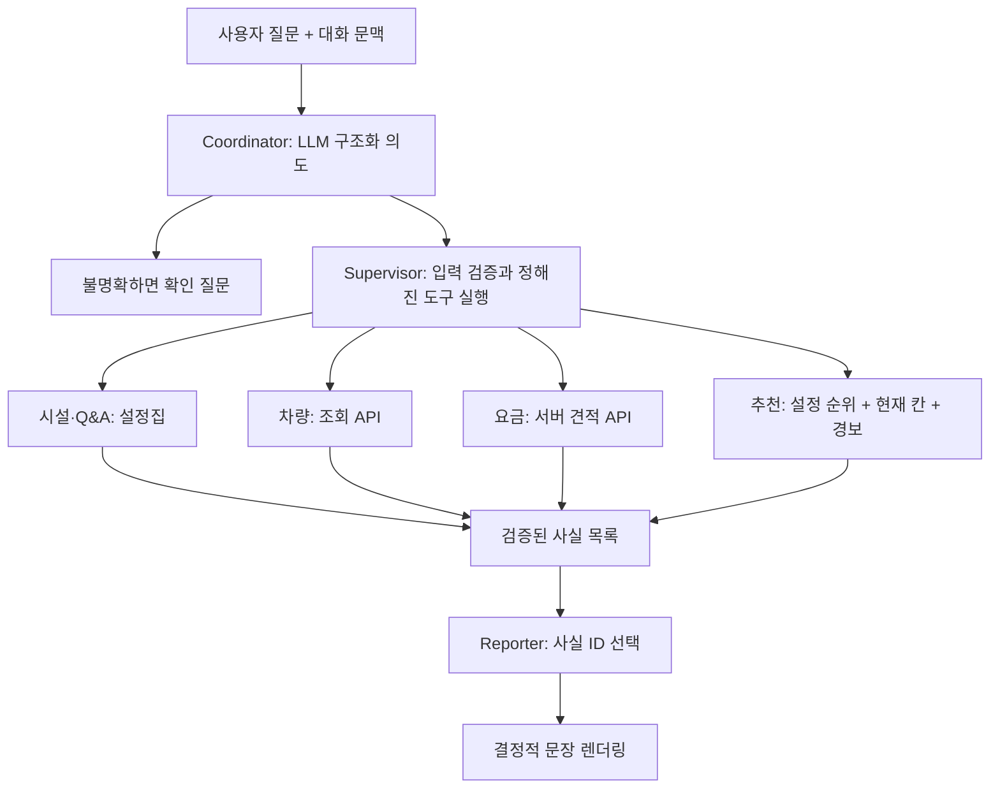

# PARK:ON 챗봇 v3 구조 설계

복구 재구성 문서 · 2026-11-06 · 기준 Git `86c3069`.
원본 파일을 되찾은 것이 아니라 이전 대화의 설계 내용을 재작성했다.

## 목표
자연어 Q&A, 주차장 시설 설명, 서버의 현재 빈자리·차량 위치·요금 조회,
목적지 인접 칸 추천을 제공한다. 기존 규칙 파서와 engine.py에 의존하지 않는다.
시설 설정은 프로젝트 가상 시나리오이며 실제 장소의 검증된 안내 자료가 아니다.
현재 상태는 API, 고정 설명은 버전 있는 설정집에서 가져온다.

## 개념과 구현의 구분
Coordinator, Supervisor, 시설/차량/요금/추천, Reporter는 책임의 구분이다.
초기 구현은 하나의 LLM 모델을 최대 두 번 호출하고 일반 Python 도구로 실행한다.
각 책임마다 독립적인 LLM 에이전트를 띄우지 않는다. Planner는 복합 질문이 필요해질 때
추가할 설계이며 현재는 복합 요구를 확인 질문으로 좁힌다.
LangManus/DeerFlow 전체 도입, LangGraph, 벡터 DB/RAG는 필수 조건이 아니다.
명확한 소스·프롬프트 경계를 먼저 만들고 실제 평가에서 필요할 때 도입한다.

## 근거와 실패 처리
- '기차주차장' 등 표현은 별칭뿐 아니라 장소 유형·목적·부정 표현과 문맥을 함께 해석한다.
- 여러 장소가 가능한 '터미널'·'역 근처'를 무조건 한 곳으로 확정하지 않는다.
- 실물 두 자리 스티커와 가상 차량 번호 뒤 네 자리를 구분한다. 앞의 0을 보존한다.
- 차량 404는 없음 또는 중복 위치를 구분하지 못하므로 '등록 차량 없음'이라고 단정하지 않는다.
- 요금은 서버 결과만 사용한다. GET 견적도 DB 쓰기가 있으므로 자동 재시도하지 않는다.
- 추천은 일반 칸에 한정한다. 10초 이내 스냅샷·관측값, 완전한 경보 목록,
  비어 있는 상태가 필요하다. active/acknowledged Lv2 이상이면 추천을 중단한다.
- EV 빈자리와 실제 충전기 사용 가능 여부는 다르다. 충전 상태 API가 없으면 모른다고 답한다.
- 안전 대피 경로/대피소 인증 여부는 추정하지 않는다. LED 이벤트는 모의 화재로 표시한다.
- Reporter는 서버/설정집에서 만든 사실 ID만 선택한다. 잘못된 선택 시 원래 사실 문장을 출력한다.

## 세션과 관측
프로토타입의 문맥/요청 재사용 방지는 프로세스 메모리 기반이다. TTL·용량 제한을 둔다.
재시작/다중 워커에 걸친 영속적 중복 방지는 아직 없다. 실시간 조회값을 문맥에서 재사용하지 않는다.
Langfuse는 후속 연결 대상이다. coordinator/tool/reporter 별 trace와 지연·오류·토큰·비용,
프롬프트 버전, 평가 결과를 연결하되 차량 정보/사용자 질문의 기록 범위는 별도 결정한다.
현재 Langfuse 연결 또는 자연어 성능이 검증되었다고 주장하지 않는다.
